# Experiment B — Initial Visual Audit of Nine Remaining Directions

## How to interpret these plots (TRAINING ONLY / not confirmatory)

**PASS_WITH_QUALIFICATIONS.** All nine directions and 44 figures use only 1,495 eligible SPY training sessions, 2016-01-05–2021-12-31. The original full training sample remains primary. No 2022–2023 response, no 2024–2026 scientific values, no predictive fits, no new source requests and no trading optimization were used.

The lines are empirical binned means/rates, **not learned EBM curves**. Blue/green/orange denote low/middle/high RV. Display support requires 20 dates / 10 distinct five-row groups; contrast/interval support requires 50/20 (strong 100/30). Groups measure occupancy, not proven independence. B1 additionally needs 5 events, 5 nonevents and 3 event-bearing groups. Gray/missing cells abstain; gaps are never bridged. Predictor-only display limits hide tails visually but preserve all outcomes in estimates.

Whiskers are exploratory 95% percentile variability intervals from 300 shared joint circular five-day resamples, conditional on fixed bins/cuts/masks. Nonstationarity, serial dependence, heavy tails, data reuse and eight-family selection preclude theorem-certified or post-selection population coverage. Differences of within-state predictor increments address moderation; a high-state outcome level or variance alone does not.

All panels share [feature definitions](registries/feature_definitions.csv), [frozen protocol](config/initial_audit_protocol_v1.json), [numerical predictor-only design](registries/predictor_only_design.json) and [source/output hashes](registries/initial_audit_manifest.json). See [prior A1/A2 closeout](../../../reports/B/stage2C_literature_anchored_A1_A2_closeout.md) as historical context only; A1 was not rerun.

## One-page comparison and ranked review (include C1 as deferred)

| ID | X | state | n | evidence | support | caveat | verdict |
| --- | --- | --- | --- | --- | --- | --- | --- |
| A2 | w_preclose_bp | rv_open_log | 1495 | D_HL 3.33bp [-6.96, 13.4] | 71% primary cells; 3 contrasts | A2 is already explored in Stage2B; this is a training-only raw-view audit, not an independent discovery | INCONCLUSIVE |
| A3 | late_return_5m_bp | rv_open_log | 1495 | D_HL -5.62bp [-15.5, 5.41] | 67% primary cells; 12 contrasts | These overlapping recent-return features are strongly related | INCONCLUSIVE |
| A4 | gap_bp | rv_open_log | 1495 | D_HL -19.5bp [-35.8, -5.94] | 62% primary cells; 6 contrasts | Simple returns compose multiplicatively: X/10000=(1+G/10000)(1+I/10000)-1 | INCONCLUSIVE |
| A5 | x_open_bp | rv_open_log | 668–1495 | D_HL -6.84bp [-18.2, 5.88] | 58% primary cells; 15 contrasts | Magnitude/squares remove direction and are dependent transforms, not independent replications | INCONCLUSIVE |
| A6 | w_preclose_bp | rv_late_log | 1495 | D_HL 2.6bp [-8.69, 12.5] | 62% primary cells; 6 contrasts | Recent RV shares 15:00–15:30 prices with W; changed state occupancy can alter composition | INCONCLUSIVE |
| B1 | x_open_bp | rv_open_log | 1495 | D_HL ABSTAIN [ABSTAIN, ABSTAIN] | 46% primary cells; 4 contrasts | Event scarcity and clustering restrict local probability contrasts | INCONCLUSIVE |
| B2 | late_volume_30m | rv_open_log | 1475–1495 | D_HL 3.55bp [-5.66, 11.8] | 71% primary cells; 9 contrasts | Volume units and normalization change the question; a volume/RV level effect is not moderation | INCONCLUSIVE |
| B3 | lag_close_1_bp | rv_open_log | 1475–1494 | D_HL 0.642bp [-7.85, 11.3] | 62% primary cells; 9 contrasts | The lag calendar skips scheduled half-days, but retains full sessions with missing opening data | LOW_PRIORITY |
| C1 | abs_w_bp | rv_open_log | 1495 | D_HL 2.27bp [-9.42, 13.3] | 71% primary cells; 3 contrasts | Entry at C15:29/exit at C15:59 assumes immediate availability and fills | MODEL_DEPENDENT / DEFER |

**NO_CLEAR_WINNER.** No direction passes the frozen conjunctive PROMISING_TO_TEST rubric. Ratings use the first prespecified panel; every variant is displayed and reported below. C1 is deferred regardless of gross payoff. Effect units differ, so no cross-target effect-size ranking is made. All-feature common-date sensitivity has n=1475; exact direction/variant masks and dates are in the registries.

## A2 — Late momentum × opening RV

### Scientific question and feature/target definitions

W directly tests late momentum/reversal, with other information marginalized.

Target: Y: 15:30–16:00 return (bp). Panels: W: 15:00–15:30 (bp), rv_open_log, known 15:30 ET, n=1495, 2016-01-05–2021-12-31.

| panel | n | supported_curve_cells | displayed_mean_range | D_HL | interval | low_increment | high_increment | status | D_HL_common_dates |
| --- | --- | --- | --- | --- | --- | --- | --- | --- | --- |
| W: 15:00–15:30 | 1495 | 17/24 | -9.03 to 7.19 | 3.33 | [-6.96, 13.4] | -1.29 | 2.04 | EXPLORATORY_BLOCK_PERCENTILE | 4.01 |

The high-state W increment is positive in the selected bands, but its difference from the low-state increment has a wide interval crossing zero. The orange raw curve is jagged rather than a stable continuation slope.

### Figure 1: Raw scatter and state lines

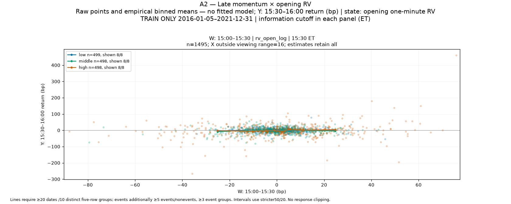

All 1 prespecified panel(s) are shown. Raw points include crisis days. Primary viewing-window exclusions are 16 predictor-tail points; estimates retain them. Displayed primary curve cells: 24/24; numerical state increments appear in the table above.

### Figure 2: Conditional means with intervals

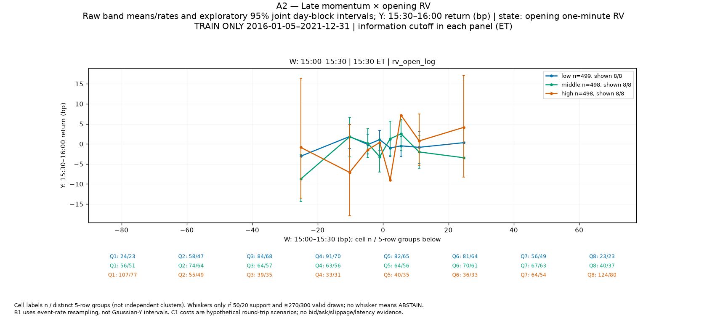

Intervals abstain where date/group or event support fails. Primary H−L increment difference is 3.33 [-6.96, 13.4], status EXPLORATORY_BLOCK_PERCENTILE. Cell n/group counts accompany the means, and rare-event counts are printed for B1.

### Figure 3: Raw X–Z conditional-response heatmap

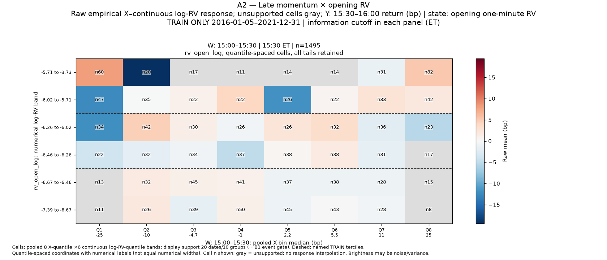

These are raw empirical responses across continuous log-RV cells, with cell counts and separately marked terciles. rv_open_log is the principal state. Gray cells forbid a continuous-surface inference; brighter extremes can be noisy.

### Figure 4: Support and state contrasts

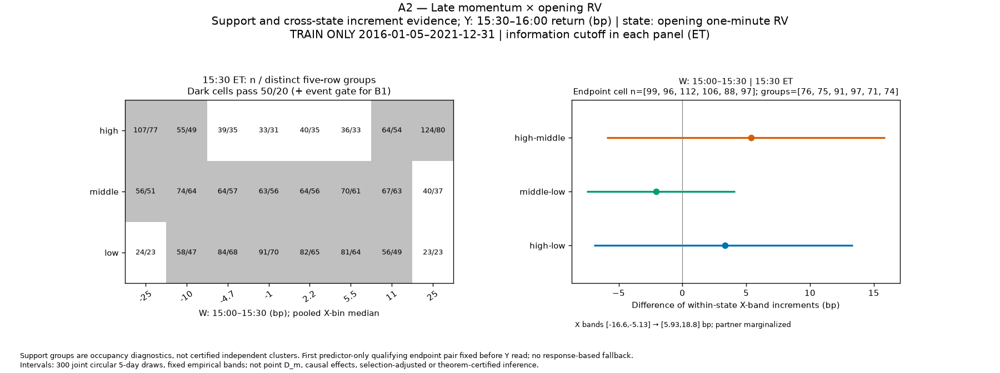

Across all displayed variants: 3 supported and 0 abstained FULL pairwise state contrasts. The first qualifying predictor-only bands and all required endpoint counts are shown; broad-band partners are marginalized rather than held fixed.

### Figure 5: Temporal and outlier robustness

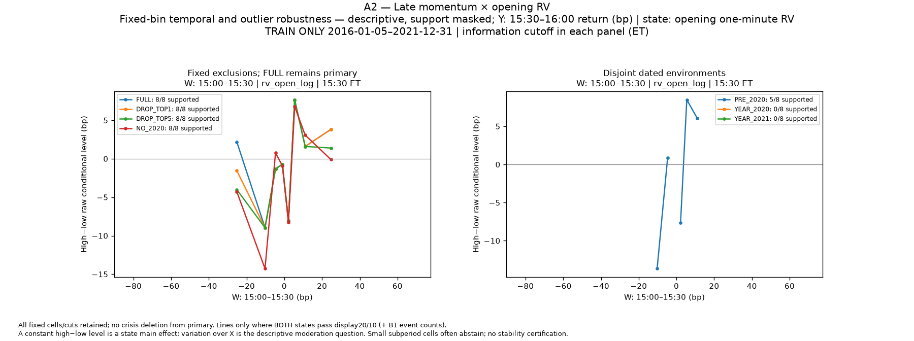

For the primary panel, 3/3 supported fixed-exclusion contrasts keep the FULL sign; 1/1 temporal contrasts agree at the weaker display-level support threshold. Each line remains on the original bin grid; the high−low level difference alone is not a moderator effect.

### What looks promising, and why

The inputs are available without acquisition; primary n=1495. The supported primary effect/noise ratio is 0.0994; 71% of primary state×X cells pass contrast-level support. The raw increments and every variant above provide a concrete candidate to falsify, rather than evidence of model superiority.

### What argues against it / key limitations / support / uncertainty

A2 is already explored in Stage2B; this is a training-only raw-view audit, not an independent discovery. Broad bands do not hold opening X fixed.

The primary interval does not exclude / cannot assess zero. Fixed-exclusion supported sign reversals: 0; unsupported sensitivities cannot establish stability. Broad-band state compositions differ, and the direction was screened with seven other families.

### Feasibility verdict, new data needed, and recommended next model stage

**INCONCLUSIVE.** No new data are needed for this descriptive audit. No model stage is automatically authorized by a visual pattern. If selected after human review, freeze one primary predictor/state contrast, its supported mask and simple state-aware/additive comparators before any future model work. Do not reopen reserved/sealed outcomes for this triage.

## A3 — Recent momentum and acceleration × opening RV

### Scientific question and feature/target definitions

All last5/10/15 and disjoint5-minute acceleration variants are shown; none is selected for a better response.

Target: Y: 15:30–16:00 return (bp). Panels: Last 5 minutes (bp), rv_open_log, known 15:30 ET, n=1495, 2016-01-05–2021-12-31; Last 10 minutes (bp), rv_open_log, known 15:30 ET, n=1495, 2016-01-05–2021-12-31; Last 15 minutes (bp), rv_open_log, known 15:30 ET, n=1495, 2016-01-05–2021-12-31; Recent 5m minus disjoint earlier 5m (bp), rv_open_log, known 15:30 ET, n=1495, 2016-01-05–2021-12-31.

| panel | n | supported_curve_cells | displayed_mean_range | D_HL | interval | low_increment | high_increment | status | D_HL_common_dates |
| --- | --- | --- | --- | --- | --- | --- | --- | --- | --- |
| Last 5 minutes | 1495 | 16/24 | -9.51 to 2.92 | -5.62 | [-15.5, 5.41] | 0.651 | -4.97 | EXPLORATORY_BLOCK_PERCENTILE | -6.22 |
| Last 10 minutes | 1495 | 16/24 | -11 to 4.86 | 7.63 | [-0.698, 15.9] | -0.815 | 6.81 | EXPLORATORY_BLOCK_PERCENTILE | 7.38 |
| Last 15 minutes | 1495 | 16/24 | -7.32 to 7.75 | -0.841 | [-9.1, 8.36] | -1.07 | -1.91 | EXPLORATORY_BLOCK_PERCENTILE | -0.739 |
| Recent 5m minus disjoint earlier 5m | 1495 | 17/24 | -10.2 to 6.53 | 1.63 | [-11.5, 13.1] | 3.72 | 5.35 | EXPLORATORY_BLOCK_PERCENTILE | 0.653 |

The last 5 and last 10 contrasts point in opposite directions; last 15 and acceleration are nearer zero. None of their H−L intervals excludes zero. That endpoint dependence argues against treating the visually strongest recent-return panel as a discovery.

### Figure 1: Raw scatter and state lines

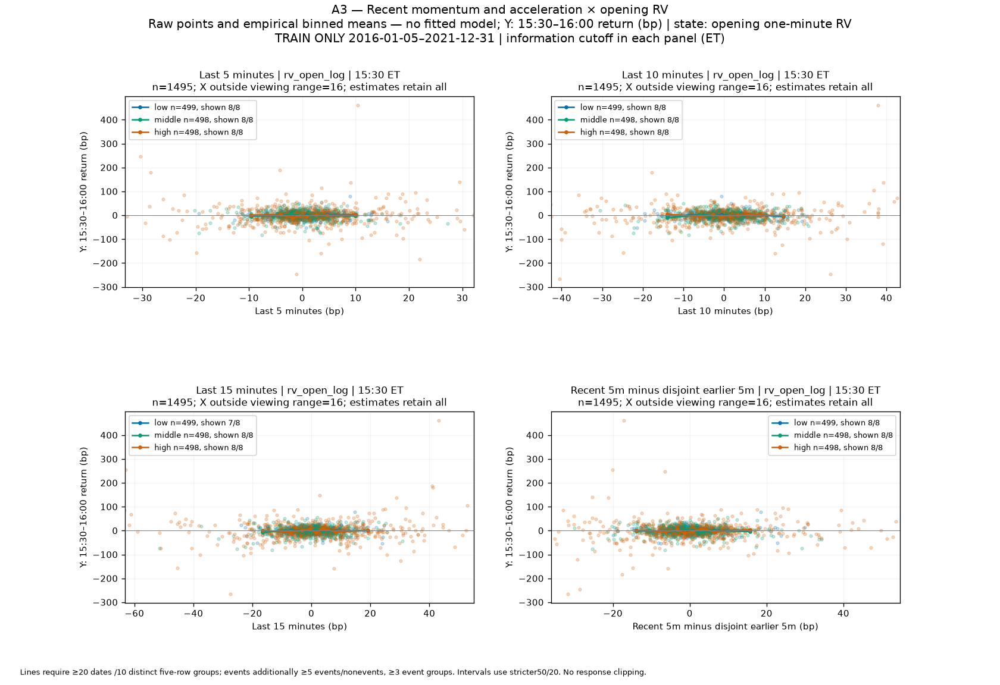

All 4 prespecified panel(s) are shown. Raw points include crisis days. Primary viewing-window exclusions are 16 predictor-tail points; estimates retain them. Displayed primary curve cells: 24/24; numerical state increments appear in the table above.

### Figure 2: Conditional means with intervals

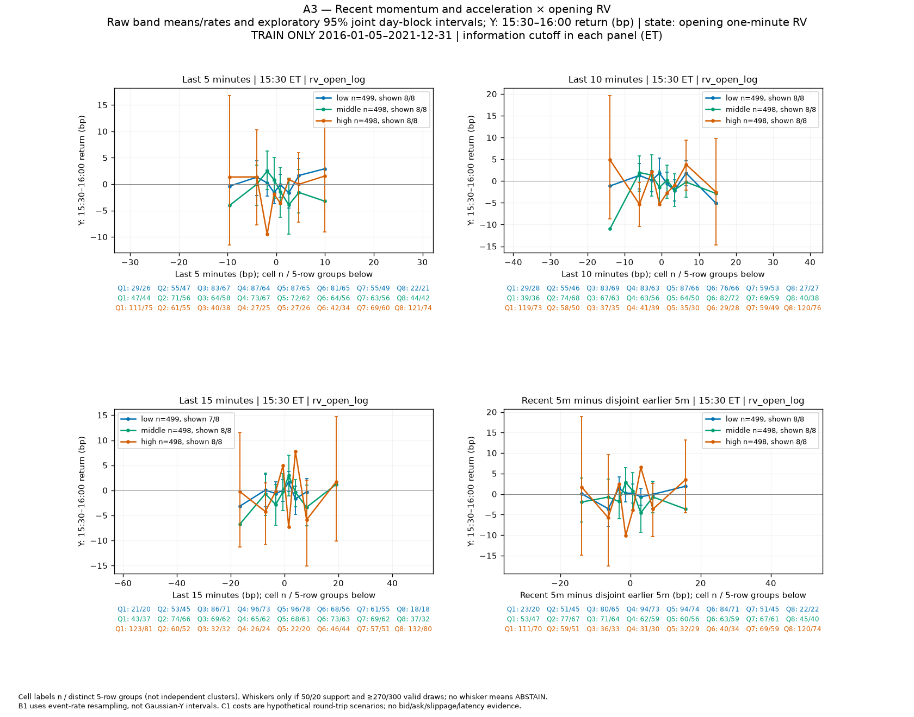

Intervals abstain where date/group or event support fails. Primary H−L increment difference is -5.62 [-15.5, 5.41], status EXPLORATORY_BLOCK_PERCENTILE. Cell n/group counts accompany the means, and rare-event counts are printed for B1.

### Figure 3: Raw X–Z conditional-response heatmap

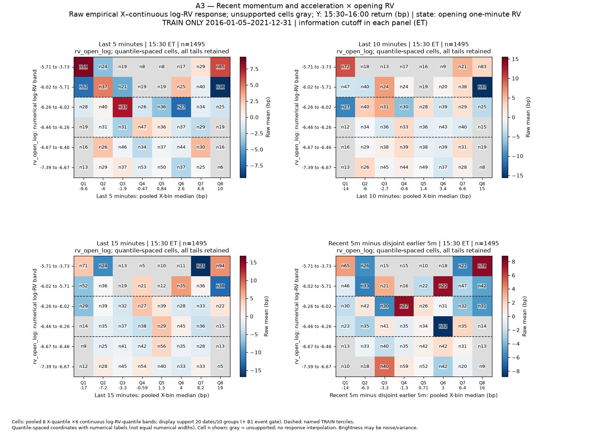

These are raw empirical responses across continuous log-RV cells, with cell counts and separately marked terciles. rv_open_log is the principal state. Gray cells forbid a continuous-surface inference; brighter extremes can be noisy.

### Figure 4: Support and state contrasts

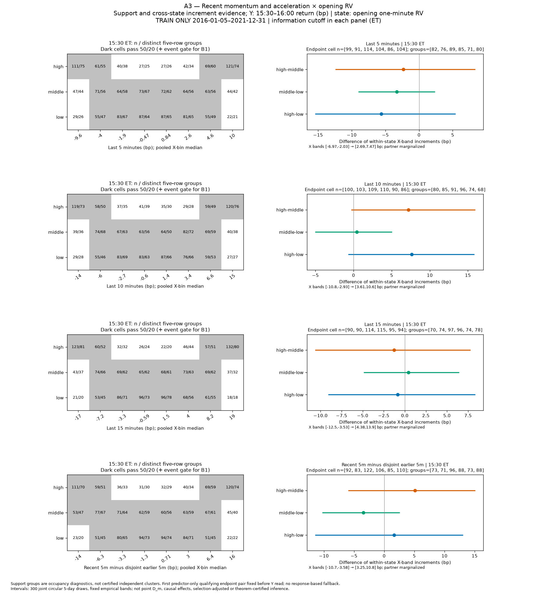

Across all displayed variants: 12 supported and 0 abstained FULL pairwise state contrasts. The first qualifying predictor-only bands and all required endpoint counts are shown; broad-band partners are marginalized rather than held fixed.

### Figure 5: Temporal and outlier robustness

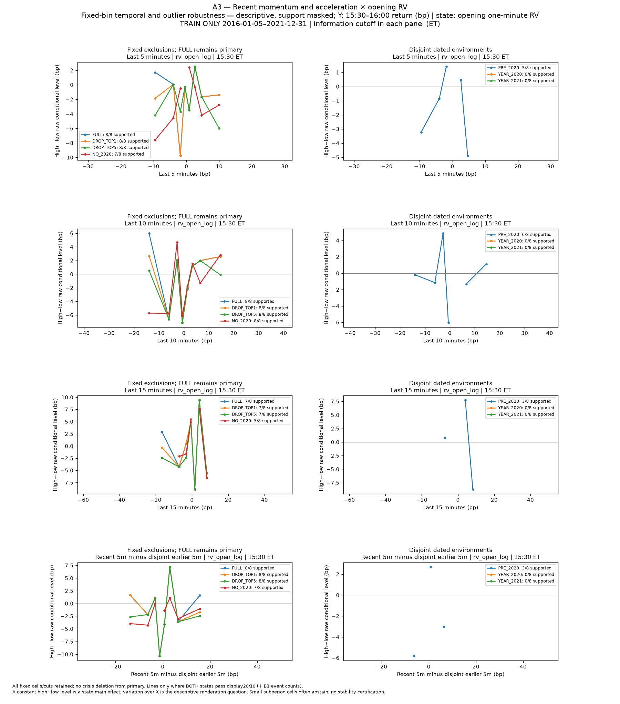

For the primary panel, 3/3 supported fixed-exclusion contrasts keep the FULL sign; 1/1 temporal contrasts agree at the weaker display-level support threshold. Each line remains on the original bin grid; the high−low level difference alone is not a moderator effect.

### What looks promising, and why

The inputs are available without acquisition; primary n=1495. The supported primary effect/noise ratio is 0.168; 67% of primary state×X cells pass contrast-level support. The raw increments and every variant above provide a concrete candidate to falsify, rather than evidence of model superiority.

### What argues against it / key limitations / support / uncertainty

These overlapping recent-return features are strongly related. Acceleration is a difference of disjoint returns, not a second independent trial.

The primary interval does not exclude / cannot assess zero. Fixed-exclusion supported sign reversals: 0; unsupported sensitivities cannot establish stability. Broad-band state compositions differ, and the direction was screened with seven other families.

### Feasibility verdict, new data needed, and recommended next model stage

**INCONCLUSIVE.** No new data are needed for this descriptive audit. No model stage is automatically authorized by a visual pattern. If selected after human review, freeze one primary predictor/state contrast, its supported mask and simple state-aware/additive comparators before any future model work. Do not reopen reserved/sealed outcomes for this triage.

## A4 — Overnight gap versus morning intraday × opening RV

### Scientific question and feature/target definitions

Gap G and morning I isolate two components of the overnight-inclusive opening predictor.

Target: Y: 15:30–16:00 return (bp). Panels: Overnight gap G (bp), rv_open_log, known 10:00 ET, n=1495, 2016-01-05–2021-12-31; 09:30–10:00 intraday I (bp), rv_open_log, known 10:00 ET, n=1495, 2016-01-05–2021-12-31.

| panel | n | supported_curve_cells | displayed_mean_range | D_HL | interval | low_increment | high_increment | status | D_HL_common_dates |
| --- | --- | --- | --- | --- | --- | --- | --- | --- | --- |
| Overnight gap G | 1495 | 15/24 | -25.7 to 6.19 | -19.5 | [-35.8, -5.94] | 0.416 | -19.1 | EXPLORATORY_BLOCK_PERCENTILE | -19.9 |
| 09:30–10:00 intraday I | 1495 | 16/24 | -7.51 to 9.39 | -2.64 | [-13.5, 8.29] | -1.44 | -4.08 | EXPLORATORY_BLOCK_PERCENTILE | -2.83 |

Gap G has a negative H−L increment contrast whose nominal exploratory interval excludes zero; the morning I contrast remains interval-inconclusive. All three fixed exclusions retain the gap sign, but only one temporal comparison meets even the weaker display-support gate. The gap deserves visual scrutiny, with multiplicity and missing temporal confirmation kept explicit.

### Figure 1: Raw scatter and state lines

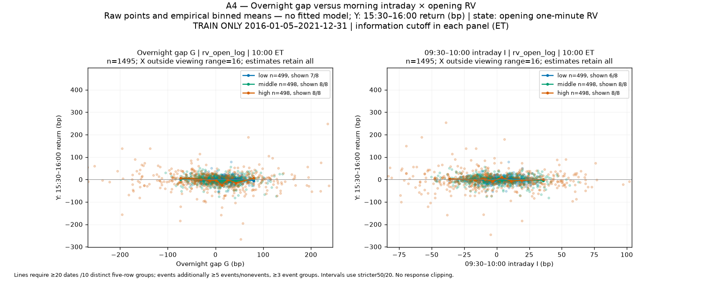

All 2 prespecified panel(s) are shown. Raw points include crisis days. Primary viewing-window exclusions are 16 predictor-tail points; estimates retain them. Displayed primary curve cells: 23/24; numerical state increments appear in the table above.

### Figure 2: Conditional means with intervals

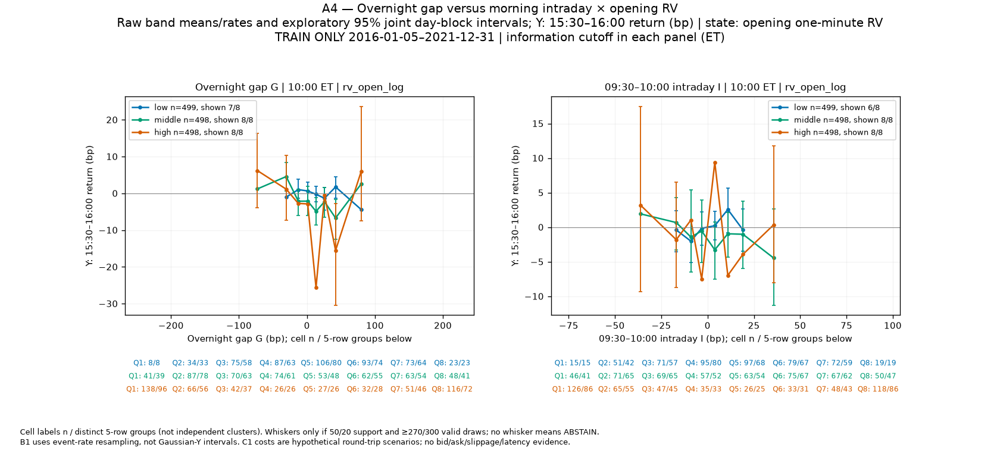

Intervals abstain where date/group or event support fails. Primary H−L increment difference is -19.5 [-35.8, -5.94], status EXPLORATORY_BLOCK_PERCENTILE. Cell n/group counts accompany the means, and rare-event counts are printed for B1.

### Figure 3: Raw X–Z conditional-response heatmap

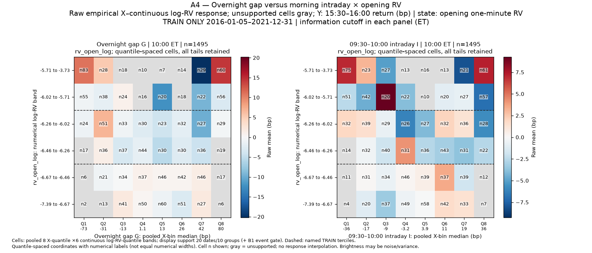

These are raw empirical responses across continuous log-RV cells, with cell counts and separately marked terciles. rv_open_log is the principal state. Gray cells forbid a continuous-surface inference; brighter extremes can be noisy.

### Figure 4: Support and state contrasts

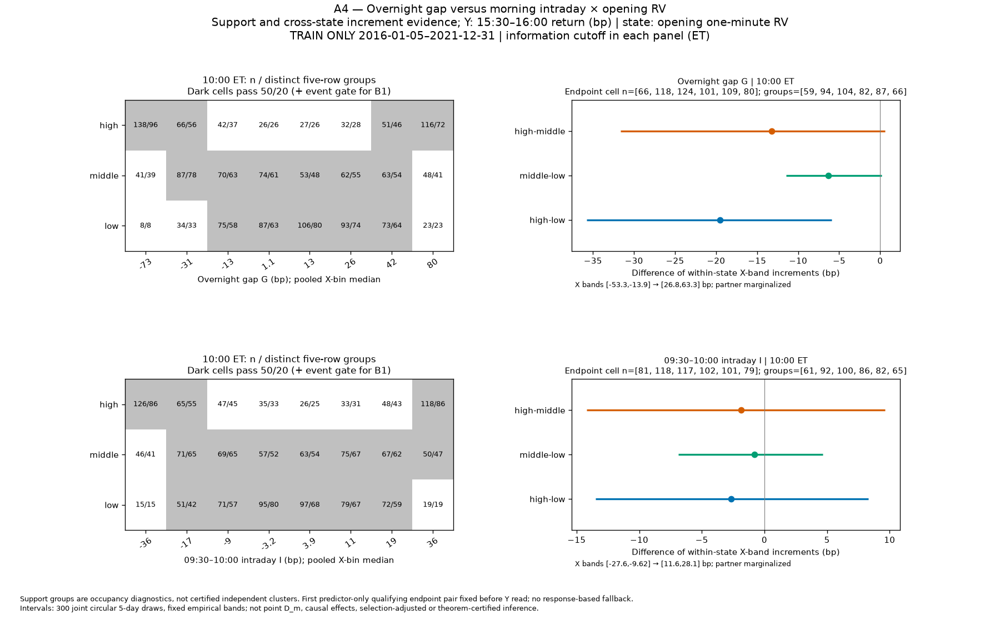

Across all displayed variants: 6 supported and 0 abstained FULL pairwise state contrasts. The first qualifying predictor-only bands and all required endpoint counts are shown; broad-band partners are marginalized rather than held fixed.

### Figure 5: Temporal and outlier robustness

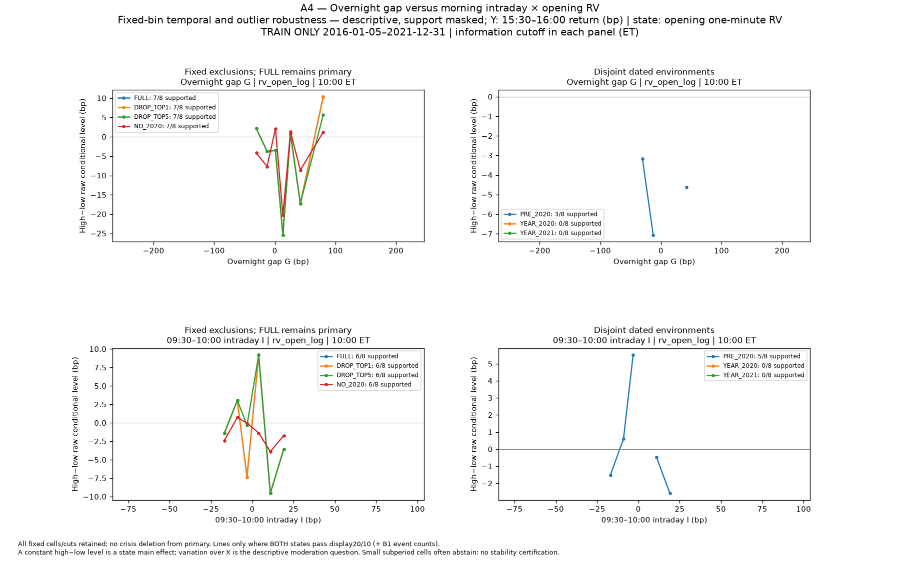

For the primary panel, 3/3 supported fixed-exclusion contrasts keep the FULL sign; 1/1 temporal contrasts agree at the weaker display-level support threshold. Each line remains on the original bin grid; the high−low level difference alone is not a moderator effect.

### What looks promising, and why

The inputs are available without acquisition; primary n=1495. The supported primary effect/noise ratio is 0.583; 62% of primary state×X cells pass contrast-level support. The raw increments and every variant above provide a concrete candidate to falsify, rather than evidence of model superiority.

### What argues against it / key limitations / support / uncertainty

Simple returns compose multiplicatively: X/10000=(1+G/10000)(1+I/10000)-1. Opening RV shares the morning price path; gap and morning facets do not control for each other.

The primary interval excludes zero. Fixed-exclusion supported sign reversals: 0; unsupported sensitivities cannot establish stability. Broad-band state compositions differ, and the direction was screened with seven other families.

### Feasibility verdict, new data needed, and recommended next model stage

**INCONCLUSIVE.** No new data are needed for this descriptive audit. No model stage is automatically authorized by a visual pattern. If selected after human review, freeze one primary predictor/state contrast, its supported mask and simple state-aware/additive comparators before any future model work. Do not reopen reserved/sealed outcomes for this triage.

## A5 — Extreme magnitude and asymmetry × opening RV

### Scientific question and feature/target definitions

Signed X, magnitude, two squares and both sign-specific magnitude facets are all retained.

Target: Y: 15:30–16:00 return (bp). Panels: Signed opening X (bp), rv_open_log, known 10:00 ET, n=1495, 2016-01-05–2021-12-31; |X| (bp), rv_open_log, known 10:00 ET, n=1495, 2016-01-05–2021-12-31; X² (direction removed) (bp²), rv_open_log, known 10:00 ET, n=1495, 2016-01-05–2021-12-31; (X − TRAIN mean X)² (bp²), rv_open_log, known 10:00 ET, n=1495, 2016-01-05–2021-12-31; |X| conditional on X < 0 (bp), rv_open_log, known 10:00 ET, n=668, 2016-01-05–2021-12-31; |X| conditional on X ≥ 0 (bp), rv_open_log, known 10:00 ET, n=827, 2016-01-08–2021-12-30.

| panel | n | supported_curve_cells | displayed_mean_range | D_HL | interval | low_increment | high_increment | status | D_HL_common_dates |
| --- | --- | --- | --- | --- | --- | --- | --- | --- | --- |
| Signed opening X | 1495 | 14/24 | -9.24 to 7.22 | -6.84 | [-18.2, 5.88] | 3.11 | -3.73 | EXPLORATORY_BLOCK_PERCENTILE | -7.92 |
| /X/ | 1495 | 17/24 | -7.12 to 7.05 | 0.808 | [-12.8, 14.1] | -2.76 | -1.95 | EXPLORATORY_BLOCK_PERCENTILE | 1.51 |
| X² (direction removed) | 1495 | 17/24 | -7.12 to 7.05 | 0.808 | [-12.8, 14.1] | -2.76 | -1.95 | EXPLORATORY_BLOCK_PERCENTILE | 1.51 |
| (X − TRAIN mean X)² | 1495 | 15/24 | -9.6 to 5.75 | 2.27 | [-9.49, 13.7] | -3.13 | -0.854 | EXPLORATORY_BLOCK_PERCENTILE | 2.25 |
| /X/ conditional on X < 0 | 668 | 1/24 | -5.89 to 7.34 | ABSTAIN | [ABSTAIN, ABSTAIN] | ABSTAIN | ABSTAIN | ABSTAIN_SUPPORT | ABSTAIN |
| /X/ conditional on X ≥ 0 | 827 | 4/24 | -8 to 9.06 | -1.34 | [-16.5, 11.7] | 1.41 | 0.0655 | EXPLORATORY_BLOCK_PERCENTILE | -1.14 |

|X| and X² give identical rank-bin contrasts because squaring is monotone on nonnegative magnitude; these are the same observations, not replication. Signed-X, magnitude, centered-square and positive-sign intervals cross zero. The negative-sign magnitude contrast abstains for joint support.

### Figure 1: Raw scatter and state lines

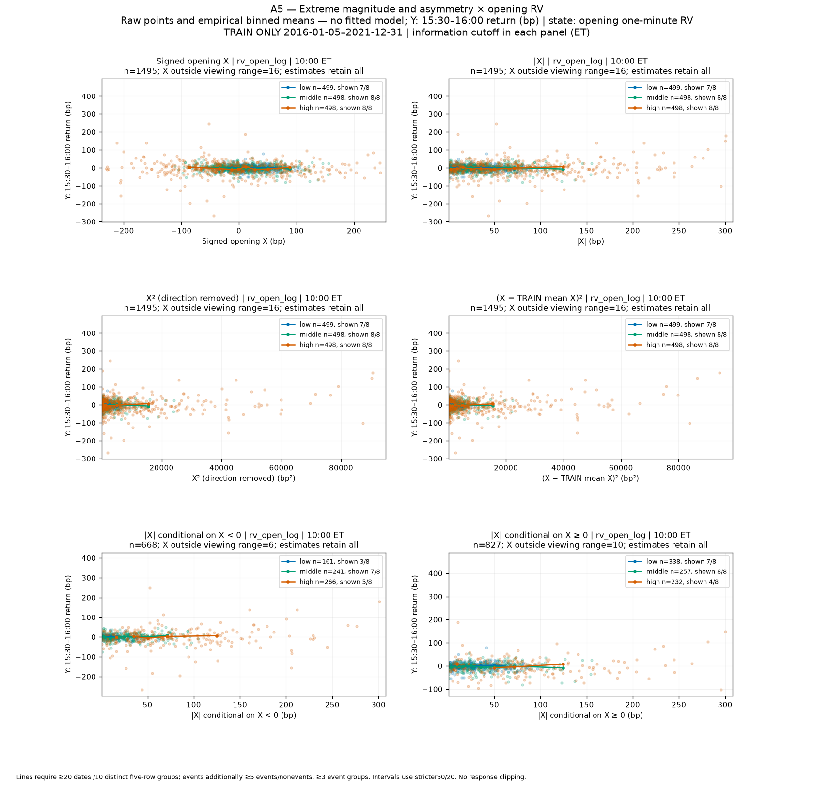

All 6 prespecified panel(s) are shown. Raw points include crisis days. Primary viewing-window exclusions are 16 predictor-tail points; estimates retain them. Displayed primary curve cells: 23/24; numerical state increments appear in the table above.

### Figure 2: Conditional means with intervals

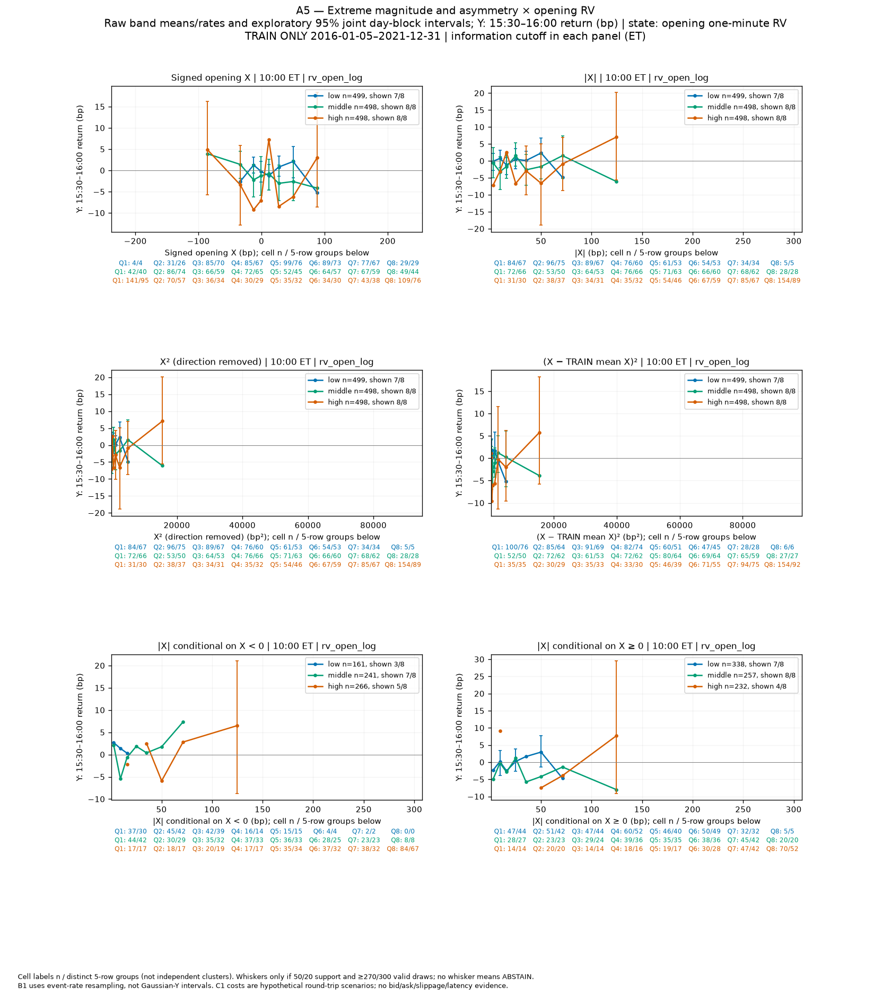

Intervals abstain where date/group or event support fails. Primary H−L increment difference is -6.84 [-18.2, 5.88], status EXPLORATORY_BLOCK_PERCENTILE. Cell n/group counts accompany the means, and rare-event counts are printed for B1.

### Figure 3: Raw X–Z conditional-response heatmap

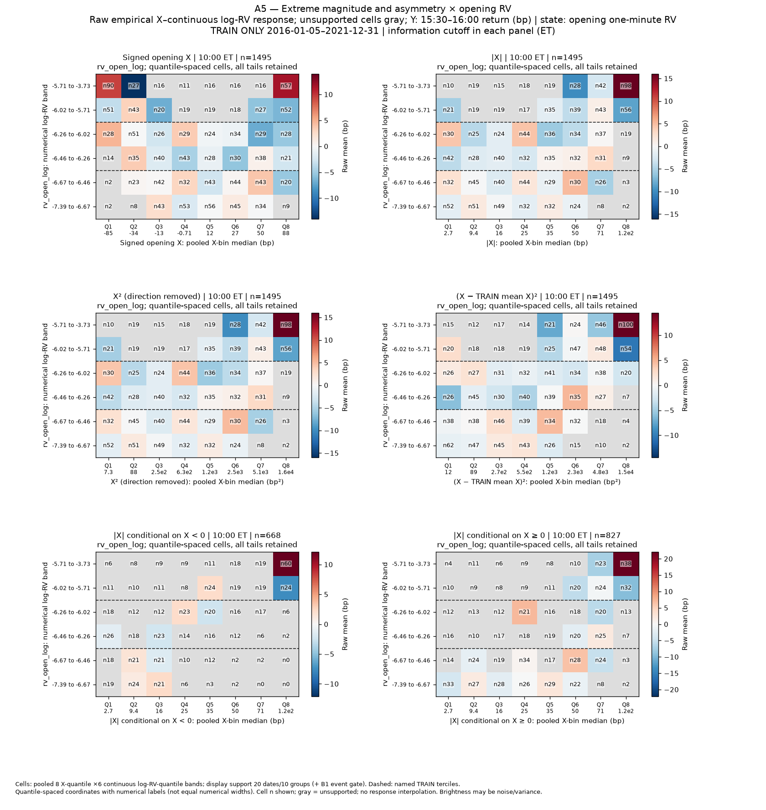

These are raw empirical responses across continuous log-RV cells, with cell counts and separately marked terciles. rv_open_log is the principal state. Gray cells forbid a continuous-surface inference; brighter extremes can be noisy.

### Figure 4: Support and state contrasts

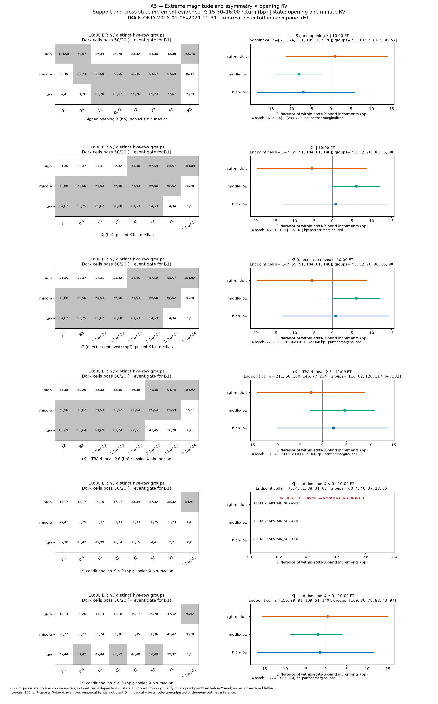

Across all displayed variants: 15 supported and 3 abstained FULL pairwise state contrasts. The first qualifying predictor-only bands and all required endpoint counts are shown; broad-band partners are marginalized rather than held fixed.

### Figure 5: Temporal and outlier robustness

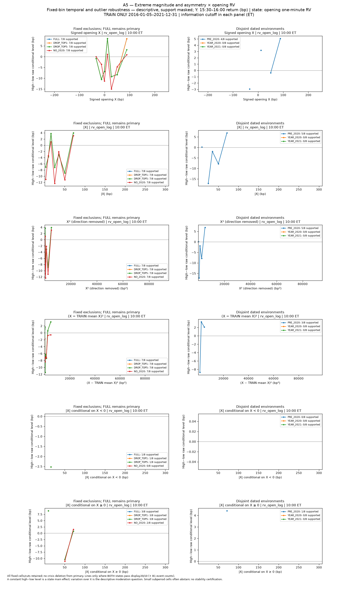

For the primary panel, 3/3 supported fixed-exclusion contrasts keep the FULL sign; 0/1 temporal contrasts agree at the weaker display-level support threshold. Each line remains on the original bin grid; the high−low level difference alone is not a moderator effect.

### What looks promising, and why

The inputs are available without acquisition; primary n=1495. The supported primary effect/noise ratio is 0.204; 58% of primary state×X cells pass contrast-level support. The raw increments and every variant above provide a concrete candidate to falsify, rather than evidence of model superiority.

### What argues against it / key limitations / support / uncertainty

Magnitude/squares remove direction and are dependent transforms, not independent replications. Low-RV large-magnitude support is structurally thin; TRAIN centering is retrospective.

The primary interval does not exclude / cannot assess zero. Fixed-exclusion supported sign reversals: 0; unsupported sensitivities cannot establish stability. Broad-band state compositions differ, and the direction was screened with seven other families.

### Feasibility verdict, new data needed, and recommended next model stage

**INCONCLUSIVE.** No new data are needed for this descriptive audit. No model stage is automatically authorized by a visual pattern. If selected after human review, freeze one primary predictor/state contrast, its supported mask and simple state-aware/additive comparators before any future model work. Do not reopen reserved/sealed outcomes for this triage.

## A6 — Late momentum × recent versus opening RV

### Scientific question and feature/target definitions

The principal recent state and opening-state comparison use exactly the same W/Y dates.

Target: Y: 15:30–16:00 return (bp). Panels: W; recent RV PRINCIPAL (bp), rv_late_log, known 15:30 ET, n=1495, 2016-01-05–2021-12-31; W; opening RV COMPARISON (bp), rv_open_log, known 15:30 ET, n=1495, 2016-01-05–2021-12-31.

| panel | n | supported_curve_cells | displayed_mean_range | D_HL | interval | low_increment | high_increment | status | D_HL_common_dates |
| --- | --- | --- | --- | --- | --- | --- | --- | --- | --- |
| W; recent RV PRINCIPAL | 1495 | 15/24 | -6.67 to 9.5 | 2.6 | [-8.69, 12.5] | -0.775 | 1.83 | EXPLORATORY_BLOCK_PERCENTILE | 3.37 |
| W; opening RV COMPARISON | 1495 | 17/24 | -9.03 to 7.19 | 3.33 | [-6.96, 13.4] | -1.29 | 2.04 | EXPLORATORY_BLOCK_PERCENTILE | 4.01 |

Replacing opening RV by recent RV leaves an interval-inconclusive W increment contrast. Only 61.1% of days keep the same state, so visually different curves partly reflect regrouping. Neither state specification establishes moderation or a preference for a new model.

### Figure 1: Raw scatter and state lines

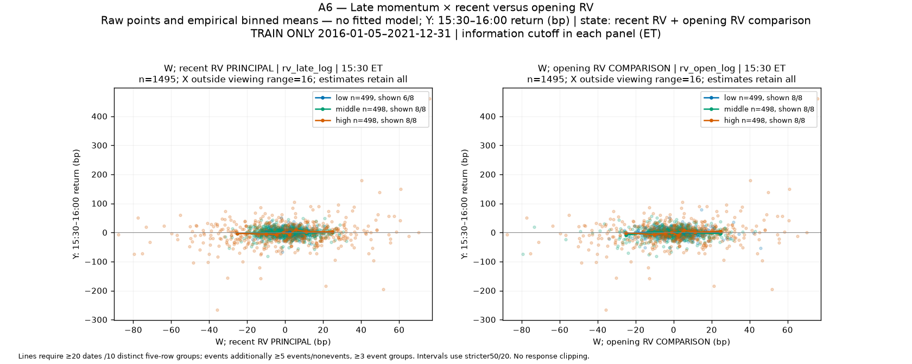

All 2 prespecified panel(s) are shown. Raw points include crisis days. Primary viewing-window exclusions are 16 predictor-tail points; estimates retain them. Displayed primary curve cells: 22/24; numerical state increments appear in the table above.

### Figure 2: Conditional means with intervals

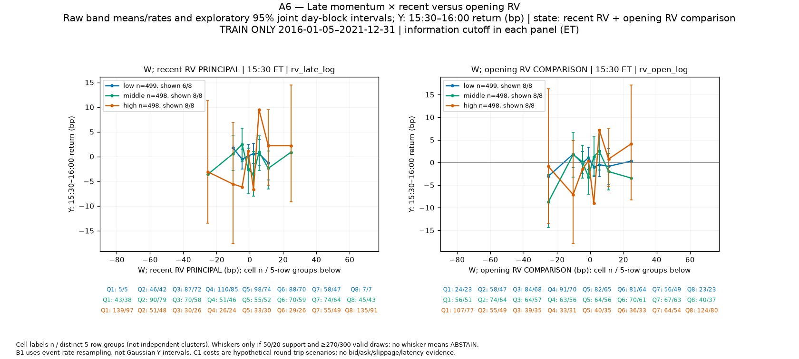

Intervals abstain where date/group or event support fails. Primary H−L increment difference is 2.6 [-8.69, 12.5], status EXPLORATORY_BLOCK_PERCENTILE. Cell n/group counts accompany the means, and rare-event counts are printed for B1.

### Figure 3: Raw X–Z conditional-response heatmap

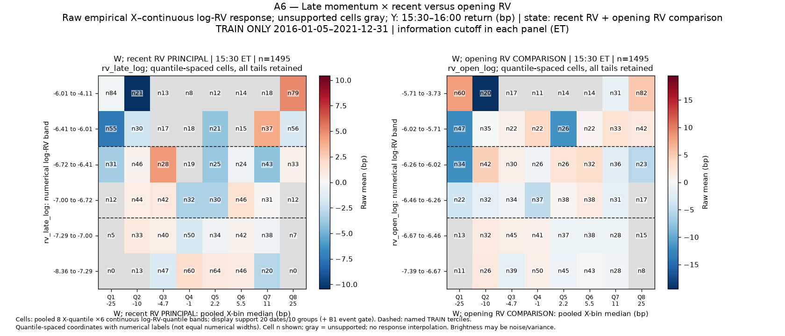

These are raw empirical responses across continuous log-RV cells, with cell counts and separately marked terciles. rv_late_log is the principal state. Gray cells forbid a continuous-surface inference; brighter extremes can be noisy.

### Figure 4: Support and state contrasts

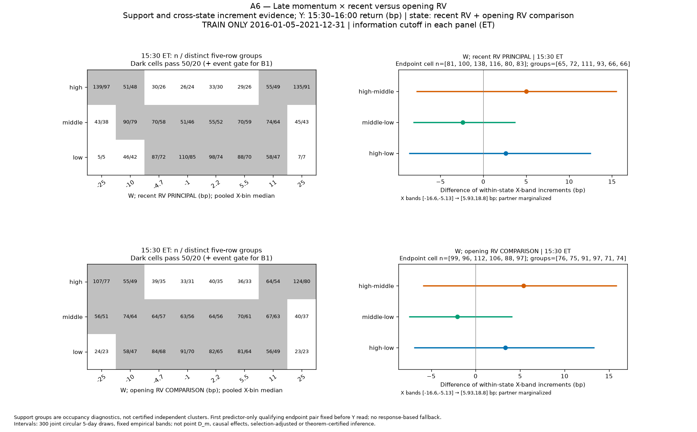

Across all displayed variants: 6 supported and 0 abstained FULL pairwise state contrasts. The first qualifying predictor-only bands and all required endpoint counts are shown; broad-band partners are marginalized rather than held fixed.

### Figure 5: Temporal and outlier robustness

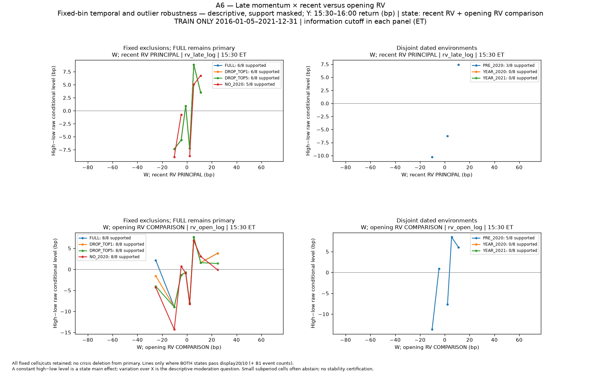

For the primary panel, 3/3 supported fixed-exclusion contrasts keep the FULL sign; 1/1 temporal contrasts agree at the weaker display-level support threshold. Each line remains on the original bin grid; the high−low level difference alone is not a moderator effect.

### What looks promising, and why

The inputs are available without acquisition; primary n=1495. The supported primary effect/noise ratio is 0.0776; 62% of primary state×X cells pass contrast-level support. The raw increments and every variant above provide a concrete candidate to falsify, rather than evidence of model superiority.

### What argues against it / key limitations / support / uncertainty

Recent RV shares 15:00–15:30 prices with W; changed state occupancy can alter composition. Distinct named cutoffs prevent conflating this with opening-RV discretization.

The primary interval does not exclude / cannot assess zero. Fixed-exclusion supported sign reversals: 0; unsupported sensitivities cannot establish stability. Broad-band state compositions differ, and the direction was screened with seven other families.

### Feasibility verdict, new data needed, and recommended next model stage

**INCONCLUSIVE.** No new data are needed for this descriptive audit. No model stage is automatically authorized by a visual pattern. If selected after human review, freeze one primary predictor/state contrast, its supported mask and simple state-aware/additive comparators before any future model work. Do not reopen reserved/sealed outcomes for this triage.

## B1 — Downside event probability × opening RV

### Scientific question and feature/target definitions

Both early X and late W panels show the fixed Y<−20bp adverse event.

Target: Downside probability (0–1). Panels: Opening X — early information (bp), rv_open_log, known 10:00 ET, n=1495, 2016-01-05–2021-12-31; Late W — late information (bp), rv_open_log, known 15:30 ET, n=1495, 2016-01-05–2021-12-31.

| panel | n | supported_curve_cells | displayed_mean_range | D_HL | interval | low_increment | high_increment | status | D_HL_common_dates |
| --- | --- | --- | --- | --- | --- | --- | --- | --- | --- |
| Opening X — early information | 1495 | 11/24 | 0.0649 to 0.312 | ABSTAIN | [ABSTAIN, ABSTAIN] | ABSTAIN | ABSTAIN | ABSTAIN_SUPPORT | ABSTAIN |
| Late W — late information | 1495 | 11/24 | 0.0741 to 0.355 | -0.0134 | [-0.168, 0.132] | 0.00158 | -0.0118 | EXPLORATORY_BLOCK_PERCENTILE | -0.0238 |

There are 217 adverse days out of 1,495 (14.5%), with 52 adjacent event pairs. The early-X H−L contrast fails because one necessary cell has only four events. The supported late-W contrast is near zero with a broad probability interval; a higher high-state event level is not changed momentum response.

### Figure 1: Raw scatter and state lines

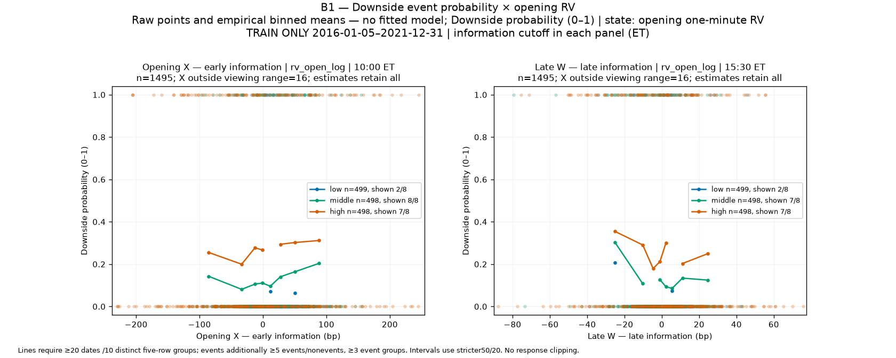

All 2 prespecified panel(s) are shown. Raw points include crisis days. Primary viewing-window exclusions are 16 predictor-tail points; estimates retain them. Displayed primary curve cells: 17/24; numerical state increments appear in the table above.

### Figure 2: Conditional means with intervals

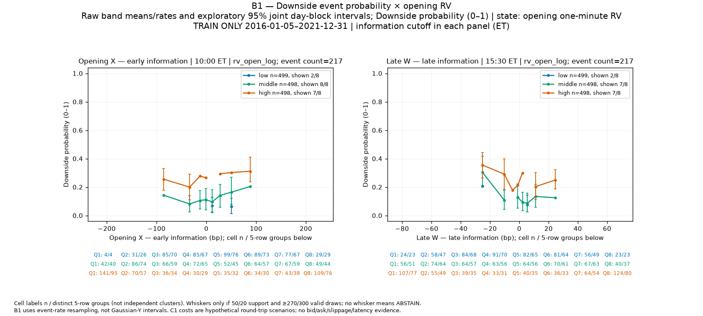

Intervals abstain where date/group or event support fails. Primary H−L increment difference is ABSTAIN [ABSTAIN, ABSTAIN], status ABSTAIN_SUPPORT. Cell n/group counts accompany the means, and rare-event counts are printed for B1.

### Figure 3: Raw X–Z conditional-response heatmap

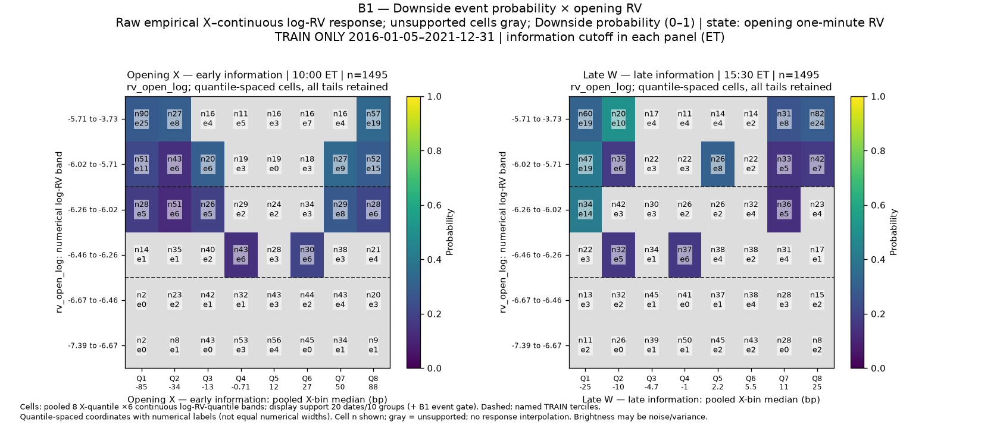

These are raw empirical responses across continuous log-RV cells, with cell counts and separately marked terciles. rv_open_log is the principal state. Gray cells forbid a continuous-surface inference; brighter extremes can be noisy.

### Figure 4: Support and state contrasts

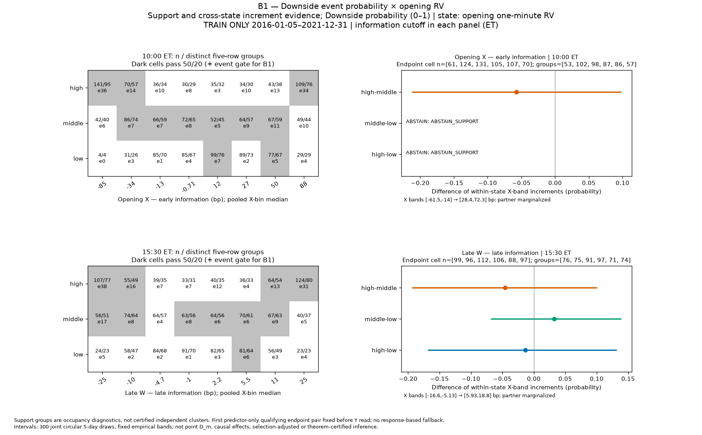

Across all displayed variants: 4 supported and 2 abstained FULL pairwise state contrasts. The first qualifying predictor-only bands and all required endpoint counts are shown; broad-band partners are marginalized rather than held fixed.

### Figure 5: Temporal and outlier robustness

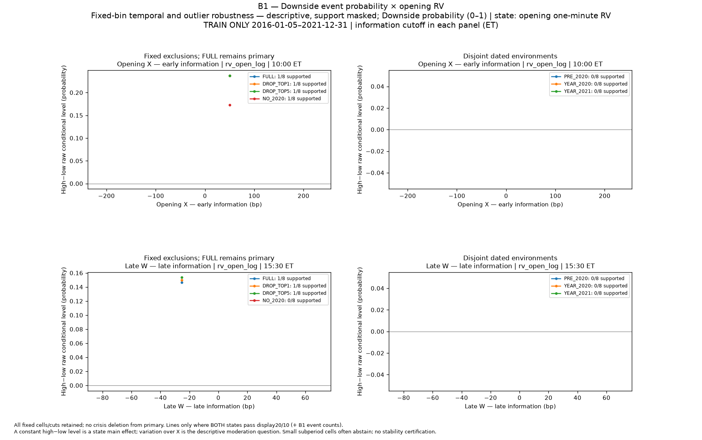

For the primary panel, 0/0 supported fixed-exclusion contrasts keep the FULL sign; 0/0 temporal contrasts agree at the weaker display-level support threshold. Each line remains on the original bin grid; the high−low level difference alone is not a moderator effect.

### What looks promising, and why

The inputs are available without acquisition; primary n=1495. The supported primary effect/noise ratio is ABSTAIN; 46% of primary state×X cells pass contrast-level support. The raw increments and every variant above provide a concrete candidate to falsify, rather than evidence of model superiority.

### What argues against it / key limitations / support / uncertainty

Event scarcity and clustering restrict local probability contrasts. These resampled event rates are not Gaussian-return inference, classifier calibration or forecasts.

The primary interval does not exclude / cannot assess zero. Fixed-exclusion supported sign reversals: 0; unsupported sensitivities cannot establish stability. Broad-band state compositions differ, and the direction was screened with seven other families.

### Feasibility verdict, new data needed, and recommended next model stage

**INCONCLUSIVE.** No new data are needed for this descriptive audit. No model stage is automatically authorized by a visual pattern. If selected after human review, freeze one primary predictor/state contrast, its supported mask and simple state-aware/additive comparators before any future model work. Do not reopen reserved/sealed outcomes for this triage.

## B2 — Late volume × opening RV

### Scientific question and feature/target definitions

Raw30m volume, raw5m volume and strictly prior20-eligible-session relative volume are all shown.

Target: Y: 15:30–16:00 return (bp). Panels: 15:00–15:30 volume (shares), rv_open_log, known 15:30 ET, n=1495, 2016-01-05–2021-12-31; 15:25–15:30 volume (shares), rv_open_log, known 15:30 ET, n=1495, 2016-01-05–2021-12-31; Late volume / prior 20 eligible mean (ratio), rv_open_log, known 15:30 ET, n=1475, 2016-02-03–2021-12-31.

| panel | n | supported_curve_cells | displayed_mean_range | D_HL | interval | low_increment | high_increment | status | D_HL_common_dates |
| --- | --- | --- | --- | --- | --- | --- | --- | --- | --- |
| 15:00–15:30 volume | 1495 | 17/24 | -4.98 to 6.64 | 3.55 | [-5.66, 11.8] | -0.696 | 2.85 | EXPLORATORY_BLOCK_PERCENTILE | 3.47 |
| 15:25–15:30 volume | 1495 | 18/24 | -10.2 to 7.51 | 3.93 | [-3.22, 13.1] | 0.045 | 3.97 | EXPLORATORY_BLOCK_PERCENTILE | 4.14 |
| Late volume / prior 20 eligible mean | 1475 | 19/24 | -12.2 to 6.62 | -2.53 | [-13.5, 8.05] | -0.569 | -3.1 | EXPLORATORY_BLOCK_PERCENTILE | -2.53 |

Raw 30m and 5m volume contrasts are positive while relative volume is negative, and all H−L intervals cross zero. Normalization changes the feature meaning; the sign difference cannot justify choosing whichever scale looks favorable. Relative volume ranges to 7.90× and has 20 warmup days.

### Figure 1: Raw scatter and state lines

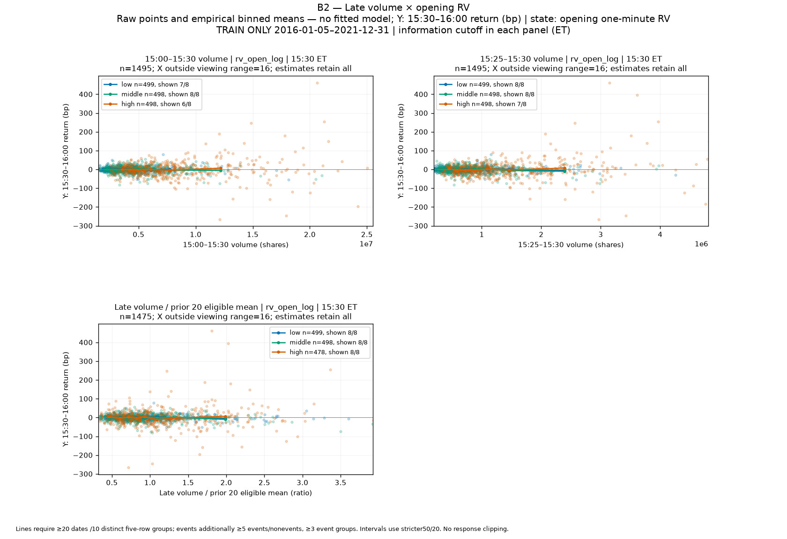

All 3 prespecified panel(s) are shown. Raw points include crisis days. Primary viewing-window exclusions are 16 predictor-tail points; estimates retain them. Displayed primary curve cells: 21/24; numerical state increments appear in the table above.

### Figure 2: Conditional means with intervals

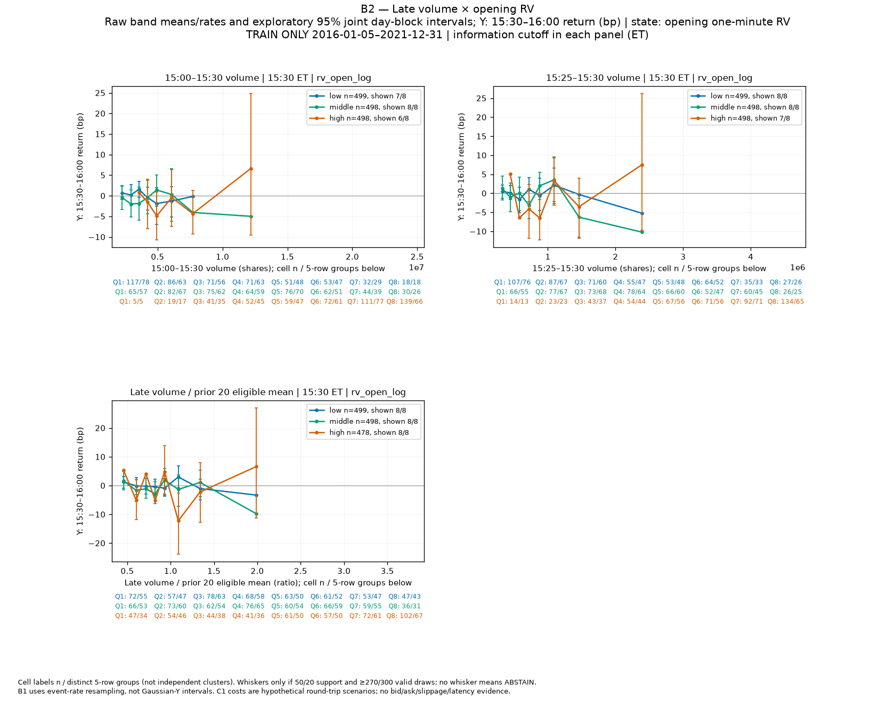

Intervals abstain where date/group or event support fails. Primary H−L increment difference is 3.55 [-5.66, 11.8], status EXPLORATORY_BLOCK_PERCENTILE. Cell n/group counts accompany the means, and rare-event counts are printed for B1.

### Figure 3: Raw X–Z conditional-response heatmap

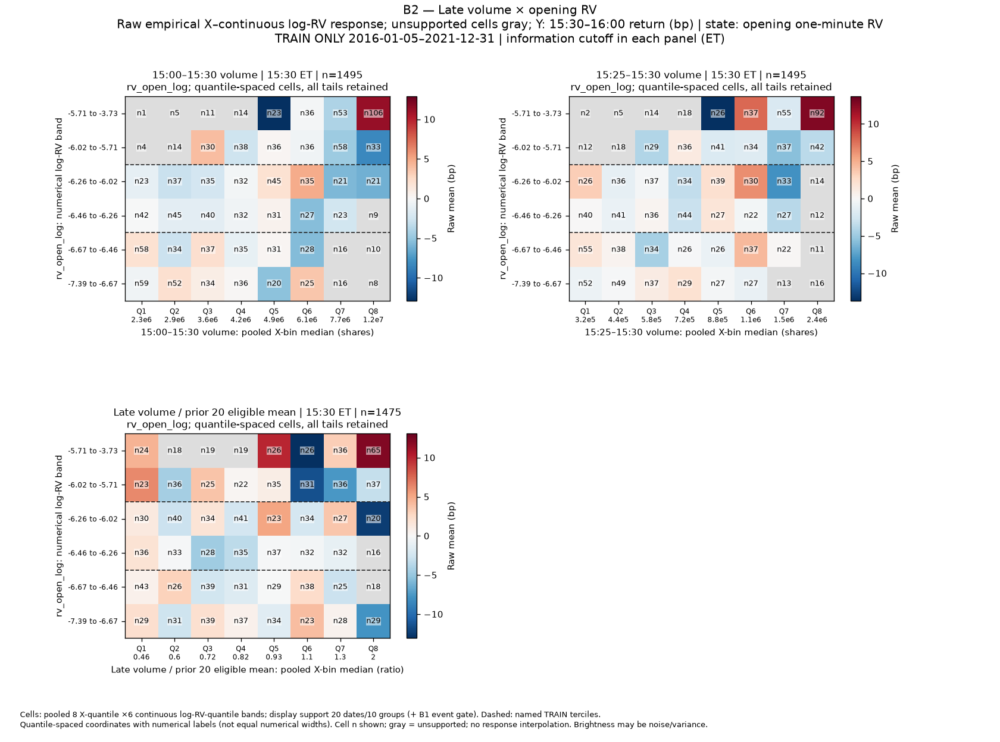

These are raw empirical responses across continuous log-RV cells, with cell counts and separately marked terciles. rv_open_log is the principal state. Gray cells forbid a continuous-surface inference; brighter extremes can be noisy.

### Figure 4: Support and state contrasts

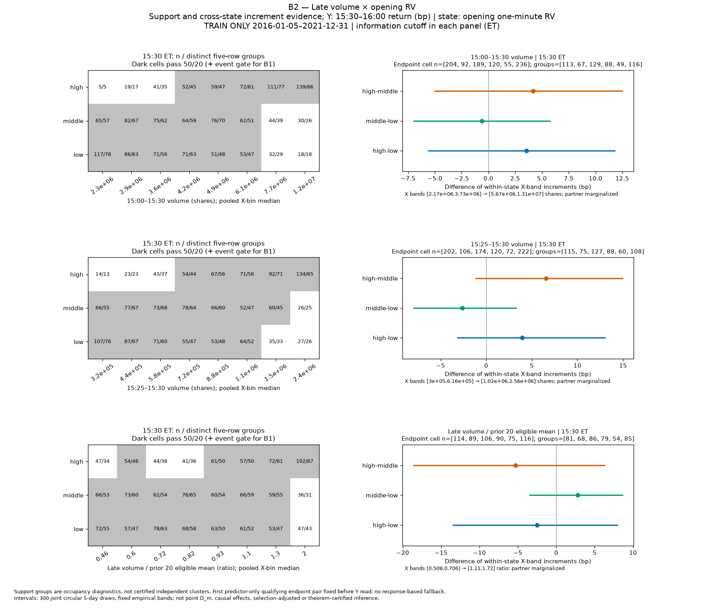

Across all displayed variants: 9 supported and 0 abstained FULL pairwise state contrasts. The first qualifying predictor-only bands and all required endpoint counts are shown; broad-band partners are marginalized rather than held fixed.

### Figure 5: Temporal and outlier robustness

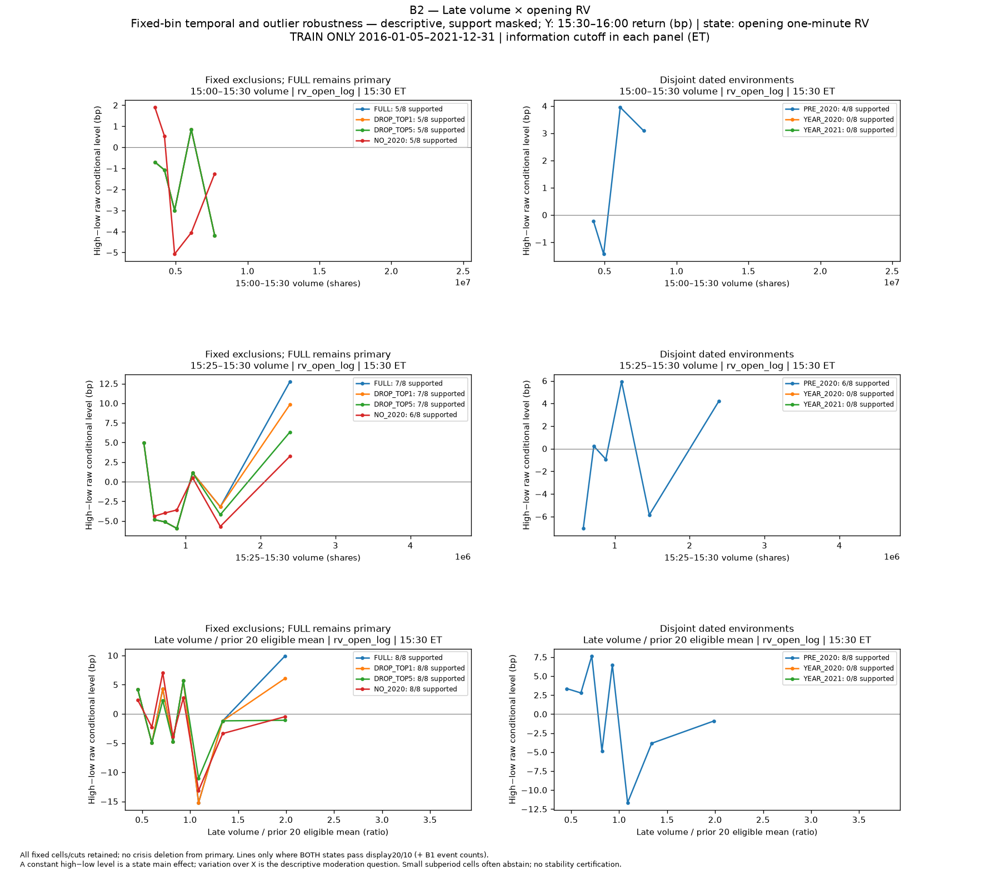

For the primary panel, 2/2 supported fixed-exclusion contrasts keep the FULL sign; 0/1 temporal contrasts agree at the weaker display-level support threshold. Each line remains on the original bin grid; the high−low level difference alone is not a moderator effect.

### What looks promising, and why

The inputs are available without acquisition; primary n=1495. The supported primary effect/noise ratio is 0.106; 71% of primary state×X cells pass contrast-level support. The raw increments and every variant above provide a concrete candidate to falsify, rather than evidence of model superiority.

### What argues against it / key limitations / support / uncertainty

Volume units and normalization change the question; a volume/RV level effect is not moderation. Relative volume loses its first20eligible days. VWAP is omitted because repaired VWAP is null.

The primary interval does not exclude / cannot assess zero. Fixed-exclusion supported sign reversals: 0; unsupported sensitivities cannot establish stability. Broad-band state compositions differ, and the direction was screened with seven other families.

### Feasibility verdict, new data needed, and recommended next model stage

**INCONCLUSIVE.** No new data are needed for this descriptive audit. No model stage is automatically authorized by a visual pattern. If selected after human review, freeze one primary predictor/state contrast, its supported mask and simple state-aware/additive comparators before any future model work. Do not reopen reserved/sealed outcomes for this triage.

## B3 — Lagged full-session momentum × opening RV

### Scientific question and feature/target definitions

One/five/20-session returns end at the previous completed full-session close.

Target: Y: 15:30–16:00 return (bp). Panels: Prior 1-full-session return (bp), rv_open_log, known 10:00 ET, n=1494, 2016-01-06–2021-12-31; Prior 5-full-session return (bp), rv_open_log, known 10:00 ET, n=1490, 2016-01-12–2021-12-31; Prior 20-full-session return (bp), rv_open_log, known 10:00 ET, n=1475, 2016-02-03–2021-12-31.

| panel | n | supported_curve_cells | displayed_mean_range | D_HL | interval | low_increment | high_increment | status | D_HL_common_dates |
| --- | --- | --- | --- | --- | --- | --- | --- | --- | --- |
| Prior 1-full-session return | 1494 | 15/24 | -10.9 to 9.53 | 0.642 | [-7.85, 11.3] | 2.72 | 3.36 | EXPLORATORY_BLOCK_PERCENTILE | 0.632 |
| Prior 5-full-session return | 1490 | 15/24 | -7.71 to 5.53 | 1.44 | [-10.7, 12.8] | -1.06 | 0.381 | EXPLORATORY_BLOCK_PERCENTILE | 1.59 |
| Prior 20-full-session return | 1475 | 16/24 | -9.37 to 7.96 | -4.65 | [-12.3, 3.86] | 4.63 | -0.0129 | EXPLORATORY_BLOCK_PERCENTILE | -4.65 |

The one-session primary contrast is small relative to daily Y noise and its interval crosses zero; five-session evidence is also weak, while the 20-session estimate points negative with an interval crossing zero. These differing horizons provide no coherent moderation signal.

### Figure 1: Raw scatter and state lines

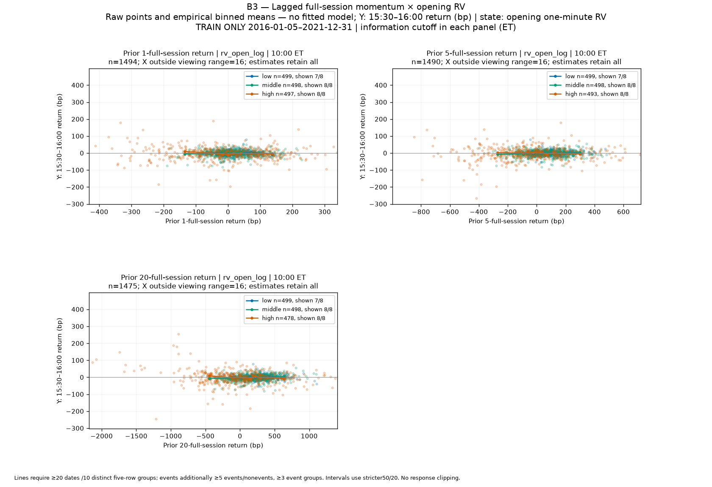

All 3 prespecified panel(s) are shown. Raw points include crisis days. Primary viewing-window exclusions are 16 predictor-tail points; estimates retain them. Displayed primary curve cells: 23/24; numerical state increments appear in the table above.

### Figure 2: Conditional means with intervals

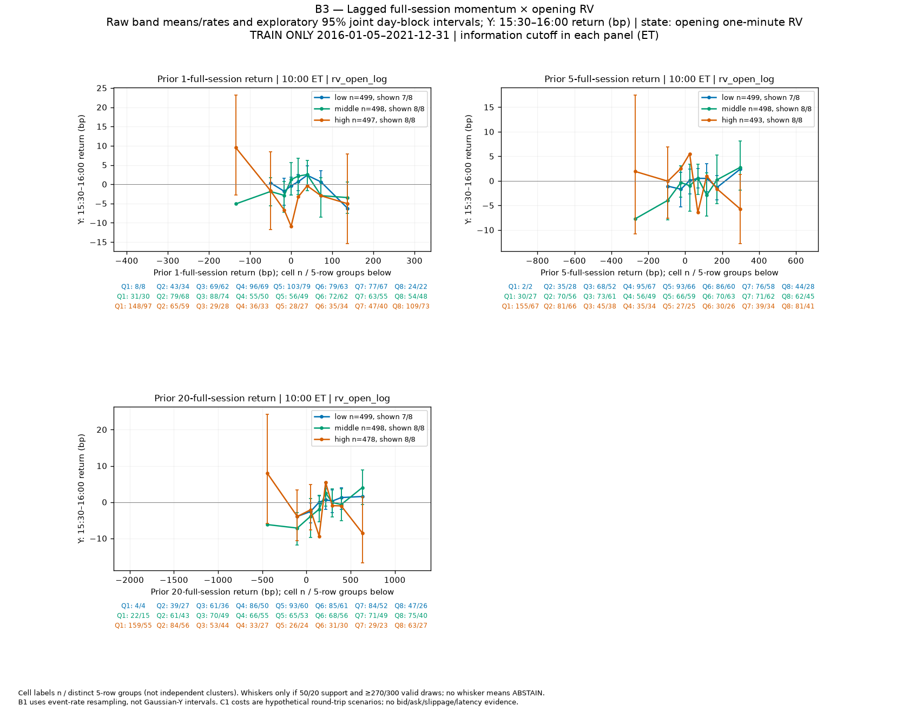

Intervals abstain where date/group or event support fails. Primary H−L increment difference is 0.642 [-7.85, 11.3], status EXPLORATORY_BLOCK_PERCENTILE. Cell n/group counts accompany the means, and rare-event counts are printed for B1.

### Figure 3: Raw X–Z conditional-response heatmap

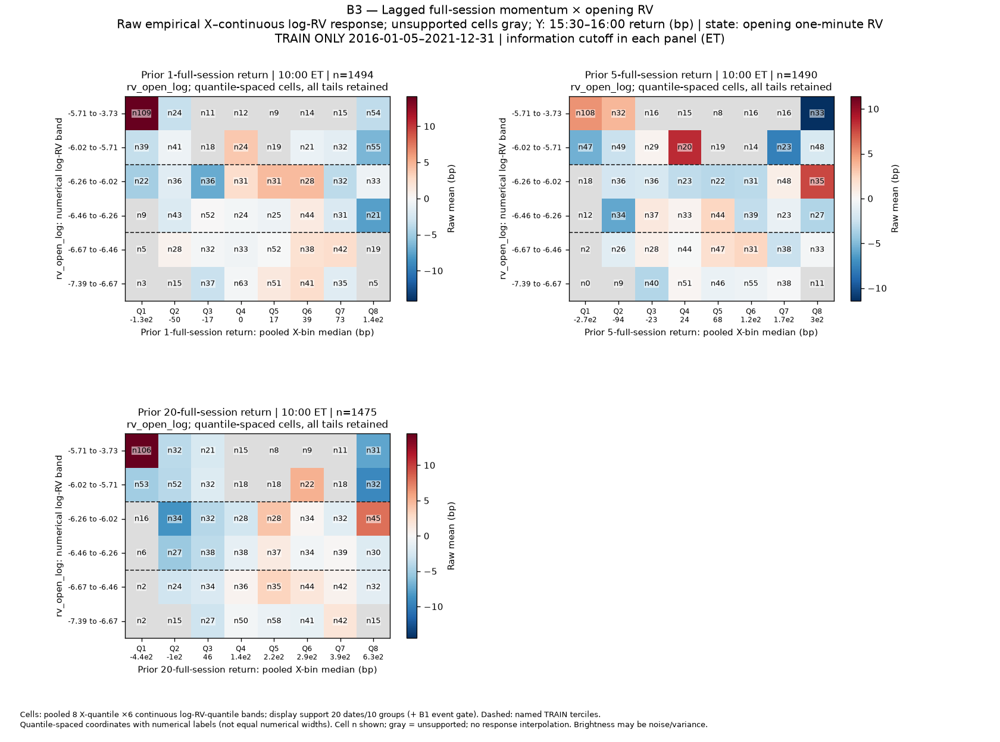

These are raw empirical responses across continuous log-RV cells, with cell counts and separately marked terciles. rv_open_log is the principal state. Gray cells forbid a continuous-surface inference; brighter extremes can be noisy.

### Figure 4: Support and state contrasts

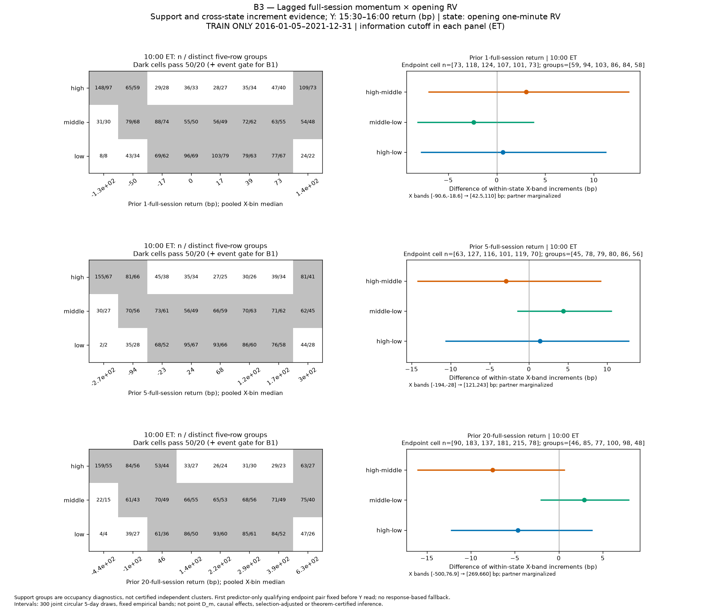

Across all displayed variants: 9 supported and 0 abstained FULL pairwise state contrasts. The first qualifying predictor-only bands and all required endpoint counts are shown; broad-band partners are marginalized rather than held fixed.

### Figure 5: Temporal and outlier robustness

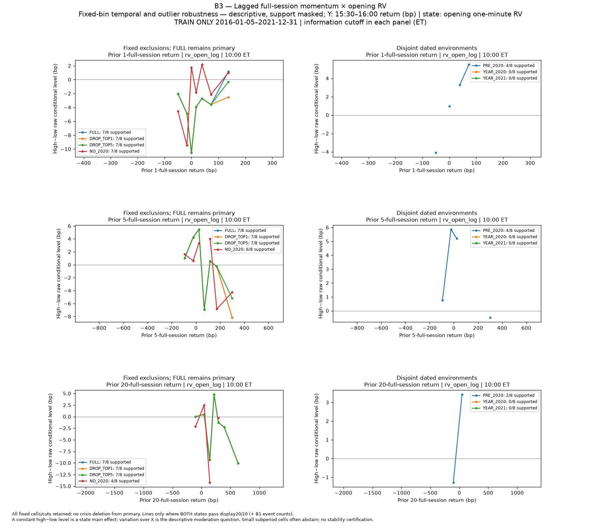

For the primary panel, 3/3 supported fixed-exclusion contrasts keep the FULL sign; 1/1 temporal contrasts agree at the weaker display-level support threshold. Each line remains on the original bin grid; the high−low level difference alone is not a moderator effect.

### What looks promising, and why

The inputs are available without acquisition; primary n=1494. The supported primary effect/noise ratio is 0.0192; 62% of primary state×X cells pass contrast-level support. The raw increments and every variant above provide a concrete candidate to falsify, rather than evidence of model superiority.

### What argues against it / key limitations / support / uncertainty

The lag calendar skips scheduled half-days, but retains full sessions with missing opening data. Missing full-close anchors invalidate windows; price returns are not dividend-adjusted total returns.

The primary interval does not exclude / cannot assess zero. Fixed-exclusion supported sign reversals: 0; unsupported sensitivities cannot establish stability. Broad-band state compositions differ, and the direction was screened with seven other families.

### Feasibility verdict, new data needed, and recommended next model stage

**LOW_PRIORITY.** No new data are needed for this descriptive audit. No model stage is automatically authorized by a visual pattern. If selected after human review, freeze one primary predictor/state contrast, its supported mask and simple state-aware/additive comparators before any future model work. Do not reopen reserved/sealed outcomes for this triage.

## C1 — Fixed-rule decision feasibility — MODEL_DEPENDENT / DEFER

### Scientific question and feature/target definitions

The fixed, unoptimized sign(W) continuation rule is displayed versus |W|; no policy is learned.

Target: Illustrative payoff (bp). Panels: |W|; fixed sign(W) continuation (bp), rv_open_log, known 15:30 ET, n=1495, 2016-01-05–2021-12-31.

| panel | n | supported_curve_cells | displayed_mean_range | D_HL | interval | low_increment | high_increment | status | D_HL_common_dates |
| --- | --- | --- | --- | --- | --- | --- | --- | --- | --- |
| /W/; fixed sign(W) continuation | 1495 | 17/24 | -8.28 to 8.27 | 2.27 | [-9.42, 13.3] | 3.96 | 6.23 | EXPLORATORY_BLOCK_PERCENTILE | 2.04 |

The all-day fixed-rule gross mean is 0.833 bp, with an exploratory interval spanning zero. Hypothetical net means at 2/5/10 bp costs are −1.14/−4.09/−9.01bp; implied gross break-even is only 0.846 bp per active day. Zero-signal days (23) stay flat. These assumptions are not executable alpha evidence.

### Figure 1: Raw scatter and state lines

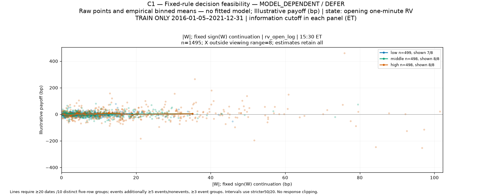

All 1 prespecified panel(s) are shown. Raw points include crisis days. Primary viewing-window exclusions are 8 predictor-tail points; estimates retain them. Displayed primary curve cells: 23/24; numerical state increments appear in the table above.

### Figure 2: Conditional means with intervals

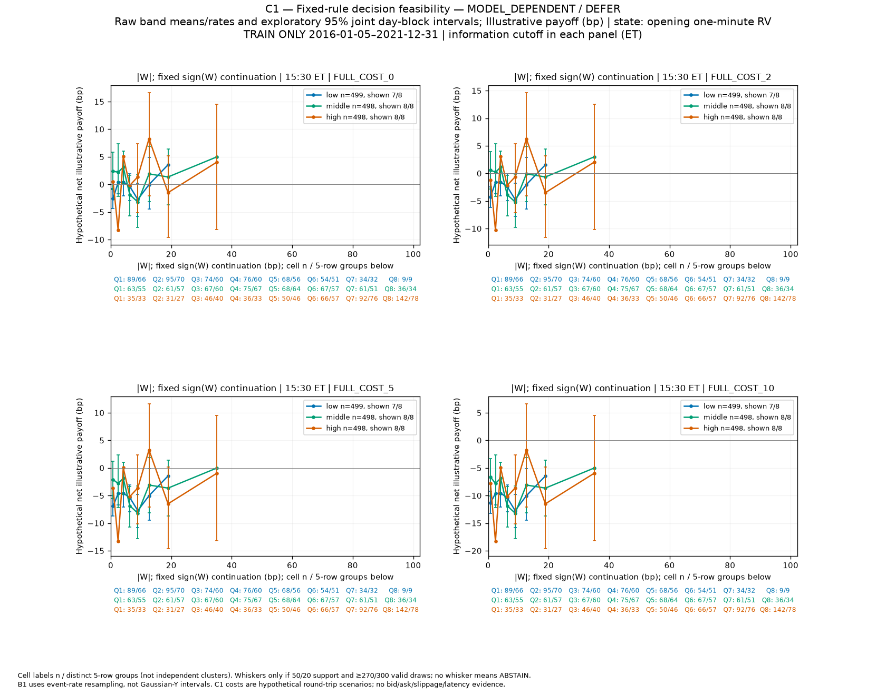

Intervals abstain where date/group or event support fails. Primary H−L increment difference is 2.27 [-9.42, 13.3], status EXPLORATORY_BLOCK_PERCENTILE. All four cost scenarios use the same fixed rule and dates; they are illustrative, not observed net executions.

### Figure 3: Raw X–Z conditional-response heatmap

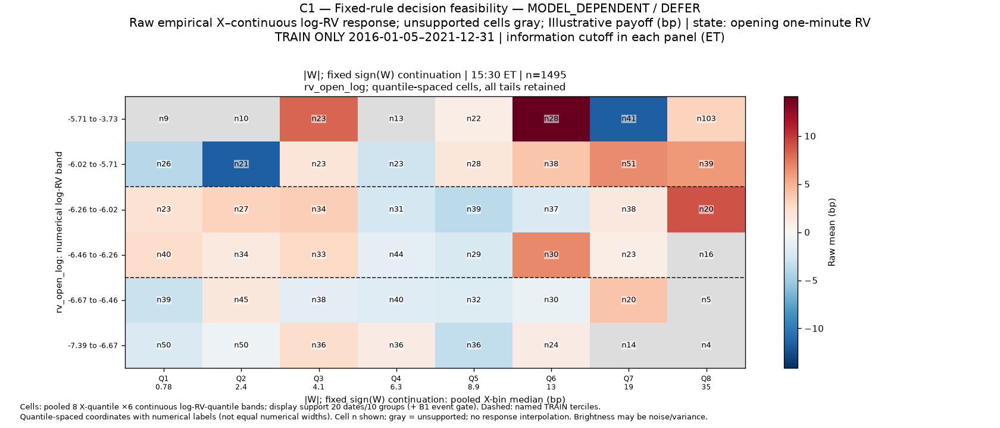

These are raw empirical responses across continuous log-RV cells, with cell counts and separately marked terciles. rv_open_log is the principal state. Gray cells forbid a continuous-surface inference; brighter extremes can be noisy.

### Figure 4: Support and state contrasts

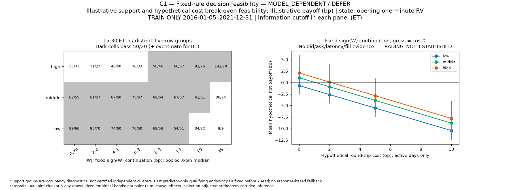

Across all displayed variants: 3 supported and 0 abstained FULL pairwise state contrasts. The right panel is a hypothetical cost break-even diagnostic; it is not a learned-model interaction.

### What looks promising, and why

The inputs are available without acquisition; primary n=1495. The supported primary effect/noise ratio is 0.0677; 71% of primary state×X cells pass contrast-level support. The fixed-rule display shows where hypothetical costs exceed gross means; it cannot nominate an EBM.

### What argues against it / key limitations / support / uncertainty

Entry at C15:29/exit at C15:59 assumes immediate availability and fills. Cost0/2/5/10bp is hypothetical; bid/ask, latency and slippage are absent. TRADING_NOT_ESTABLISHED.

The primary interval does not exclude / cannot assess zero. Fixed-exclusion supported sign reversals: 0; unsupported sensitivities cannot establish stability. Broad-band state compositions differ, and the direction was screened with seven other families.

### Feasibility verdict, new data needed, and recommended next model stage

**MODEL_DEPENDENT / DEFER.** No new data are needed for this descriptive audit. Actual execution/fill/cost evidence and a separately frozen learned-model protocol are prerequisites to a later trading study.

## Final decision: prospective experiments to prioritize, unresolved data needs, multiplicity, protocol freeze and what would falsify candidate state dependence

No family is confirmatory. Review the apparent A4 gap contrast and its missing temporal support first, then A6 against its opening-state control and the A5/B1 support limitations; this concerns interpretation, not a validation-based ranking. A replicated change of increments on a supported predeclared grid would be the next falsifiable claim. Loss of that difference under fixed exclusions, different environments, stronger additive/state-aware baselines or future properly reserved evaluation would argue against it. Eight-family exploration and dependent transforms incur multiplicity. A later selected analysis needs a fresh frozen protocol with stagewise/hierarchical multiplicity and appropriately scoped full-process null assumptions; no such fits/nulls occur here. NO_CLEAR_WINNER and supported ABSTAIN are valid outcomes. C1 stays MODEL_DEPENDENT / DEFER.

## Reproduction commands and link to technical report

With the matching authorized canonical sources available under `EBM_DATA_ROOT` (default `data/`), use the existing environment: `python -B scripts/b_initial_audit.py run` then `python -B scripts/b_initial_audit.py qa`. On a new checkout lacking this audit protocol, run `freeze` first. No provider credentials or network are used by this stage. Install the project and the existing pinned `requirements-stage2B.lock.txt` on a fresh machine; licensed/private input acquisition remains a prerequisite.

[Technical report](../../../reports/B/initial_audit_nine_experiments_feasibility.md). [Detailed cell results](registries/empirical_bins_and_support.csv); [all contrasts and sensitivities](registries/empirical_state_contrasts.csv).
