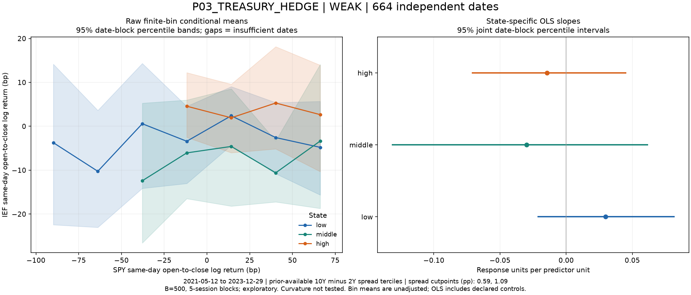
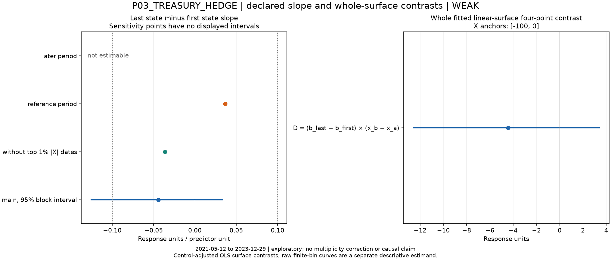
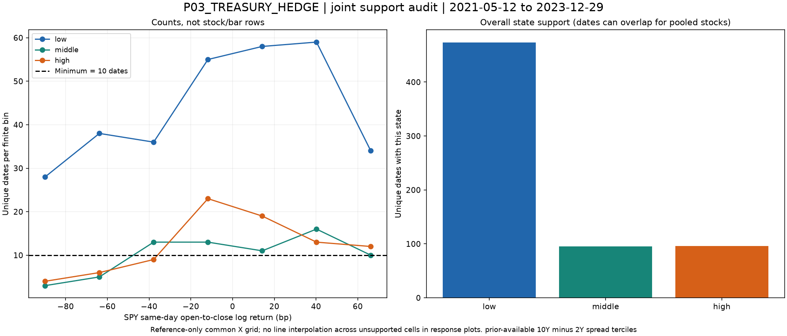

# P03_TREASURY_HEDGE preliminary screen

## P03_TREASURY_HEDGE — results and limitations

**WEAK**; 664 independent dates; 664 matched rows.

Primary last-minus-first slope contrast: **-0.0443**, 95% date-block sensitivity interval **[-0.126, 0.0345]**. Frozen material slope threshold: 0.1.

| state | slope | interval |
| --- | --- | --- |
| low | 0.0297 | [-0.0216, 0.08206] |
| middle | -0.03 | [-0.1318, 0.06201] |
| high | -0.0146 | [-0.07143, 0.04533] |

4 jointly supported common-X bins; 500/500 nonsingular resamples. Reference-half contrast 0.0365, later unavailable, without top1% absolute-X dates -0.0365. Sign stability: False. These sensitivity results do not replace the primary estimate.

Reference spread tercile cutpoints (percentage points): [0.5899999999999997, 1.0866666666666664].

The high-spread beta point estimate is lower than the low-spread beta, but the difference interval spans zero. The later period has only the low-spread state (377dates), so its full contrast is not estimable; the reference-period contrast has the opposite sign. State and calendar era are strongly confounded. No reliable sign-reversal or hedge claim follows.

All dates shown are exploratory. State-bin means are finite-interval averages, not a raw singleton conditional-mean function. B=500 intervals are conditional date-block sensitivity, without multiplicity correction or confirmatory coverage guarantees. IEF and SPY are actual ETF symbols, same-day O-C price returns. This avoids claiming dividend-adjusted total returns from the source. FRED is current vintage: observation t is conservatively usable only after17:00ET on the next federal business day; exact historical releases/revisions are not reconstructed. This is a contemporaneous association, not an ex-ante return forecast or exact source replication.

Exact definitions: Y=`IEF_same_day_open_close_log_return_bp`; X=`SPY_same_day_open_close_log_return_bp`; Z=`prior_available_DGS10_minus_DGS2_terciles`.

Config SHA-256 `fe4a1b73a08bc527b80297ddd0e269375ef290494b75ac5df37c868e0ef9a13b`; input fingerprint `877717c8fddd79652f725482ac9bf43ba198f67111dad377c6176ce3f1df8909`; source manifest SHA-256 `5aeef79b565d833bceb832004b638ada449eb6075838ea869b89201cae4256f5`.

Reproduction: from repository root, `.venv/bin/python -B scripts/five_prelim.py screen` (verified completed screens are skipped), then `report` and `verify`. Config and source identities are frozen.
