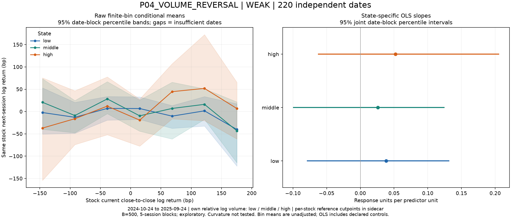
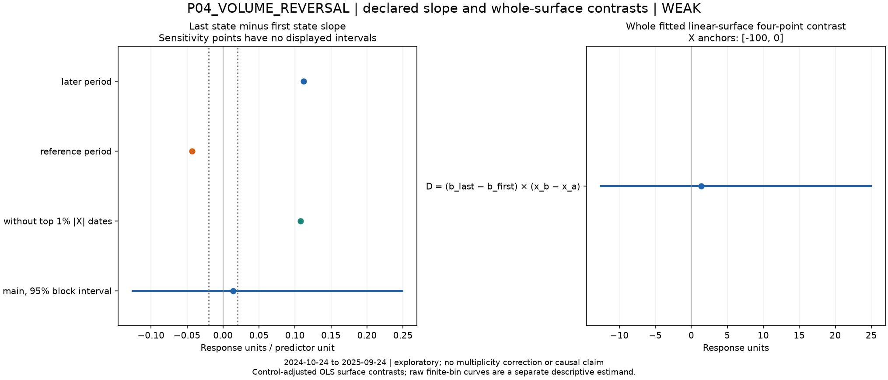
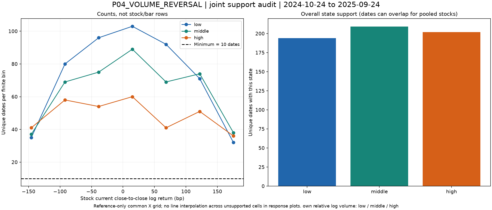

# P04_VOLUME_REVERSAL preliminary screen

## P04_VOLUME_REVERSAL — results and limitations

**WEAK**; 220 independent dates; 2,200 matched rows.

Primary last-minus-first slope contrast: **0.014**, 95% date-block sensitivity interval **[-0.127, 0.251]**. Frozen material slope threshold: 0.02.

| state | slope | interval |
| --- | --- | --- |
| low | 0.0381 | [-0.0793, 0.1321] |
| middle | 0.026 | [-0.09994, 0.1248] |
| high | 0.0522 | [-0.06287, 0.2059] |

7 jointly supported common-X bins; 500/500 nonsingular resamples. Reference-half contrast -0.0427, later 0.112, without top1% absolute-X dates 0.108. Sign stability: False. These sensitivity results do not replace the primary estimate.

Per-stock reference log-volume cutpoints: `results/summary.json → per_stock_state_cutpoints`. They were not fitted to future returns.

The high-minus-low-volume slope estimate is slightly positive, rather than the historical more-negative-autocorrelation direction; its interval is wide. This recent survivorship-selected sample does not reproduce a robust negative contrast.

All dates shown are exploratory. State-bin means are finite-interval averages, not a raw singleton conditional-mean function. B=500 intervals are conditional date-block sensitivity, without multiplicity correction or confirmatory coverage guarantees. Native30-minute observed stock OHLCV; split-only, not dividend-adjusted close-to-close price returns. Only full13-bar days retained. Own log volume uses previous20eligible full days, excludes current; terciles fitted per stock in reference period. Next return requires the immediately next scheduled session. SPY O-C is a declared same-day market control, not the target or state. One year and ten stocks limit generalization.

Exact definitions: Y=`same_stock_next_session_close_close_log_return_bp`; X=`same_stock_current_close_close_log_return_bp`; Z=`own_log_volume_minus_prior20_mean_log_volume`.

Config SHA-256 `b12c6d0c70a4dbb13d4de5db64716ca690739c9458e1a817b0716903d187cd37`; input fingerprint `877717c8fddd79652f725482ac9bf43ba198f67111dad377c6176ce3f1df8909`; source manifest SHA-256 `5aeef79b565d833bceb832004b638ada449eb6075838ea869b89201cae4256f5`.

Reproduction: from repository root, `.venv/bin/python -B scripts/five_prelim.py screen` (verified completed screens are skipped), then `report` and `verify`. Config and source identities are frozen.
