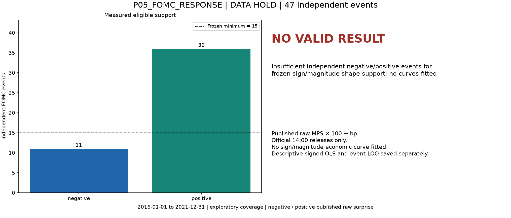

# P05_FOMC_RESPONSE preliminary screen

## P05_FOMC_RESPONSE — results and limitations

**DATA HOLD**; 47 independent FOMC events; 47 matched rows.

**NO VALID RESULT for the intended state shape.** Insufficient independent negative/positive events for frozen sign/magnitude shape support; no curves fitted State event/date counts: {'negative': 11, 'positive': 36}. No supported response curve or shape-contrast image is presented.

Descriptive signed linear benchmark slope -5.15 bp SPY response per bp shock; event leave-one-out slopes are saved only as diagnostics. This is not the held sign/magnitude shape.

Published2016–2021rows:54; verified standard14:00and complete SPY events:47; excluded nonstandard/unverified release-time rows:7. Exact exclusion dates/reasons are in `../manifests/fomc_event_eligibility.csv`. Event leave-one-out signed-slope range [-6.02, -4.51] bp/bp. No independent-event nonlinear confidence band is estimated under the hold.

All dates shown are exploratory. State-bin means are finite-interval averages, not a raw singleton conditional-mean function. B=500 intervals are conditional date-block sensitivity, without multiplicity correction or confirmatory coverage guarantees. Raw SF Fed updated FOMC-sheet MPS, not MPS_ORTH. MPS rate percentage points are multiplied by100 to bp (ED4 unit loading in the author paper p16). The publisher chart is only a units crosscheck:53/54overlapping values differ by less than0.025bp, but2019-07-31differs by4.714bp (workbook0.576bp versus chart5.29bp). The cause is unresolved, possibly a vintage/revision difference; no value is silently replaced. Standard14:00 releases verified against official statements; other times excluded, not shifted. Shock construction overlaps the stock-response window, so association is contemporaneous, not an ex-ante forecast or clean causal estimate. Insufficient negative events and unresolved source disagreement limit this branch; the signed OLS/LOO diagnostic does not remove the hold.

Exact definitions: Y=`SPY_standard_1400_1430_log_return_bp`; X=`absolute_published_surprise_bp`; Z=`published_raw_surprise_sign`.

Config SHA-256 `ab17d8d6d9f1948ab6d62e1bce34cbb96877059f83d180e77c29d991388f095a`; input fingerprint `877717c8fddd79652f725482ac9bf43ba198f67111dad377c6176ce3f1df8909`; source manifest SHA-256 `5aeef79b565d833bceb832004b638ada449eb6075838ea869b89201cae4256f5`.

Reproduction: from repository root, `.venv/bin/python -B scripts/five_prelim.py screen` (verified completed screens are skipped), then `report` and `verify`. Config and source identities are frozen.
