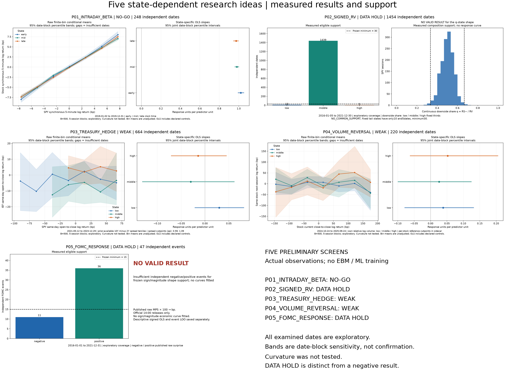
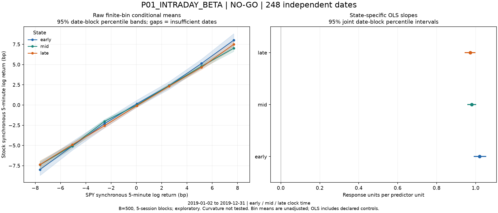
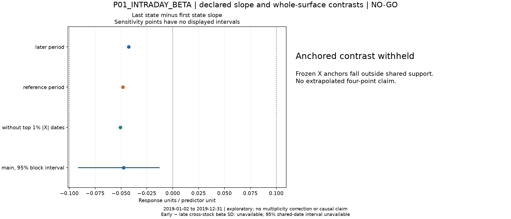
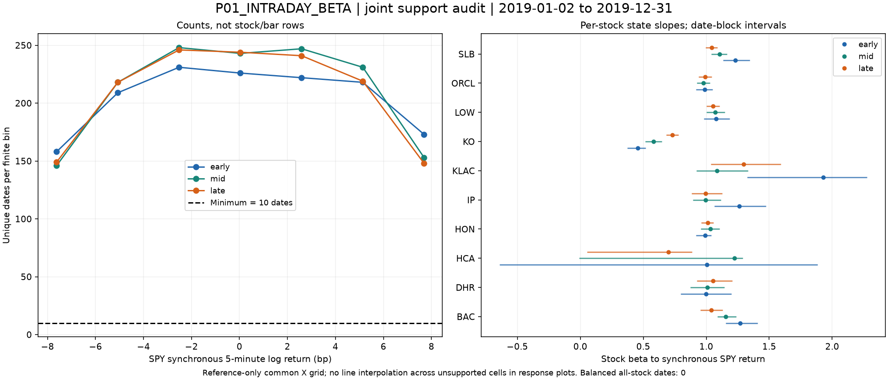
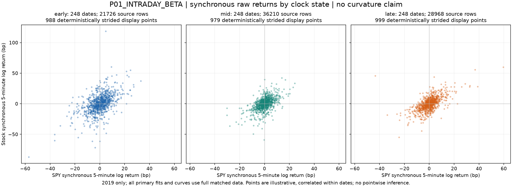
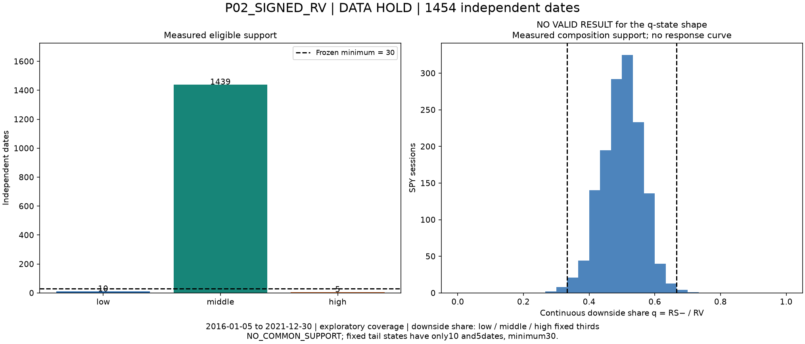

# Preliminary screen of five state-dependent EBM research ideas

## Executive decision matrix

| Experiment ID | Source and period | Scientific target | Independent days/events | Main state contrast | Uncertainty/support | Status | Figure |
| --- | --- | --- | --- | --- | --- | --- | --- |
| P01_INTRADAY_BETA | HF_MINUTE_A, LOCAL_SPY_1M; ['2019-01-01', '2019-12-31'] | stock_5m_log_return_bp | 248 | -0.0476 [-0.0916, -0.0128] | 7 common bins; exploratory | NO-GO | [summary](figures/P01_INTRADAY_BETA_summary.png) |
| P02_SIGNED_RV | HF_MINUTE_A, LOCAL_SPY_1M; ['2016-01-04', '2021-12-31'] | next_session_log_RV_389 | 1454 | not estimable: insufficient support | 0 common bins; exploratory | DATA HOLD | [summary](figures/P02_SIGNED_RV_summary.png) |
| P03_TREASURY_HEDGE | HF_ETF_DAILY, FED_RATES; ['2021-05-12', '2023-12-29'] | IEF_same_day_open_close_log_return_bp | 664 | -0.0443 [-0.126, 0.0345] | 4 common bins; exploratory | WEAK | [summary](figures/P03_TREASURY_HEDGE_summary.png) |
| P04_VOLUME_REVERSAL | LOCAL_OBSERVED_30M, HF_ETF_DAILY; ['2024-09-26', '2025-09-25'] | same_stock_next_session_close_close_log_return_bp | 220 | 0.014 [-0.127, 0.251] | 7 common bins; exploratory | WEAK | [summary](figures/P04_VOLUME_REVERSAL_summary.png) |
| P05_FOMC_RESPONSE | FED_SHOCKS, LOCAL_SPY_1M; ['2016-01-01', '2021-12-31'] | SPY_standard_1400_1430_log_return_bp | 47 | not estimable: Insufficient independent negative/positive events for frozen sign/magnitude shape support; no curves fitted | held common bins; exploratory | DATA HOLD | [summary](figures/P05_FOMC_RESPONSE_summary.png) |

Implementation/QA verdict: **PASS WITH QUALIFICATIONS**. The requested preliminary workflow has executed; a DATA HOLD is a completed, explicitly limited branch, not evidence of no relationship. No EBM, ML or trading backtest was run.

## Shared data sources, provenance and storage

Existing SPY minute files (2016–2021), cached observed BAC/KO minute partitions (2019), and ten original native30-minute stock files were reused by exact hash reference. Full source paths, SHA-256, byte sizes and schemas are in `../manifests/validated_inputs.json` and `source_registry.json`; input rows are not copied into experiments. Earlier A/B/C plots, fitted models and conclusions were not used as evidence.

New minute intake used only [mito0o852/OHLCV-1m](https://huggingface.co/datasets/mito0o852/OHLCV-1m), revision `776328445b7ac6e7815ef3a483e9c8ded1eb6d56`, twelve2019months, eight missing symbols. Each month was downloaded once, verified against LFS SHA-256, batch-filtered, then its raw temporary file deleted. All twelve validated outputs were skipped on the small-source recovery run. No mirror, snapshot, second minute pass or hidden HF cache. Private-research permission is user-authorized and backed by the supplied human-reported maintainer receipt; upstream vendor rights have not been independently certified. Raw data are excluded from the review bundle.

[ETF daily source](https://huggingface.co/datasets/thecharttruth/etf-data) pinned revision `fb85708dc152ddaa15d9f75608171219cc3fc69a`: actual SPY and IEF O-C prices, instrument metadata identifies both as ETF; names are absent, so no names are invented. Custom research/education terms prohibit redistribution/resale without permission. [FRED DGS10](https://fred.stlouisfed.org/series/DGS10) and DGS2 are current-vintage daily percentage yields, with conservative lag rather than exact historical-vintage reconstruction. [SF Fed raw monetary-policy surprises](https://www.frbsf.org/research-and-insights/data-and-indicators/monetary-policy-surprises/) use updated FOMC sheet MPS. The [author paper, p16](https://www.michaeldbauer.com/files/mps.pdf) specifies percentage-point ED4 scaling: MPS×100 gives bp. The chart CSV is units QA only and has vintage differences. Official statement HTML verifies announcement times;2021 historical-calendar404 was recovered through direct official statements.

Measured incremental peak **297,766,292 bytes**; largest reserved envelope **397,708,076 bytes**; current retained **26,744,179 bytes** (includes code, filtered data, figures, caches and any existing review ZIP). Hard cap **10,000,000,000 bytes**. Initial forecast620,814,381bytes. See exact final values in `../manifests/final_storage.json` and streaming trace `../logs/storage.jsonl`; later report/ZIP additions are checked again at final verification. Raw monthly temps remaining:0.

Frozen stock list: BAC, KO, HON, ORCL, DHR, KLAC, LOW, HCA, SLB, IP. Selected by roster membership, sector diversity and coverage before viewing response relationships. CAT/JNJ were not eligible roster members. Reference-only state/X cutoffs; raw data without winsorization; per-date top1% absolute focal-X exclusion is sensitivity only. No missing minute or volume is imputed.

## P01_INTRADAY_BETA — results and limitations

**NO-GO**; 248 independent dates; 86,904 matched rows.

Primary last-minus-first slope contrast: **-0.0476**, 95% date-block sensitivity interval **[-0.0916, -0.0128]**. Frozen material slope threshold: 0.1.

| state | slope | interval |
| --- | --- | --- |
| early | 1.02 | [0.9899, 1.055] |
| mid | 0.98 | [0.9578, 1.003] |
| late | 0.972 | [0.9441, 0.9994] |

7 jointly supported common-X bins; 493/500 nonsingular resamples. Reference-half contrast -0.0482, later -0.0425, without top1% absolute-X dates -0.0505. Sign stability: True. These sensitivity results do not replace the primary estimate.

Early minus late cross-stock beta SD: unavailable; shared-date95% interval None; 0 common dates. Per-stock beta estimates are saved. **Dispersion compression cannot be assessed reliably:** there are fewer than30common dates across all ten stocks; HCA/KLAC each have only6eligible dates. No balanced-panel dispersion bootstrap or literature-dispersion replication claim is made. The NO-GO status applies to the pooled mean-beta contrast only.

The pooled mean beta is slightly lower late than early. This is a mean-slope finding, not evidence of the literature’s cross-stock dispersion compression.

All dates shown are exploratory. State-bin means are finite-interval averages, not a raw singleton conditional-mean function. B=500 intervals are conditional date-block sensitivity, without multiplicity correction or confirmatory coverage guarantees. 2019 only; ten coverage/sector-selected stocks, incomplete minute days excluded without filling. Cross-stock beta dispersion uses common balanced dates and identical resampled dates across stocks. Primary status uses the pooled last-minus-first slope; dispersion is an additional diagnostic. Neither curvature nor a novel intraday effect is asserted.

Exact definitions: Y=`stock_5m_log_return_bp`; X=`spy_synchronous_5m_log_return_bp`; Z=`clock_start_ET_early_mid_late`.

Config SHA-256 `197c769732e27298df2ff9a02b290ef2f9d5406404a74db3b7928895155faa3b`; input fingerprint `877717c8fddd79652f725482ac9bf43ba198f67111dad377c6176ce3f1df8909`; source manifest SHA-256 `5aeef79b565d833bceb832004b638ada449eb6075838ea869b89201cae4256f5`.

## P02_SIGNED_RV — results and limitations

**DATA HOLD**; 1454 independent dates; 1,454 matched rows.

**NO VALID RESULT for the intended state shape.** Insufficient state counts and/or common predictor support. State event/date counts: {'high': 5, 'low': 10, 'middle': 1439}. No supported response curve or shape-contrast image is presented.

The fixed q tail states have10low and5high SPY days (minimum30); reference-only common logRV support is empty. No bins were merged. Continuous q support is shown in the summary. The separate raw-RV reference remains descriptive: negative coefficient 1.95, positive -1.09, lagRV 0.408; negative-minus-positive95% interval {'estimate': 3.03979058189282, 'lo': 0.7949252646071433, 'hi': 5.532162429285212}. No-state current/lag logRV MSE 0.346; state model 0.345. The held state-slope contrast and any rank-deficient bootstrap draws are not treated as evidence.

| sample | dates | rows | status |
| --- | --- | --- | --- |
| STOCKS_POOLED | 238 | 929 | DATA HOLD |

All dates shown are exploratory. State-bin means are finite-interval averages, not a raw singleton conditional-mean function. B=500 intervals are conditional date-block sensitivity, without multiplicity correction or confirmatory coverage guarantees. SPY2016–2021 is principal; ten-stock2019 is reported separately and must not be pooled with SPY as independent confirmation. RV uses389 adjacent observed closes, excludes overnight and the opening O-C return. Strict prior/next scheduled-session joins discard gaps. Fixed q bins can have weak tail support. Lag logRV is controlled. The raw semivariance regression includes lag RV; it is a separate estimand.

Exact definitions: Y=`next_session_log_RV_389`; X=`current_log_RV_389`; Z=`current_q_down_fixed_thirds`.

Config SHA-256 `57db40d2fc8b9dfab52282abd07b8e663ae959a2cec832c0dc863c635d995eee`; input fingerprint `877717c8fddd79652f725482ac9bf43ba198f67111dad377c6176ce3f1df8909`; source manifest SHA-256 `5aeef79b565d833bceb832004b638ada449eb6075838ea869b89201cae4256f5`.

## P03_TREASURY_HEDGE — results and limitations

**WEAK**; 664 independent dates; 664 matched rows.

Primary last-minus-first slope contrast: **-0.0443**, 95% date-block sensitivity interval **[-0.126, 0.0345]**. Frozen material slope threshold: 0.1.

| state | slope | interval |
| --- | --- | --- |
| low | 0.0297 | [-0.0216, 0.08206] |
| middle | -0.03 | [-0.1318, 0.06201] |
| high | -0.0146 | [-0.07143, 0.04533] |

4 jointly supported common-X bins; 500/500 nonsingular resamples. Reference-half contrast 0.0365, later unavailable, without top1% absolute-X dates -0.0365. Sign stability: False. These sensitivity results do not replace the primary estimate.

Reference spread tercile cutpoints (percentage points): [0.5899999999999997, 1.0866666666666664].

The high-spread beta point estimate is lower than the low-spread beta, but the difference interval spans zero. The later period has only the low-spread state (377dates), so its full contrast is not estimable; the reference-period contrast has the opposite sign. State and calendar era are strongly confounded. No reliable sign-reversal or hedge claim follows.

All dates shown are exploratory. State-bin means are finite-interval averages, not a raw singleton conditional-mean function. B=500 intervals are conditional date-block sensitivity, without multiplicity correction or confirmatory coverage guarantees. IEF and SPY are actual ETF symbols, same-day O-C price returns. This avoids claiming dividend-adjusted total returns from the source. FRED is current vintage: observation t is conservatively usable only after17:00ET on the next federal business day; exact historical releases/revisions are not reconstructed. This is a contemporaneous association, not an ex-ante return forecast or exact source replication.

Exact definitions: Y=`IEF_same_day_open_close_log_return_bp`; X=`SPY_same_day_open_close_log_return_bp`; Z=`prior_available_DGS10_minus_DGS2_terciles`.

Config SHA-256 `fe4a1b73a08bc527b80297ddd0e269375ef290494b75ac5df37c868e0ef9a13b`; input fingerprint `877717c8fddd79652f725482ac9bf43ba198f67111dad377c6176ce3f1df8909`; source manifest SHA-256 `5aeef79b565d833bceb832004b638ada449eb6075838ea869b89201cae4256f5`.

## P04_VOLUME_REVERSAL — results and limitations

**WEAK**; 220 independent dates; 2,200 matched rows.

Primary last-minus-first slope contrast: **0.014**, 95% date-block sensitivity interval **[-0.127, 0.251]**. Frozen material slope threshold: 0.02.

| state | slope | interval |
| --- | --- | --- |
| low | 0.0381 | [-0.0793, 0.1321] |
| middle | 0.026 | [-0.09994, 0.1248] |
| high | 0.0522 | [-0.06287, 0.2059] |

7 jointly supported common-X bins; 500/500 nonsingular resamples. Reference-half contrast -0.0427, later 0.112, without top1% absolute-X dates 0.108. Sign stability: False. These sensitivity results do not replace the primary estimate.

Per-stock reference log-volume cutpoints: `results/summary.json → per_stock_state_cutpoints`. They were not fitted to future returns.

The high-minus-low-volume slope estimate is slightly positive, rather than the historical more-negative-autocorrelation direction; its interval is wide. This recent survivorship-selected sample does not reproduce a robust negative contrast.

All dates shown are exploratory. State-bin means are finite-interval averages, not a raw singleton conditional-mean function. B=500 intervals are conditional date-block sensitivity, without multiplicity correction or confirmatory coverage guarantees. Native30-minute observed stock OHLCV; split-only, not dividend-adjusted close-to-close price returns. Only full13-bar days retained. Own log volume uses previous20eligible full days, excludes current; terciles fitted per stock in reference period. Next return requires the immediately next scheduled session. SPY O-C is a declared same-day market control, not the target or state. One year and ten stocks limit generalization.

Exact definitions: Y=`same_stock_next_session_close_close_log_return_bp`; X=`same_stock_current_close_close_log_return_bp`; Z=`own_log_volume_minus_prior20_mean_log_volume`.

Config SHA-256 `b12c6d0c70a4dbb13d4de5db64716ca690739c9458e1a817b0716903d187cd37`; input fingerprint `877717c8fddd79652f725482ac9bf43ba198f67111dad377c6176ce3f1df8909`; source manifest SHA-256 `5aeef79b565d833bceb832004b638ada449eb6075838ea869b89201cae4256f5`.

## P05_FOMC_RESPONSE — results and limitations

**DATA HOLD**; 47 independent FOMC events; 47 matched rows.

**NO VALID RESULT for the intended state shape.** Insufficient independent negative/positive events for frozen sign/magnitude shape support; no curves fitted State event/date counts: {'negative': 11, 'positive': 36}. No supported response curve or shape-contrast image is presented.

Descriptive signed linear benchmark slope -5.15 bp SPY response per bp shock; event leave-one-out slopes are saved only as diagnostics. This is not the held sign/magnitude shape.

Published2016–2021rows:54; verified standard14:00and complete SPY events:47; excluded nonstandard/unverified release-time rows:7. Exact exclusion dates/reasons are in `../manifests/fomc_event_eligibility.csv`. Event leave-one-out signed-slope range [-6.02, -4.51] bp/bp. No independent-event nonlinear confidence band is estimated under the hold.

All dates shown are exploratory. State-bin means are finite-interval averages, not a raw singleton conditional-mean function. B=500 intervals are conditional date-block sensitivity, without multiplicity correction or confirmatory coverage guarantees. Raw SF Fed updated FOMC-sheet MPS, not MPS_ORTH. MPS rate percentage points are multiplied by100 to bp (ED4 unit loading in the author paper p16). The publisher chart is only a units crosscheck:53/54overlapping values differ by less than0.025bp, but2019-07-31differs by4.714bp (workbook0.576bp versus chart5.29bp). The cause is unresolved, possibly a vintage/revision difference; no value is silently replaced. Standard14:00 releases verified against official statements; other times excluded, not shifted. Shock construction overlaps the stock-response window, so association is contemporaneous, not an ex-ante forecast or clean causal estimate. Insufficient negative events and unresolved source disagreement limit this branch; the signed OLS/LOO diagnostic does not remove the hold.

Exact definitions: Y=`SPY_standard_1400_1430_log_return_bp`; X=`absolute_published_surprise_bp`; Z=`published_raw_surprise_sign`.

Config SHA-256 `ab17d8d6d9f1948ab6d62e1bce34cbb96877059f83d180e77c29d991388f095a`; input fingerprint `877717c8fddd79652f725482ac9bf43ba198f67111dad377c6176ce3f1df8909`; source manifest SHA-256 `5aeef79b565d833bceb832004b638ada449eb6075838ea869b89201cae4256f5`.

## Cross-experiment methodological comparison

P01 tests contemporaneous clock-dependent stock beta and cross-stock dispersion; P03 tests contemporaneous equity/bond association. P02 and P04 have next-session targets but are exploratory associations with declared lags/controls, not demonstrated implementable forecasts. P05 is an event-response association with overlapping shock measurement and response windows. Their target units, states, populations and periods differ and must not be pooled. None is an exact literature replication or a nonlinear-curvature test. Directional context comes from the controlling design; apparent agreement here is a qualified adaptation, not an exact reproduced coefficient.

Conditional raw bin means and controlled OLS slopes are distinct estimands. Uncertainty is date-block resampling across all stock/bar rows together, or independent-event diagnostics for P05. Intervals and GO decisions are exploratory; no untouched confirmation, economic profitability, novelty or EBM theory guarantee follows. NO-GO denotes a supported small contrast in this design, not a population equivalence proof. Missing/rare support remains DATA HOLD.

## Ranked recommendations for possible next EBM studies

1. **P03_TREASURY_HEDGE: WEAK.** Sensitivity or interval width prevents a strong feasibility recommendation; do not tune this examined sample to improve the result.
2. **P04_VOLUME_REVERSAL: WEAK.** Sensitivity or interval width prevents a strong feasibility recommendation; do not tune this examined sample to improve the result.
3. **P01_INTRADAY_BETA: NO-GO.** The valid preliminary contrast is small under the frozen materiality criterion; preserve the negative result.
4. **P02_SIGNED_RV: DATA HOLD.** Resolve independent support or source limitations first; no EBM shape inference is authorized by this screen.
5. **P05_FOMC_RESPONSE: DATA HOLD.** Resolve independent support or source limitations first; no EBM shape inference is authorized by this screen.

Ranking groups statuses only; ties retain experiment-ID order. No return-score optimization or cross-experiment p-value ranking.

## QA and artifacts index

All plotted coordinates, interval endpoints and date/event counts: `figure_data/*.csv`; paired `figures/*.meta.json` bind target/state/config/source/input and both hashes. Five separate `../experiments/<ID>/report.md`, results and diagnostics; frozen configs `../configs`; data-lineage schema `../manifests/validated_inputs.json`; source/month/storage/legacy integrity `../manifests/final_integrity_QA.json`; full test and visual QA `../manifests/final_visual_statistical_QA.json`. See [execution integrity](five_experiment_execution_integrity_v1.md).

The [review ZIP](five_experiment_prelim_review_bundle_v1.zip) preserves relative image paths and contains no raw market Parquet or source workbook. Upload **this Markdown, the ZIP, and all six standalone summary/overview PNGs to the EBM Theory ChatGPT chat**. Uploading Markdown alone does not attach its local images.
