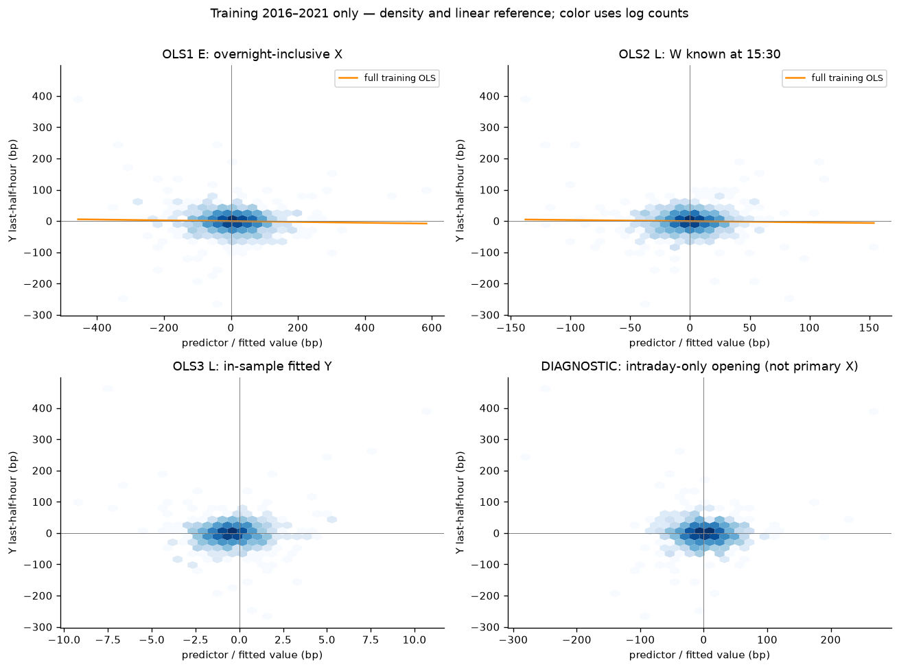
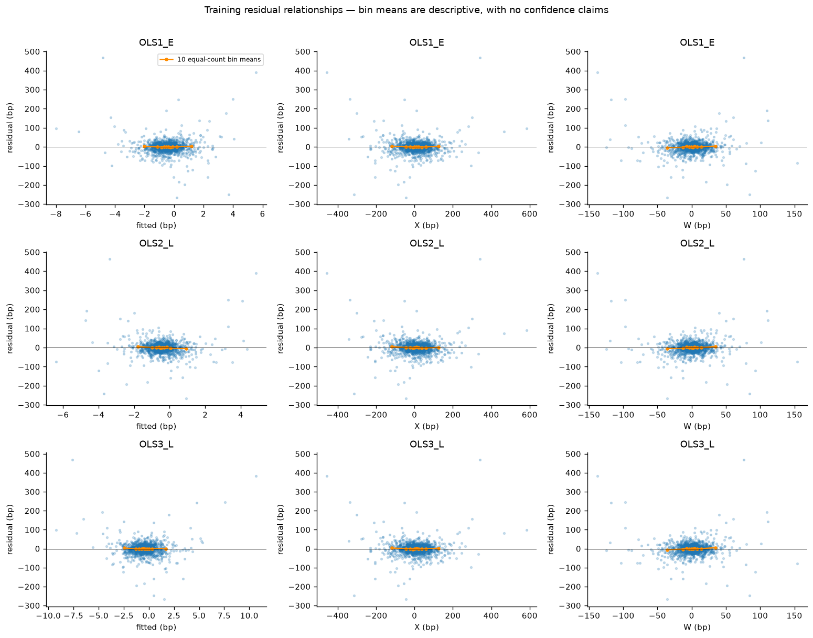
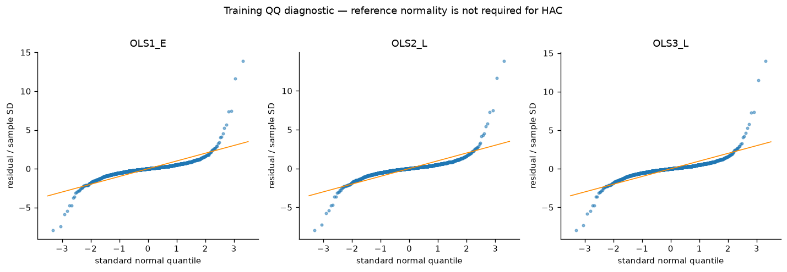
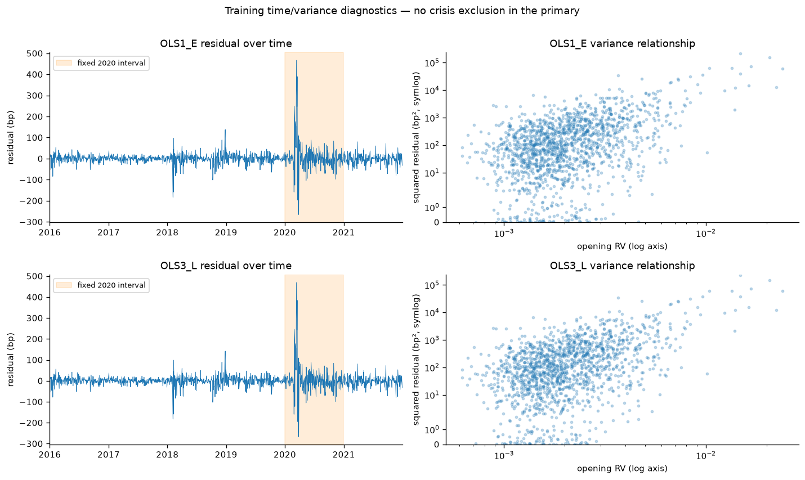

# Experiment B Stage 1.5 — focused diagnosis of weak modern linear replication

**PASS WITH QUALIFICATIONS.** Stage 1 baseline numerically reproduces: **57 coefficient/lag rows**, maximum absolute numeric difference **4.44e-16**, tolerance atol=1e-10, rtol=1e-09. Only **1,495 eligible training dates, 2016-01-05–2021-12-31**, were exposed to diagnostics after a date-only guard and Arrow filtering. Validation 2022–2023 remains reserved; no sealed 2024–2026 scientific rows/statistics/plots were used. Stage 1 source/table/config/reports remain immutable. This stage diagnoses association estimates; it does not establish a unique cause of a historical-modern difference.

The main observations are **heavy tails and volatility clustering/serial dependence**, rather than collinearity: residual Pearson kurtosis is 51.38–51.85 (Gaussian reference3), and OLS1 lag1 residual ACF is 0.1013. White, ARCH and residual/squared-residual portmanteau diagnostics flag departures under their reference assumptions; Koenker BP for W alone does **not** reject (p≈0.451), illustrating that different variance alternatives need not agree. OLS3 predictor VIF≈1.00033 gives no evidence that X/W collinearity explains the weak fit. HAC RESET flags are exploratory and do not identify an EBM shape or superiority.

Cook's top observation is 2020-03-18 for all three models. Removing that one date changes OLS1's slope to 0.013357, CI[-0.056840,0.083554]; removing the fixed top five gives -0.017269, and the Huber opening slope is -0.021664. **Sign sensitivity to one observation does not rescue a reliable positive effect**; the top-five and Huber opening estimates remain negative. Removing all 2020 gives -0.034969, CI[-0.079539,0.009601], more negative than the primary, so 2020 alone is not a supported explanation for its negative sign. The 2021 descriptive slope is -0.082951, CI[-0.149732,-0.016169], while the formal 2020 X-slope difference is inconclusive (p=0.4998). Period heterogeneity and crisis influence are observed; a specific structural break, zero relationship, or unique source mismatch is not established.

## Baseline verification and uncertainty

| model | term | n | estimate | ordinary_se | r_squared | hac_se | ci_low | ci_high | p_value |
| --- | --- | --- | --- | --- | --- | --- | --- | --- | --- |
| OLS1_E | intercept | 1495 | -0.37131 | 0.87013 | 0.000711736 | 1.08904 | -2.50579 | 1.76317 | 0.73314 |
| OLS1_E | x_open_bp | 1495 | -0.0130066 | 0.0126131 | 0.000711736 | 0.030629 | -0.0730385 | 0.0470252 | 0.671092 |
| OLS2_L | intercept | 1495 | -0.44082 | 0.866824 | 0.000522399 | 1.05147 | -2.50167 | 1.62003 | 0.675041 |
| OLS2_L | w_preclose_bp | 1495 | -0.0385155 | 0.0436004 | 0.000522399 | 0.134167 | -0.301477 | 0.224446 | 0.774057 |
| OLS3_L | intercept | 1495 | -0.362183 | 0.870268 | 0.00121251 | 1.0901 | -2.49875 | 1.77438 | 0.739703 |
| OLS3_L | x_open_bp | 1495 | -0.0128096 | 0.0126162 | 0.00121251 | 0.0306374 | -0.0728578 | 0.0472386 | 0.675872 |
| OLS3_L | w_preclose_bp | 1495 | -0.037716 | 0.0436071 | 0.00121251 | 0.132585 | -0.297578 | 0.222146 | 0.776053 |

| model | term | estimate | hac_se | ci_low | ci_high | p_value |
| --- | --- | --- | --- | --- | --- | --- |
| RV_pooled_interaction | high_minus_low_slope | -0.00665008 | 0.0425233 | -0.0899942 | 0.076694 | 0.875728 |

Units: simple-return bp; slopes bp/bp, intercepts bp. Frozen primary covariance remains Bartlett Newey–West/HAC5 with n/(n−k) finite-sample covariance correction and asymptotic normal two-sided95% intervals/p-values. HAC10/20 and every principal Stage 1 coefficient, ordinarySE, R², HACSE/CI/p were verified against the hashed machine CSV. Ordinary OLSSE/classical F are descriptive reference comparators. The fixed RV terciles/cross-state model are unchanged and conditional on their estimated training boundaries. No outcome- or sign-driven source/state choice was made.

## Source-method and timing checklist

Seven **training** dates independently rechecked against selectively read existing original annual Parquets plus the sole source1 overlay (no new source/download/daily replica):

| session_et | prior_full_session | all_manual_equations_match | opening_bar_count | early_available_utc | skipped_early_sessions | terminal_repair_dependency |
| --- | --- | --- | --- | --- | --- | --- |
| 2016-01-05 | 2016-01-04 | True | 30 | 2016-01-05T15:00:00+00:00 | 0 | False |
| 2019-03-08 | 2019-03-07 | True | 30 | 2019-03-08T15:00:00+00:00 | 0 | False |
| 2019-03-11 | 2019-03-08 | True | 30 | 2019-03-11T14:00:00+00:00 | 0 | False |
| 2019-08-12 | 2019-08-09 | True | 30 | 2019-08-12T14:00:00+00:00 | 0 | True |
| 2019-08-13 | 2019-08-12 | True | 30 | 2019-08-13T14:00:00+00:00 | 0 | True |
| 2019-12-02 | 2019-11-27 | True | 30 | 2019-12-02T15:00:00+00:00 | 1 | False |
| 2020-03-17 | 2020-03-16 | True | 30 | 2020-03-17T14:00:00+00:00 | 0 | False |

Reused Stage 1 scalar `manual_check` verifies P10/Pprev−1, P1530/P15−1, P16/P1530−1 and all30 within-opening log increments; source prices were not exported. Training spring2019 DST maps09:59ET to14:59UTC before and13:59UTC after the boundary. Dec2,2019 uses Nov27 full close, skipping Nov29 early close; missing ordinary prior closes never trigger an older fallback. Availability remains earliest bar completion E10:00, L15:30, Y16:00, not measured vendor delivery latency. Three March2020 incomplete-opening dates remain excluded by the frozen eligibility rule, never reinserted because RV is absent from OLS1. Their missingness can still affect unconditional sample selection.

| Difference / issue | Can affect unconditional Y~X? | State-only or broader qualification |
| --- | --- | --- |
| 1993–2013/1996–2013 TAQ versus2016–2021 Alpaca SIP | Yes: different period, population of days, microstructure and feed | Current diagnostics do not identify a period/measurement cause uniquely |
| Overnight-inclusive X vs intraday-only opening | Yes: distinct predictors | Already stored intraday-only return compared as labeled diagnostic below; never replaces X |
| Prior full-session skip-halfday rule / missing anchors / complete-minute eligibility | Yes: elapsed interval and retained-day population | Approved frozen rule; crisis missingness need not be random |
| Closing anchors/minute versus daily-close conventions, split-only prices/cash distributions | Yes: can change X/Y/W measurements | No daily-close, dividend or16:00-start substitution; actual split-event/full event calendar remains unverified |
| Source1 terminalAug12 repair and Aug13 prior close | Yes: two training observations | One-sided qualification preserved; original-only equivalent exclusion remains explicit |
| RV normalization or tercile thresholds alone | **No: RV is not a regressor in OLS1** | Affects state membership/moderation; eligibility tied to complete RV can affect sample, separately from numeric normalization |
| Vendor ≥500 daily trade flag | Potential population difference from TAQ | Every retained full day passed saved Alpaca flag; qualifying counts not TAQ identity |
| HAC convention | Changes uncertainty, not ordinary OLS point estimate | Project Bartlett5/10/20 and finite correction are not verified source-paper exact settings |

The [original source crosswalk](../../docs/experiment_B_source_method_crosswalk.md) remains authoritative about unresolved source construction. No numerical historical slope magnitude is verified in the local crosswalk/spec, so no invented historical effect size/t-statistic-as-slope comparison is made. No external article/history search was necessary for this bounded audit.

## Training marginal and residual structure

| term | statistic | estimate |
| --- | --- | --- |
| x_open_bp | mean | 6.15602 |
| x_open_bp | std_ddof1 | 68.7342 |
| x_open_bp | quantile_0.001 | -338.677 |
| x_open_bp | quantile_0.5 | 5.41712 |
| x_open_bp | quantile_0.999 | 404.68 |
| w_preclose_bp | mean | 0.274146 |
| w_preclose_bp | std_ddof1 | 19.8858 |
| w_preclose_bp | quantile_0.001 | -121.8 |
| w_preclose_bp | quantile_0.5 | 0.46032 |
| w_preclose_bp | quantile_0.999 | 110.394 |
| y_last30_bp | mean | -0.451379 |
| y_last30_bp | std_ddof1 | 33.5103 |
| y_last30_bp | quantile_0.001 | -220.955 |
| y_last30_bp | quantile_0.5 | -0.144451 |
| y_last30_bp | quantile_0.999 | 325.281 |
| rv_open_raw | mean | 0.00240264 |
| rv_open_raw | std_ddof1 | 0.00182957 |
| rv_open_raw | quantile_0.001 | 0.000637499 |
| rv_open_raw | quantile_0.5 | 0.00191695 |
| rv_open_raw | quantile_0.999 | 0.0214833 |
| rv_open_log | mean | -6.19001 |
| rv_open_log | std_ddof1 | 0.520072 |
| rv_open_log | quantile_0.001 | -7.35833 |
| rv_open_log | quantile_0.5 | -6.25701 |
| rv_open_log | quantile_0.999 | -3.84121 |

| term | statistic | estimate |
| --- | --- | --- |
| x_open_bp:y_last30_bp | pearson | -0.0266784 |
| w_preclose_bp:y_last30_bp | pearson | -0.0228561 |
| y_last30_bp:rv_open_raw | pearson | 0.211731 |
| y_last30_bp:rv_open_log | pearson | 0.0885311 |
| y_last30_bp:intraday_only_bp | pearson | -0.0166224 |
| y_last30_bp:overnight_bp | pearson | -0.0154268 |
| x_open_bp:y_last30_bp | spearman | -0.054596 |
| w_preclose_bp:y_last30_bp | spearman | 0.0275832 |
| y_last30_bp:rv_open_raw | spearman | -0.0197263 |
| y_last30_bp:rv_open_log | spearman | -0.0197263 |
| y_last30_bp:intraday_only_bp | spearman | -0.0274405 |
| y_last30_bp:overnight_bp | spearman | -0.0613701 |

Full min/max/extreme quantiles, X–W/RV/logRV/component correlations and all residual statistics are in the [machine register](../../data/registry/B_stage1_5_linear_diagnostics_summary.csv). Correlations are point descriptions, with no IID p-values. RV raw is dimensionless √Σlog-return²; logRV is natural log(RV+1e−8). Scatter density is log-count colored; lines are the frozen full-training simple linear fits. Intraday-only X is a distinct labeled diagnostic, not a substitute primary model.

Orange lines are10 equal-frequency residual-bin means; all displayed bins are checked for at least20 observations. Bin means/visual patterns are exploratory descriptions, not independent threshold discoveries, CIs or new fitted nonlinear forecasts.

## Assumption diagnostics — EXPLORATORY, test-specific reference distributions

| model | statistic | estimate | p_value | df | null |
| --- | --- | --- | --- | --- | --- |
| OLS1_E | Koenker_BP_LM | 8.14113 | 0.00432723 | 1 | constant conditional variance vs original model regressors |
| OLS1_E | White_LM | 306.114 | 3.37448e-67 | 2 | constant variance vs regressors, squares and cross-products |
| OLS1_E | residual_LjungBox_5 | 60.5362 | 9.41686e-12 | 5 | no residual autocorrelation through lag 5 |
| OLS1_E | residual_LjungBox_10 | 75.0119 | 4.73247e-12 | 10 | no residual autocorrelation through lag 10 |
| OLS1_E | residual_LjungBox_20 | 113.921 | 3.76572e-15 | 20 | no residual autocorrelation through lag 20 |
| OLS1_E | squared_residual_LjungBox_5 | 898.039 | 7.07145e-192 | 5 | no squared_residual autocorrelation through lag 5 |
| OLS1_E | squared_residual_LjungBox_10 | 1468.82 | 1.36446e-309 | 10 | no squared_residual autocorrelation through lag 10 |
| OLS1_E | squared_residual_LjungBox_20 | 1513.4 | 5.31247e-309 | 20 | no squared_residual autocorrelation through lag 20 |
| OLS1_E | ARCH_LM_5 | 580.504 | 3.29476e-123 | 5 | no ARCH through 5 eligible observations |
| OLS1_E | Jarque_Bera | 150419 | 0 | 2 | Gaussian residual skewness=0, Pearson kurtosis=3 |
| OLS1_E | ordinary_joint_F | 1.06338 | 0.302613 | 1 | all non-intercept slopes = 0 |
| OLS1_E | HAC5_joint_Wald | 0.180328 | 0.671092 | 1 | all non-intercept slopes = 0 |
| OLS1_E | RESET_fitted_squared_HAC5 | 4.06853 | 0.0436892 | 1 | coefficient on fitted squared = 0 |
| OLS2_L | Koenker_BP_LM | 0.569035 | 0.450643 | 1 | constant conditional variance vs original model regressors |
| OLS2_L | White_LM | 284.958 | 1.32485e-62 | 2 | constant variance vs regressors, squares and cross-products |
| OLS2_L | residual_LjungBox_5 | 62.1264 | 4.41517e-12 | 5 | no residual autocorrelation through lag 5 |
| OLS2_L | residual_LjungBox_10 | 75.7664 | 3.37403e-12 | 10 | no residual autocorrelation through lag 10 |
| OLS2_L | residual_LjungBox_20 | 112.925 | 5.7353e-15 | 20 | no residual autocorrelation through lag 20 |
| OLS2_L | squared_residual_LjungBox_5 | 885.348 | 3.94489e-189 | 5 | no squared_residual autocorrelation through lag 5 |
| OLS2_L | squared_residual_LjungBox_10 | 1441.72 | 9.74717e-304 | 10 | no squared_residual autocorrelation through lag 10 |
| OLS2_L | squared_residual_LjungBox_20 | 1484.45 | 8.6139e-303 | 20 | no squared_residual autocorrelation through lag 20 |
| OLS2_L | ARCH_LM_5 | 573.989 | 8.42006e-122 | 5 | no ARCH through 5 eligible observations |
| OLS2_L | Jarque_Bera | 147607 | 0 | 2 | Gaussian residual skewness=0, Pearson kurtosis=3 |
| OLS2_L | ordinary_joint_F | 0.78035 | 0.377176 | 1 | all non-intercept slopes = 0 |
| OLS2_L | HAC5_joint_Wald | 0.0824103 | 0.774057 | 1 | all non-intercept slopes = 0 |
| OLS3_L | Koenker_BP_LM | 7.21365 | 0.0271378 | 2 | constant conditional variance vs original model regressors |
| OLS3_L | White_LM | 592.571 | 8.14482e-126 | 5 | constant variance vs regressors, squares and cross-products |
| OLS3_L | residual_LjungBox_5 | 59.9038 | 1.27241e-11 | 5 | no residual autocorrelation through lag 5 |
| OLS3_L | residual_LjungBox_10 | 74.1211 | 7.05274e-12 | 10 | no residual autocorrelation through lag 10 |
| OLS3_L | residual_LjungBox_20 | 113.593 | 4.32445e-15 | 20 | no residual autocorrelation through lag 20 |
| OLS3_L | squared_residual_LjungBox_5 | 877.49 | 1.97981e-187 | 5 | no squared_residual autocorrelation through lag 5 |
| OLS3_L | squared_residual_LjungBox_10 | 1444.83 | 2.07753e-304 | 10 | no squared_residual autocorrelation through lag 10 |
| OLS3_L | squared_residual_LjungBox_20 | 1488.95 | 9.33759e-304 | 20 | no squared_residual autocorrelation through lag 20 |
| OLS3_L | ARCH_LM_5 | 562.545 | 2.49556e-119 | 5 | no ARCH through 5 eligible observations |
| OLS3_L | Jarque_Bera | 149325 | 0 | 2 | Gaussian residual skewness=0, Pearson kurtosis=3 |
| OLS3_L | ordinary_joint_F | 0.90563 | 0.404509 | 2 | all non-intercept slopes = 0 |
| OLS3_L | HAC5_joint_Wald | 0.263493 | 0.876563 | 2 | all non-intercept slopes = 0 |
| OLS3_L | RESET_fitted_squared_HAC5 | 15.1713 | 9.81821e-05 | 1 | coefficient on fitted squared = 0 |

| model | term | statistic | estimate |
| --- | --- | --- | --- |
| OLS1_E | — | residual_ACF_1 | 0.101317 |
| OLS1_E | — | residual_ACF_5 | 0.110826 |
| OLS1_E | — | residual_ACF_10 | 0.0314453 |
| OLS1_E | — | residual_ACF_20 | 0.0160284 |
| OLS1_E | — | Durbin_Watson | 1.79667 |
| OLS1_E | — | skewness | 2.66247 |
| OLS1_E | — | Pearson_kurtosis | 51.8508 |
| OLS1_E | — | residual_quantile_0.001 | -223.199 |
| OLS1_E | — | residual_quantile_0.999 | 320.491 |
| OLS1_E | — | condition_number | 69.2628 |
| OLS1_E | x_open_bp | HC3_slope_SE | 0.0438748 |
| OLS2_L | — | residual_ACF_1 | 0.104342 |
| OLS2_L | — | residual_ACF_5 | 0.110871 |
| OLS2_L | — | residual_ACF_10 | 0.0297837 |
| OLS2_L | — | residual_ACF_20 | 0.0185501 |
| OLS2_L | — | Durbin_Watson | 1.79065 |
| OLS2_L | — | skewness | 2.69519 |
| OLS2_L | — | Pearson_kurtosis | 51.3793 |
| OLS2_L | — | residual_quantile_0.001 | -217.889 |
| OLS2_L | — | residual_quantile_0.999 | 321.196 |
| OLS2_L | — | condition_number | 19.883 |
| OLS2_L | w_preclose_bp | HC3_slope_SE | 0.155368 |
| OLS3_L | — | residual_ACF_1 | 0.0978408 |
| OLS3_L | — | residual_ACF_5 | 0.111502 |
| OLS3_L | — | residual_ACF_10 | 0.0282927 |
| OLS3_L | — | residual_ACF_20 | 0.0172221 |
| OLS3_L | — | Durbin_Watson | 1.80364 |
| OLS3_L | — | skewness | 2.6578 |
| OLS3_L | — | Pearson_kurtosis | 51.6717 |
| OLS3_L | — | residual_quantile_0.001 | -220.599 |
| OLS3_L | — | residual_quantile_0.999 | 316.128 |
| OLS3_L | — | condition_number | 69.2691 |
| OLS3_L | x_open_bp | HC3_slope_SE | 0.0440148 |
| OLS3_L | w_preclose_bp | HC3_slope_SE | 0.155665 |
| OLS3_L | x_open_bp | VIF | 1.00033 |
| OLS3_L | w_preclose_bp | VIF | 1.00033 |

Koenker BP uses each original model's intercept/predictors as variance regressors (robust=True); White adds their squares/cross-products. Their IID chi-square references are diagnostics, not generally valid replacements for dependent-return inference. Residual/squared-residual Ljung–Box uses fixed5/10/20 lags, `model_df=0` because no ARMA coefficients were estimated; ARCH LM uses5lags and OLS parameter-count ddof. Eligible-observation spacing is not uniform calendar-day spacing: gaps, holidays and omitted full days remain. Durbin–Watson/ACF are descriptive. JB tests Gaussian skewness0/kurtosis3 under its asymptotic reference; heavy tails are not grounds to remove days. Neither normality nor zero serial correlation is a prerequisite for HAC, and failed rejection cannot prove independence. HAC itself needs suitable dependence/moment regularity and is not guaranteed reliable by one test.

HC3 is a heteroskedastic/leverage comparator without serial correction. Raw design condition numbers depend on bp scaling; OLS3 VIF addresses only its two actual regressors. RESET is **one predeclared fitted-value square** for OLS1/OLS3, chi-square Wald using augmented-fit HAC5; it is a broad misspecification flag, not a test of a specific EBM advantage. Ordinary joint F uses its classical homoskedastic/Gaussian reference; HAC joint Wald tests all original slopes using robust chi-square. No residual test verifies exogeneity, zero conditional mean, causality or correct financial measurement. Many unadjusted exploratory tests are reported; no selected nominal rejection is familywise-confirmed evidence. Underflowed p-values of0 mean numerical underflow, never mathematically zero probability.

## Influence and fixed robustness comparisons

Ranking is descending Cook's distance within each original model, date ascending for ties, **fixed before diagnostics**. The table uses internally studentized residuals (explicit standard equivalent, not externally studentized). Drop-one coefficient deltas are refits of that particular date; these are not significance-based deletions. Primary full-sample OLS remains authoritative.

| model | rank | session_et | cooks_distance | leverage | studentized_internal | x_open_bp | w_preclose_bp | y_last30_bp | single_delete_delta_x_open_bp | single_delete_delta_w_preclose_bp |
| --- | --- | --- | --- | --- | --- | --- | --- | --- | --- | --- |
| OLS1_E | 1 | 2020-03-18 | 2.23254 | 0.0310274 | 11.8086 | -456.745 | -137.82 | 395.083 | 0.0263635 |  |
| OLS1_E | 2 | 2020-03-13 | 1.65946 | 0.0165532 | 14.0422 | 340.992 | 75.8696 | 461.83 | -0.0225094 |  |
| OLS1_E | 3 | 2020-02-28 | 0.494682 | 0.0171978 | 7.51926 | -335.406 | -96.6912 | 253.783 | 0.0122994 |  |
| OLS1_E | 4 | 2020-03-27 | 0.434803 | 0.0152338 | -7.49761 | -314.473 | 84.2391 | -245.602 | -0.0115009 |  |
| OLS1_E | 5 | 2020-03-24 | 0.220667 | 0.0480158 | 2.95806 | 584.243 | 36.0504 | 88.744 | -0.00832068 |  |
| OLS2_L | 1 | 2020-03-18 | 2.38823 | 0.0329471 | 11.8405 | -456.745 | -137.82 | 395.083 |  | 0.0943169 |
| OLS2_L | 2 | 2020-03-13 | 1.01727 | 0.0103417 | 13.9534 | 340.992 | 75.8696 | 461.83 |  | -0.0601457 |
| OLS2_L | 3 | 2020-03-17 | 0.67274 | 0.0242767 | 7.35372 | -52.2117 | -117.825 | 247.531 |  | 0.0498726 |
| OLS2_L | 4 | 2020-02-28 | 0.47903 | 0.0165835 | 7.5375 | -335.406 | -96.6912 | 253.783 |  | 0.0418068 |
| OLS2_L | 5 | 2020-03-02 | 0.363911 | 0.020916 | 5.83692 | 10.805 | 109.645 | 188.891 |  | -0.036597 |
| OLS3_L | 1 | 2020-03-18 | 3.1014 | 0.0621952 | 11.8445 | -456.745 | -137.82 | 395.083 | 0.02639 | 0.0941611 |
| OLS3_L | 2 | 2020-03-13 | 1.77696 | 0.0257865 | 14.1916 | 340.992 | 75.8696 | 461.83 | -0.0225436 | -0.0602476 |
| OLS3_L | 3 | 2020-02-28 | 0.6254 | 0.032537 | 7.46909 | -335.406 | -96.6912 | 253.783 | 0.0121006 | 0.0410119 |
| OLS3_L | 4 | 2020-03-27 | 0.525704 | 0.027652 | -7.44696 | -314.473 | 84.2391 | -245.602 | -0.0116886 | 0.0366989 |
| OLS3_L | 5 | 2020-03-17 | 0.453214 | 0.0246453 | 7.33544 | -52.2117 | -117.825 | 247.531 | 0.00179904 | 0.0496453 |

Distinct top-five influential dates across models: 2020-02-28, 2020-03-02, 2020-03-13, 2020-03-17, 2020-03-18, 2020-03-24, 2020-03-27. Top1/top5 removals are in the sensitivity table below. Their HAC intervals are diagnostic conditional-fit summaries after influence selection, not selection-adjusted confidence intervals. HuberT1.345/MAD/maxiter100/tol1e−8 robust fits are point-estimate-only comparisons with different loss/estimand; no RLM HAC claim or primary replacement.

| model | term | estimate | iterations |
| --- | --- | --- | --- |
| OLS1_E | x_open_bp | -0.0216643 | 23 |
| OLS2_L | w_preclose_bp | 0.0277683 | 20 |
| OLS3_L | x_open_bp | -0.0216262 | 22 |
| OLS3_L | w_preclose_bp | 0.027115 | 22 |

## Fixed time periods, leave-year-out and source/deletion sensitivity

| cohort | n | first | last | x_std_bp | w_std_bp | y_std_bp | rv_low | rv_middle | rv_high |
| --- | --- | --- | --- | --- | --- | --- | --- | --- | --- |
| 2016_2019 | 996 | 2016-01-05 | 2019-12-31 | 51.9188 | 16.8694 | 21.127 | 405 | 334 | 257 |
| 2020 | 248 | 2020-01-02 | 2020-12-31 | 121.342 | 31.1208 | 66.762 | 21 | 67 | 160 |
| 2021 | 251 | 2021-01-04 | 2021-12-31 | 53.5753 | 16.3719 | 22.4505 | 73 | 97 | 81 |

State support counts use the **same frozen Stage 1 training RV cutoffs**, with no subperiod re-estimation; they do not establish joint X/RV/W support for a nonlinear contrast. Every per-period/HAC uncertainty is limited by that subperiod's effective sample/dependence;2020 is a single exceptional calendar year. Excluding2020 is the predeclared leave2020out sensitivity, never a redefinition of the primary sample. No optimized rolling window or broad breakpoint search was run.

| cohort | model | term | n | first | last | estimate | hac_se | ci_low | ci_high | p_value |
| --- | --- | --- | --- | --- | --- | --- | --- | --- | --- | --- |
| Cook_top1_excluded | OLS1_E | x_open_bp | 1494 | 2016-01-05 | 2021-12-31 | 0.0133569 | 0.0358156 | -0.0568405 | 0.0835543 | 0.709197 |
| Cook_top5_excluded | OLS1_E | x_open_bp | 1490 | 2016-01-05 | 2021-12-31 | -0.0172691 | 0.020106 | -0.056676 | 0.0221379 | 0.390395 |
| Cook_top1_excluded | OLS2_L | w_preclose_bp | 1494 | 2016-01-05 | 2021-12-31 | 0.0558015 | 0.0907496 | -0.122064 | 0.233667 | 0.538624 |
| Cook_top5_excluded | OLS2_L | w_preclose_bp | 1490 | 2016-01-05 | 2021-12-31 | 0.0571424 | 0.0785075 | -0.0967294 | 0.211014 | 0.466699 |
| Cook_top1_excluded | OLS3_L | x_open_bp | 1494 | 2016-01-05 | 2021-12-31 | 0.0135803 | 0.0353949 | -0.0557925 | 0.0829532 | 0.701215 |
| Cook_top1_excluded | OLS3_L | w_preclose_bp | 1494 | 2016-01-05 | 2021-12-31 | 0.056445 | 0.0906132 | -0.121154 | 0.234044 | 0.533335 |
| Cook_top5_excluded | OLS3_L | x_open_bp | 1490 | 2016-01-05 | 2021-12-31 | -0.00482917 | 0.0218137 | -0.0475833 | 0.0379249 | 0.824795 |
| Cook_top5_excluded | OLS3_L | w_preclose_bp | 1490 | 2016-01-05 | 2021-12-31 | 0.133069 | 0.069886 | -0.00390474 | 0.270043 | 0.0568983 |
| 2016_2019 | OLS1_E | x_open_bp | 996 | 2016-01-05 | 2019-12-31 | -0.0212513 | 0.0269614 | -0.0740946 | 0.031592 | 0.430572 |
| 2016_2019 | OLS3_L | x_open_bp | 996 | 2016-01-05 | 2019-12-31 | -0.0200627 | 0.0254343 | -0.069913 | 0.0297877 | 0.430227 |
| 2016_2019 | OLS3_L | w_preclose_bp | 996 | 2016-01-05 | 2019-12-31 | 0.0574499 | 0.0903872 | -0.119706 | 0.234606 | 0.525039 |
| 2020 | OLS1_E | x_open_bp | 248 | 2020-01-02 | 2020-12-31 | 0.00488053 | 0.0546381 | -0.102208 | 0.111969 | 0.928824 |
| 2020 | OLS3_L | x_open_bp | 248 | 2020-01-02 | 2020-12-31 | 0.0137505 | 0.054439 | -0.092948 | 0.120449 | 0.800588 |
| 2020 | OLS3_L | w_preclose_bp | 248 | 2020-01-02 | 2020-12-31 | -0.237539 | 0.285403 | -0.796919 | 0.321841 | 0.405243 |
| 2021 | OLS1_E | x_open_bp | 251 | 2021-01-04 | 2021-12-31 | -0.0829507 | 0.0340729 | -0.149732 | -0.016169 | 0.0149122 |
| 2021 | OLS3_L | x_open_bp | 251 | 2021-01-04 | 2021-12-31 | -0.0725419 | 0.035352 | -0.141831 | -0.00325331 | 0.0401706 |
| 2021 | OLS3_L | w_preclose_bp | 251 | 2021-01-04 | 2021-12-31 | 0.196213 | 0.103515 | -0.00667374 | 0.399099 | 0.0580271 |
| leave_2016_out | OLS1_E | x_open_bp | 1245 | 2017-01-03 | 2021-12-31 | -0.0159625 | 0.0345451 | -0.0836696 | 0.0517445 | 0.644025 |
| leave_2016_out | OLS3_L | x_open_bp | 1245 | 2017-01-03 | 2021-12-31 | -0.0157396 | 0.0346082 | -0.0835704 | 0.0520912 | 0.649257 |
| leave_2016_out | OLS3_L | w_preclose_bp | 1245 | 2017-01-03 | 2021-12-31 | -0.0190271 | 0.157122 | -0.32698 | 0.288926 | 0.903613 |
| leave_2017_out | OLS1_E | x_open_bp | 1246 | 2016-01-05 | 2021-12-31 | -0.0129851 | 0.0316248 | -0.0749685 | 0.0489983 | 0.681366 |
| leave_2017_out | OLS3_L | x_open_bp | 1246 | 2016-01-05 | 2021-12-31 | -0.0127783 | 0.0316327 | -0.0747773 | 0.0492206 | 0.686243 |
| leave_2017_out | OLS3_L | w_preclose_bp | 1246 | 2016-01-05 | 2021-12-31 | -0.0426372 | 0.136182 | -0.309548 | 0.224274 | 0.754212 |
| leave_2018_out | OLS1_E | x_open_bp | 1247 | 2016-01-05 | 2021-12-31 | -0.00464426 | 0.0327507 | -0.0688345 | 0.0595459 | 0.887233 |
| leave_2018_out | OLS3_L | x_open_bp | 1247 | 2016-01-05 | 2021-12-31 | -0.00350216 | 0.0324783 | -0.0671584 | 0.0601541 | 0.91413 |
| leave_2018_out | OLS3_L | w_preclose_bp | 1247 | 2016-01-05 | 2021-12-31 | -0.11373 | 0.157362 | -0.422155 | 0.194694 | 0.469846 |
| leave_2019_out | OLS1_E | x_open_bp | 1246 | 2016-01-05 | 2021-12-31 | -0.0149814 | 0.0345641 | -0.0827258 | 0.052763 | 0.664696 |
| leave_2019_out | OLS3_L | x_open_bp | 1246 | 2016-01-05 | 2021-12-31 | -0.0147695 | 0.0345837 | -0.0825522 | 0.0530133 | 0.669333 |
| leave_2019_out | OLS3_L | w_preclose_bp | 1246 | 2016-01-05 | 2021-12-31 | -0.0363016 | 0.141334 | -0.31331 | 0.240707 | 0.797294 |
| leave_2020_out | OLS1_E | x_open_bp | 1247 | 2016-01-05 | 2021-12-31 | -0.0349693 | 0.0227401 | -0.0795391 | 0.00960051 | 0.124102 |
| leave_2020_out | OLS3_L | x_open_bp | 1247 | 2016-01-05 | 2021-12-31 | -0.0324885 | 0.0212122 | -0.0740636 | 0.00908655 | 0.125621 |
| leave_2020_out | OLS3_L | w_preclose_bp | 1247 | 2016-01-05 | 2021-12-31 | 0.0888856 | 0.0748719 | -0.0578605 | 0.235632 | 0.235161 |
| leave_2021_out | OLS1_E | x_open_bp | 1244 | 2016-01-05 | 2020-12-31 | -0.00481456 | 0.0334706 | -0.0704157 | 0.0607866 | 0.885623 |
| leave_2021_out | OLS3_L | x_open_bp | 1244 | 2016-01-05 | 2020-12-31 | -0.00392044 | 0.0335015 | -0.0695821 | 0.0617412 | 0.906842 |
| leave_2021_out | OLS3_L | w_preclose_bp | 1244 | 2016-01-05 | 2020-12-31 | -0.0750824 | 0.148186 | -0.365522 | 0.215357 | 0.612381 |
| terminal_excluded_Alpaca_equivalent | OLS1_E | x_open_bp | 1493 | 2016-01-05 | 2021-12-31 | -0.0127794 | 0.030775 | -0.0730974 | 0.0475385 | 0.677957 |
| terminal_excluded_Alpaca_equivalent | OLS2_L | w_preclose_bp | 1493 | 2016-01-05 | 2021-12-31 | -0.0388392 | 0.134245 | -0.301954 | 0.224276 | 0.772339 |
| terminal_excluded_Alpaca_equivalent | OLS3_L | x_open_bp | 1493 | 2016-01-05 | 2021-12-31 | -0.0125661 | 0.0307851 | -0.0729038 | 0.0477717 | 0.683137 |
| terminal_excluded_Alpaca_equivalent | OLS3_L | w_preclose_bp | 1493 | 2016-01-05 | 2021-12-31 | -0.0379997 | 0.132704 | -0.298095 | 0.222096 | 0.774611 |
| intraday_only_diagnostic | OLS1_intraday_DIAGNOSTIC | intraday_only_bp | 1495 | 2016-01-05 | 2021-12-31 | -0.019212 | 0.116676 | -0.247893 | 0.209469 | 0.869211 |

Original Alpaca-only numerical sensitivity reuses Stage 1's **hashed matched-date identity proof**: both newly eligible repaired dates are removed, leaving exactly the same1,493 training scientific rows as original-only. Its recomputed trio is checked to the original-only Stage1 machine values; no second full minute/daily dataset is built. Intraday-only diagnostic uses the existing stored price-return field, not a new source. These alternatives are retained regardless of signs.

The pooled fixed2020 break includes an intercept, original regressors, D2020, and D2020 times every original slope. X×D2020 is the explicit 2020-minus-other-years opening slope difference; OLS3 additionally permits W's slope to change. The joint Wald tests slope interactions only, controlling the intercept shift. This is a more direct comparison than separate significance labels; the exploratory HAC reference does not identify a causal pandemic effect or prove a stable structural break.

| model | term | statistic | estimate | hac_se | ci_low | ci_high | p_value | df |
| --- | --- | --- | --- | --- | --- | --- | --- | --- |
| OLS1_E | D2020 | coefficient | 4.65513 | 5.55126 | -6.22515 | 15.5354 | 0.40171 | — |
| OLS1_E | x_open_bp_x_D2020 | coefficient | 0.0398498 | 0.0590483 | -0.0758828 | 0.155582 | 0.49976 | — |
| OLS1_E | — | 2020_joint_slope_break_HAC5 | 0.455447 | — | — | — | 0.49976 | 1 |
| OLS3_L | D2020 | coefficient | 4.25865 | 5.42437 | -6.37293 | 14.8902 | 0.432398 | — |
| OLS3_L | x_open_bp_x_D2020 | coefficient | 0.0462391 | 0.0582241 | -0.0678781 | 0.160356 | 0.427104 | — |
| OLS3_L | w_preclose_bp_x_D2020 | coefficient | -0.326425 | 0.293957 | -0.902571 | 0.249721 | 0.266805 | — |
| OLS3_L | — | 2020_joint_slope_break_HAC5 | 1.54691 | — | — | — | 0.461415 | 2 |

## Effect scales, interpretation and Stage 2

| model | term | hac_se | ci_low | ci_high | y_bp_per_100bp_low | y_bp_per_100bp_high | planning_slope_5pct_80pct |
| --- | --- | --- | --- | --- | --- | --- | --- |
| OLS1_E | x_open_bp | 0.030629 | -0.0730385 | 0.0470252 | -7.30385 | 4.70252 | 0.0857613 |
| OLS2_L | w_preclose_bp | 0.134167 | -0.301477 | 0.224446 | -30.1477 | 22.4446 | 0.375667 |
| OLS3_L | x_open_bp | 0.0306374 | -0.0728578 | 0.0472386 | -7.28578 | 4.72386 | 0.0857847 |
| OLS3_L | w_preclose_bp | 0.132585 | -0.297578 | 0.222146 | -29.7578 | 22.2146 | 0.371238 |

Intervals quantify slopes this finite training cohort cannot rule out under HAC assumptions. Multiplying by100 describes the linear fitted-Y difference associated with a100bp predictor change, not a causal/executable profit or a guarantee of joint support. The `(1.96+0.84)×SE` column is an **illustrative fixed-design normal5%/80% detectable-effect scale**, not a formal time-series power calculation or an estimate of the true slope. Significance, population absence, prediction and economic utility are distinct.

Evidence-weighted interpretation: (1) heavy-tail/dependence/influence and fixed-period instability can be **evaluated directly here** through the complete tables, but do not establish why the source-era effect changed; (2) different source-era/modern construction remains a real comparability limitation, with seven timing/formula checks and baseline reproduction providing evidence against the specific implementation errors checked; (3) a genuinely absent/changed later-market association is **UNRESOLVED** because training intervals, observational instability and unresolved measurement differences do not distinguish it uniquely. RV normalization alone cannot explain the unconditional OLS1 sign. Influence sensitivity is not permission to delete crisis observations until results become positive.

**Proceed to Stage 2 only as the originally planned, separately authorized extension**, comparing chronology-safe naive/state-aware simple competitors and small predeclared EBMs on matched dates. Carry heavy-tail/dependence/influence uncertainty, subperiod/2020 differences, incomplete crisis openings, source/one-sided repair and sample-support caveats. Keep2022–2023 for selection and2024–2026 sealed. No model family, target/state/horizon/source re-selection, trading, OOS claim or EBM superiority is established by this audit. No unique causal explanation is claimed.

Provenance, exact hashes/software/settings and resource counters: [audit manifest](../../data/registry/B_stage1_5_diagnostics_manifest.json). Supplemental methods/nulls/assumptions are included here and in every applicable machine row, so no duplicate methods document is created.
