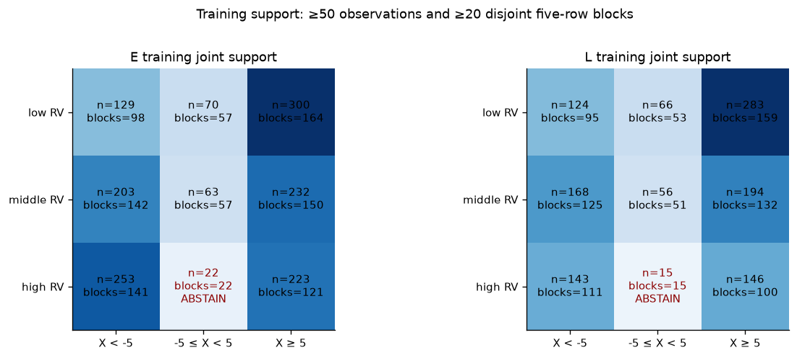
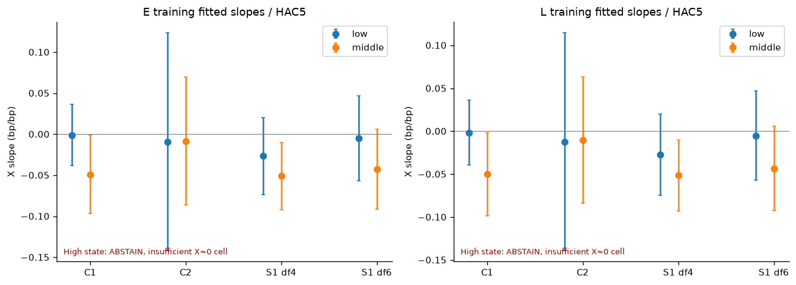
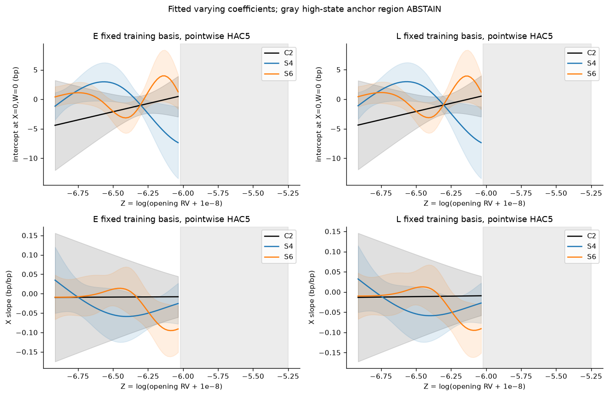
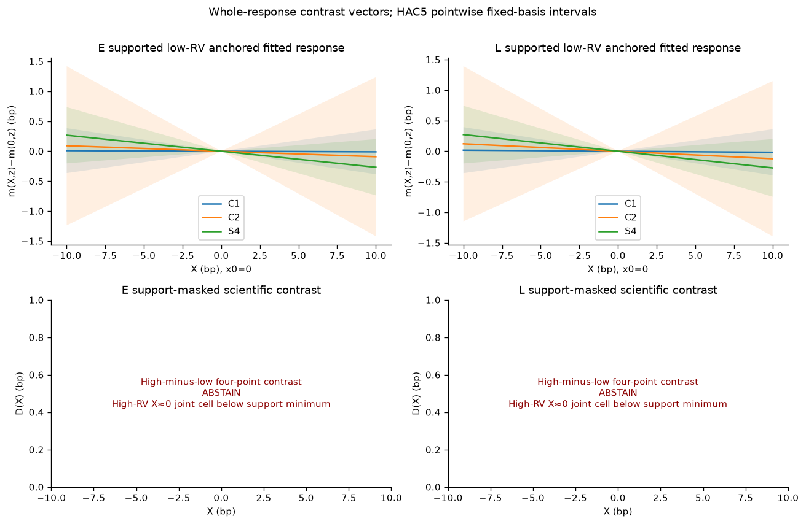
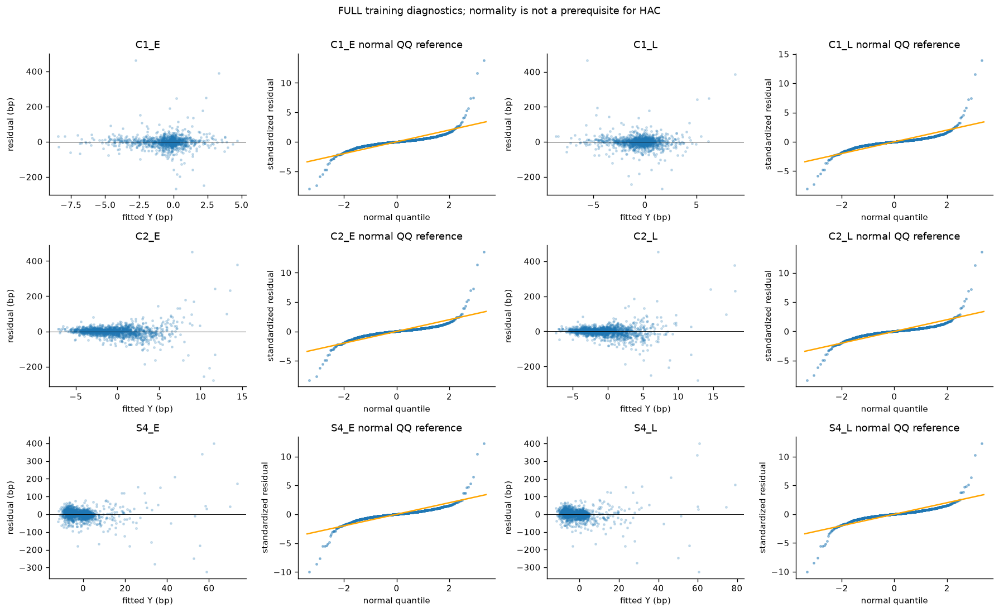
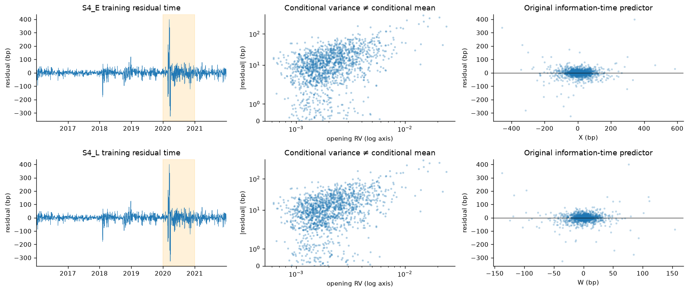
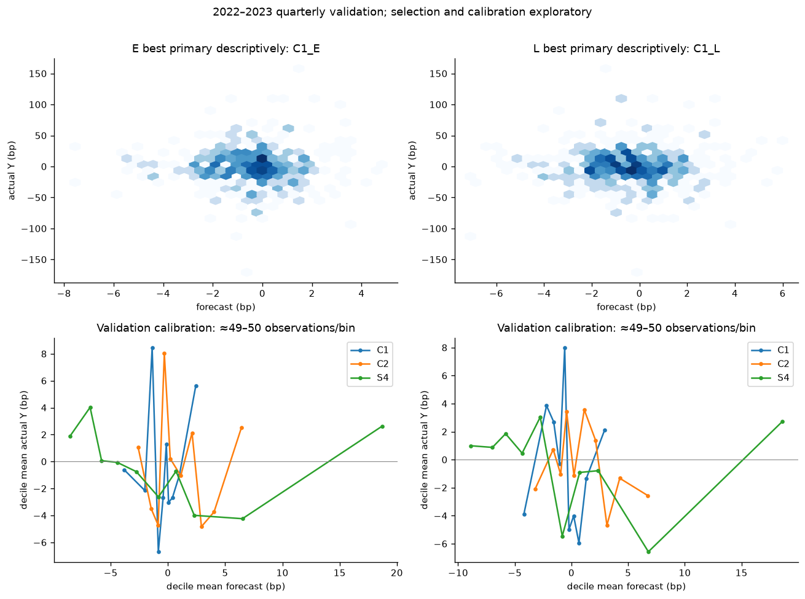
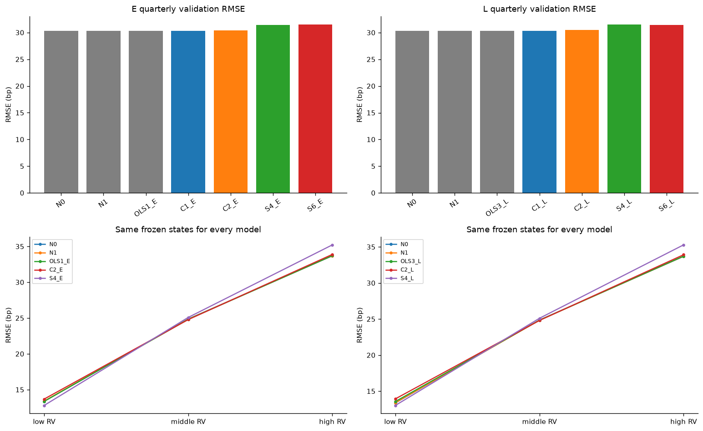

# Experiment B Stage2A — state-dependent linear and varying-coefficient splines

**PASS WITH QUALIFICATIONS.** Completed C1,C2 and two S1 complexities for E10:00/L15:30, including optional labeled W moderation, naive and state-blind references. 13 FULL regression candidates (10 state specifications,3 OLS references),2 naive rules. Training1,495 eligible dates2016-01-05–2021-12-31; validation497 eligible dates2022–2023; sealed683 dates received metadata/hash checks only. No EBM, source download, extra indicator, target/split change or trading analysis.

**Executive validation finding:** E: C1_E vs N0, quarterly loss gain -1.348bp², CI[-10.745,8.049], ABSTAIN_SUPERIORITY; L: C1_L vs N0, quarterly loss gain -3.383bp², CI[-16.064,9.297], ABSTAIN_SUPERIORITY. Minimum observed MSE does not establish superiority. FULL stays primary regardless of exclusion results. These validation years are now development/model-comparison data and will be reused for EBMs; no independent final confirmation is claimed.

**Plain-language verdict: no convincing incremental benefit is established for C1/C2/S1 here.** None of the six predeclared training tests survives Holm adjustment. C1 is the best primary state-model benchmark descriptively, while the zero forecast has lower quarterly validation error and the splines lose more. Some fixed-fit late-model deletion/Huber sensitivities improve error, documenting instability rather than permission to replace FULL. Conditional variance remains strongly state-dependent even when the fitted mean is not predictively useful.

## Frozen source, design and baseline check

Single canonical daily table B_SPY_daily_split_source1_stage1_v1: immutable Alpaca SIP adjustment=split D2 plus exactly39 native-price source1 missing-key repairs. D2.1b never combined. X includes overnight and ends10:00; W is15:00–15:30; Y15:30–16:00, simple returns×10,000bp. Opening30minute RV and log(RV+1e−8) unchanged. E never uses W; L adds information and is not a model-only advantage over E.

Stage1 **57 coefficient/lag rows reproduce**, maximum numeric difference4.44e-16. March18,2020 five original price anchors and scalar return/RV calculation match the daily table. Its14minute12:57–13:10 gap lies outside required windows and is not a reason to discard the day. Actual prices stay in a tiny ignored, hashed audit; no raw vendor export in Git. Source-era/modern period, TAQ/vendor trade-count, native community adjustment/rights and actual split-event limitations remain as in the source crosswalk.

Protocol version2 froze preprocessing and choices before fitting/validation labels. A pre-fit wording clarification preserves original2016–2021 categorical cutoffs for **all** validation, including quarterly; earlier draft retained. Quarterly centering/spline knots/scales use strictly earlier history. No fitted-curve or validation-driven change to grids/variants.

Exact models (explicit intercept):

- C1-E: 1+X+D_M+D_H+XD_M+XD_H, low reference. C1-L adds common W; C1-L-Wmod additionally WD_M,WD_H.
- C2-E: 1+X+Zc+XZc, with Zc=Z−training median. C2-L adds common W; C2-L-Wmod additionally WZc.
- S1: natural restricted cubic spans of dimensions4(primary) or6(sensitivity) for both intercept and X slope. Matrices contain literal C2 columns plus K−2 curvature columns H_j and XH_j; E ranks8/12,L9/13. L common W. No extra W spline, penalization or model-family search.
- N0=0. N1 is daily expanding past eligible-target mean: first training prediction0 then prior targets; validation initialized from training and updated only after each prior validation close. Same causal N1 denominator for fixed/quarterly. OLS1-E,OLS3-L and OLS2-L retained.

[Exact methods/model registry](../../docs/experiment_B_stage2A_methods_and_model_registry.md) defines knots, basis normalization, linear tails, dates, units and covariance. [Protocol](../../config/B_stage2A_linear_spline_protocol.json) and manifest preserve numerical preprocessing and all attempts. No silent rank/column deletion.

## Training fit and parameter inference

| model_id | info | n | parameters | rank | condition | r_squared | adjusted_r_squared | fit_seconds |
| --- | --- | --- | --- | --- | --- | --- | --- | --- |
| C1_E | E | 1495 | 6 | 6 | 330.35 | 0.00182969 | -0.00152212 | 0.00727646 |
| C2_E | E | 1495 | 4 | 4 | 183.399 | 0.00804528 | 0.00604939 | 0.00665112 |
| S4_E | E | 1495 | 8 | 8 | 2764.04 | 0.0572355 | 0.0527974 | 0.00698712 |
| S6_E | E | 1495 | 12 | 12 | 73507.4 | 0.0853784 | 0.0785943 | 0.012467 |
| C1_L | L | 1495 | 7 | 7 | 330.389 | 0.00240994 | -0.0016126 | 0.00980037 |
| C2_L | L | 1495 | 5 | 5 | 183.424 | 0.00861791 | 0.00595648 | 0.00895342 |
| S4_L | L | 1495 | 9 | 9 | 2764.43 | 0.0580387 | 0.0529676 | 0.00672096 |
| S6_L | L | 1495 | 13 | 13 | 73530.5 | 0.0857011 | 0.0782979 | 0.0140598 |
| C1_L_Wmod | L | 1495 | 9 | 9 | 331.228 | 0.00355125 | -0.00181321 | 0.0227199 |
| C2_L_Wmod | L | 1495 | 6 | 6 | 183.8 | 0.0443016 | 0.0410924 | 0.00897725 |
| OLS1_E | E | 1495 | 2 | 2 | 69.2628 | 0.000711736 | 4.24201e-05 | 0.00453729 |
| OLS3_L | L | 1495 | 3 | 3 | 69.2691 | 0.00121251 | -0.000126347 | 0.00883917 |
| OLS2_L | L | 1495 | 2 | 2 | 19.883 | 0.000522399 | -0.000147043 | 0.010371 |

| model_id | n | RMSE | MAE | MSE | bias | R2_N0 | R2_causal_N1 | Pearson | directional_accuracy | p95_absolute_error |
| --- | --- | --- | --- | --- | --- | --- | --- | --- | --- | --- |
| C1_E | 1495 | 33.4684 | 17.8575 | 1120.13 | 6.08358e-16 | 0.00201088 | 0.00499838 | 0.0427749 | 0.519064 | 53.7207 |
| C2_E | 1495 | 33.364 | 18.1026 | 1113.16 | 1.52089e-16 | 0.00822534 | 0.0111942 | 0.0896955 | 0.492977 | 54.6063 |
| S4_E | 1495 | 32.5263 | 17.9829 | 1057.96 | 6.31171e-15 | 0.0574066 | 0.0602283 | 0.239239 | 0.507692 | 52.9558 |
| S6_E | 1495 | 32.0371 | 17.6111 | 1026.38 | -6.51703e-14 | 0.0855444 | 0.0882818 | 0.292196 | 0.511037 | 52.2926 |
| C1_L | 1495 | 33.4587 | 17.8901 | 1119.48 | -1.21672e-15 | 0.00259103 | 0.00557678 | 0.0490911 | 0.517057 | 54.3882 |
| C2_L | 1495 | 33.3544 | 18.1242 | 1112.52 | 4.56268e-16 | 0.00879787 | 0.011765 | 0.0928327 | 0.490301 | 54.3259 |
| S4_L | 1495 | 32.5124 | 18.0069 | 1057.06 | -1.0152e-14 | 0.0582097 | 0.061029 | 0.240912 | 0.511037 | 53.5368 |
| S6_L | 1495 | 32.0315 | 17.6283 | 1026.02 | -4.16725e-14 | 0.085867 | 0.0886035 | 0.292747 | 0.513043 | 52.2241 |
| C1_L_Wmod | 1495 | 33.4395 | 17.9135 | 1118.2 | 1.52089e-16 | 0.00373213 | 0.00671447 | 0.0595924 | 0.512375 | 54.5053 |
| C2_L_Wmod | 1495 | 32.7486 | 18.2478 | 1072.47 | -1.78705e-15 | 0.0444751 | 0.0473355 | 0.21048 | 0.485619 | 53.7953 |
| OLS1_E | 1495 | 33.4872 | 17.8648 | 1121.39 | 3.04179e-16 | 0.000893132 | 0.00388397 | 0.0266784 | 0.514381 | 53.4308 |
| OLS3_L | 1495 | 33.4788 | 17.8926 | 1120.83 | -1.52089e-16 | 0.00139382 | 0.00438316 | 0.0348211 | 0.508361 | 53.6895 |
| OLS2_L | 1495 | 33.4903 | 17.9085 | 1121.6 | 1.52089e-16 | 0.00070383 | 0.00369524 | 0.0228561 | 0.479599 | 54.31 |
| N0 | 1495 | 33.5021 | 17.8769 | 1122.39 | 0.451379 | 0 | 0.00299351 | — | 0.0100334 | 54.4178 |
| N1 | 1495 | 33.5524 | 17.9325 | 1125.76 | 0.249682 | -0.0030025 | 0 | -0.0208634 | 0.487625 | 54.8007 |

Ordinary OLS SE are descriptive; primary Bartlett HAC5 uses n/(n−k) and normal two-sided95% CI/p, with HC3 and HAC10/20. Ordinary comparator CIs also use normal reference for consistency. Lag unit is surviving eligible daily observations. Severe tail/dependence/influence findings do not disappear by adding state functions; no test proves exogeneity/finite moments/weak dependence.

Six predeclared tests, Holm-adjusted across C1 X-state joint, C2 XZ and lower-df spline f/g curvature versus nestedC2, separately E/L:

| model_id | contrast | df | statistic | p_value | holm_p_value | status |
| --- | --- | --- | --- | --- | --- | --- |
| C1_E | X_state_moderation | 2 | 2.66912 | 0.263274 | 1 | COMPUTED |
| C2_E | X_state_moderation | 1 | 0.000596544 | 0.980514 | 1 | COMPUTED |
| S4_E | curvature_vs_C2 | 4 | 6.96615 | 0.137688 | 0.817361 | COMPUTED |
| C1_L | X_state_moderation | 2 | 2.69008 | 0.260529 | 1 | COMPUTED |
| C2_L | X_state_moderation | 1 | 0.00401168 | 0.949498 | 1 | COMPUTED |
| S4_L | curvature_vs_C2 | 4 | 6.9936 | 0.136227 | 0.817361 | COMPUTED |

Additional overall, pure-g curvature, nonconstant slope, optional W moderation and fixed2020 tests are exploratory:

| model_id | contrast | df | statistic | p_value | status |
| --- | --- | --- | --- | --- | --- |
| C1_E | overall_slopes | 5 | 4.58213 | 0.46897 | COMPUTED |
| C2_E | overall_slopes | 3 | 2.00216 | 0.571959 | COMPUTED |
| S4_E | overall_slopes | 7 | 12.8712 | 0.0753101 | COMPUTED |
| S4_E | X_state_moderation | 3 | 3.82135 | 0.281413 | COMPUTED |
| S4_E | X_slope_curvature | 2 | 3.69105 | 0.157943 | COMPUTED |
| S6_E | overall_slopes | 11 | 19.1811 | 0.0579193 | COMPUTED |
| S6_E | curvature_vs_C2 | 8 | 13.2122 | 0.104754 | COMPUTED |
| S6_E | X_state_moderation | 5 | 8.4726 | 0.132042 | COMPUTED |
| S6_E | X_slope_curvature | 4 | 8.42926 | 0.0770607 | COMPUTED |
| C1_L | overall_slopes | 6 | 4.66632 | 0.587266 | COMPUTED |
| C2_L | overall_slopes | 4 | 2.69181 | 0.610648 | COMPUTED |
| S4_L | overall_slopes | 8 | 12.9971 | 0.111949 | COMPUTED |
| S4_L | X_state_moderation | 3 | 3.8206 | 0.281499 | COMPUTED |
| S4_L | X_slope_curvature | 2 | 3.70671 | 0.15671 | COMPUTED |
| S6_L | overall_slopes | 12 | 19.1266 | 0.0855196 | COMPUTED |
| S6_L | curvature_vs_C2 | 8 | 13.3438 | 0.100554 | COMPUTED |
| S6_L | X_state_moderation | 5 | 8.45427 | 0.132913 | COMPUTED |
| S6_L | X_slope_curvature | 4 | 8.40046 | 0.0779625 | COMPUTED |
| C1_L_Wmod | overall_slopes | 8 | 5.61325 | 0.690463 | COMPUTED |
| C1_L_Wmod | X_state_moderation | 2 | 2.4103 | 0.299648 | COMPUTED |
| C1_L_Wmod | W_state_moderation | 2 | 1.47122 | 0.479213 | COMPUTED |
| C2_L_Wmod | overall_slopes | 5 | 9.18942 | 0.101743 | COMPUTED |
| C2_L_Wmod | X_state_moderation | 1 | 0.418998 | 0.517437 | COMPUTED |
| C2_L_Wmod | W_state_moderation | 1 | 3.35526 | 0.0669907 | COMPUTED |
| OLS1_E | overall_slopes | 1 | 0.180328 | 0.671092 | COMPUTED |
| OLS3_L | overall_slopes | 2 | 0.263493 | 0.876563 | COMPUTED |
| OLS2_L | overall_slopes | 1 | 0.0824103 | 0.774057 | COMPUTED |
| C2_E | 2020_X_slope_break | 1 | 0.896485 | 0.343726 | COMPUTED |
| C2_L | 2020_X_slope_break | 1 | 0.895134 | 0.34409 | COMPUTED |

Selected original/categorical interaction parameters, HAC5. These are **fixed-model projection coefficients**: C1 X_DH is its high-minus-low slope restriction, not an observed raw X0 cell mean. Unsupported raw anchored contrasts below remain ABSTAIN.

| model_id | term | estimate | se | ci_low | ci_high | p_value |
| --- | --- | --- | --- | --- | --- | --- |
| C1_E | X | -0.000968466 | 0.019112 | -0.0384272 | 0.0364903 | 0.959586 |
| C1_E | X_DM | -0.0482059 | 0.0299291 | -0.106866 | 0.0104542 | 0.107253 |
| C1_E | X_DH | -0.00665008 | 0.0425233 | -0.0899942 | 0.076694 | 0.875728 |
| C2_E | X | -0.00841102 | 0.0398816 | -0.0865776 | 0.0697555 | 0.832966 |
| C2_E | X_Zc | 0.00175354 | 0.0717949 | -0.138962 | 0.142469 | 0.980514 |
| S4_E | X | -0.0511162 | 0.0208843 | -0.0920486 | -0.0101837 | 0.0143816 |
| S4_E | X_Zc | 0.00673992 | 0.0247832 | -0.0418343 | 0.0553142 | 0.785657 |
| S6_E | X | -0.0428236 | 0.024846 | -0.0915208 | 0.00587367 | 0.0847872 |
| S6_E | X_Zc | 0.00301147 | 0.0219205 | -0.0399518 | 0.0459748 | 0.890729 |
| C1_L | X | -0.00171838 | 0.0192058 | -0.0393611 | 0.0359244 | 0.928707 |
| C1_L | X_DM | -0.0484769 | 0.0300513 | -0.107376 | 0.0104226 | 0.106715 |
| C1_L | X_DH | -0.00537427 | 0.0427821 | -0.0892256 | 0.0784771 | 0.900033 |
| C1_L | W | -0.0406778 | 0.134049 | -0.303408 | 0.222053 | 0.761543 |
| C2_L | X | -0.0103639 | 0.0374593 | -0.0837829 | 0.063055 | 0.782032 |
| C2_L | X_Zc | 0.00445157 | 0.070283 | -0.133301 | 0.142204 | 0.949498 |
| C2_L | W | -0.0408334 | 0.126745 | -0.28925 | 0.207583 | 0.747325 |
| S4_L | X | -0.0516664 | 0.0211139 | -0.0930489 | -0.0102838 | 0.014404 |
| S4_L | X_Zc | 0.00750858 | 0.0254233 | -0.0423202 | 0.0573373 | 0.767732 |
| S4_L | W | -0.0486901 | 0.10979 | -0.263874 | 0.166494 | 0.657416 |
| S6_L | X | -0.0432736 | 0.0250448 | -0.0923605 | 0.00581321 | 0.0840149 |
| S6_L | X_Zc | 0.00350098 | 0.0225911 | -0.0407767 | 0.0477786 | 0.876843 |
| S6_L | W | -0.0309545 | 0.102246 | -0.231353 | 0.169444 | 0.762084 |
| C1_L_Wmod | X | -0.00178783 | 0.019223 | -0.0394641 | 0.0358885 | 0.9259 |
| C1_L_Wmod | X_DM | -0.0450754 | 0.0295968 | -0.103084 | 0.0129333 | 0.127763 |
| C1_L_Wmod | X_DH | -0.00496739 | 0.0427102 | -0.0886778 | 0.078743 | 0.907411 |
| C1_L_Wmod | W | -0.044445 | 0.0968958 | -0.234357 | 0.145467 | 0.646458 |
| C1_L_Wmod | W_DM | 0.136521 | 0.127162 | -0.112712 | 0.385754 | 0.283003 |
| C1_L_Wmod | W_DH | -0.0223338 | 0.196124 | -0.40673 | 0.362062 | 0.909336 |
| C2_L_Wmod | X | -0.0263036 | 0.0305555 | -0.0861913 | 0.0335841 | 0.389323 |
| C2_L_Wmod | X_Zc | 0.0409903 | 0.063325 | -0.0831244 | 0.165105 | 0.517437 |
| C2_L_Wmod | W | 0.306282 | 0.124976 | 0.061333 | 0.551231 | 0.014257 |
| C2_L_Wmod | W_Zc | -0.45241 | 0.246984 | -0.936491 | 0.0316703 | 0.0669907 |
| OLS1_E | X | -0.0130066 | 0.030629 | -0.0730385 | 0.0470252 | 0.671092 |
| OLS3_L | X | -0.0128096 | 0.0306374 | -0.0728578 | 0.0472386 | 0.675872 |
| OLS3_L | W | -0.037716 | 0.132585 | -0.297578 | 0.222146 | 0.776053 |
| OLS2_L | W | -0.0385155 | 0.134167 | -0.301477 | 0.224446 | 0.774057 |

All intercepts/basis/original/interaction coefficients with ordinary/HC3/HAC5/10/20 are in B_stage2A_coefficients.csv. Correct whole-row contrast covariance vΣv′ is used; no subtraction of CI endpoints, and no comparison of bin p-values to establish a cross-bin difference.

## Supported response/slopes and abstentions

Frozen raw RV cutoffs[0.001558374721607106, 0.0024281183976187152], equality lower bin; Zref=-6.257012700074515; within-tercile median Z=[-6.673927481801225, -6.256791269350911, -5.709473991823623]. X0=0; symmetric ±10.0bp chosen strictly inside common training within-state10–90percentile range. L W0=0 screened within training central80% Wband[-16.620280276007815, 18.84402635020036].

| info | state | x_cell | n | blocks | supported | strong_support |
| --- | --- | --- | --- | --- | --- | --- |
| E | low | negative | 129 | 98 | True | True |
| E | low | zero | 70 | 57 | True | False |
| E | low | positive | 300 | 164 | True | True |
| E | middle | negative | 203 | 142 | True | True |
| E | middle | zero | 63 | 57 | True | False |
| E | middle | positive | 232 | 150 | True | True |
| E | high | negative | 253 | 141 | True | True |
| E | high | zero | 22 | 22 | False | False |
| E | high | positive | 223 | 121 | True | True |
| L | low | negative | 124 | 95 | True | True |
| L | low | zero | 66 | 53 | True | False |
| L | low | positive | 283 | 159 | True | True |
| L | middle | negative | 168 | 125 | True | True |
| L | middle | zero | 56 | 51 | True | False |
| L | middle | positive | 194 | 132 | True | True |
| L | high | negative | 143 | 111 | True | True |
| L | high | zero | 15 | 15 | False | False |
| L | high | positive | 146 | 100 | True | True |

Pragmatic exploratory minimum50 observations/20nonoverlapping five-eligible-row blocks; strong100/30. **High-RV X≈0 has only22 E and15 L observations**. The grid was not widened after that discovery. Hence high-minus-low anchored scientific four-point contrasts ABSTAIN; 350 support-abstained rows. Model projections remain estimable under parametric assumptions, but unsupported raw-cell claims/confident lines are withheld. Low/middle fitted slopes and whole-response/anchored comparisons with pointwise HAC fixed-basis CIs:

| model_id | contrast | state | estimate | se | ci_low | ci_high | p_value | status |
| --- | --- | --- | --- | --- | --- | --- | --- | --- |
| C1_E | X_slope | low | -0.000968466 | 0.019112 | -0.0384272 | 0.0364903 | 0.959586 | COMPUTED |
| C1_E | intercept_at_X0_W0 | low | -0.0692462 | 0.60299 | -1.25108 | 1.11259 | 0.908573 | COMPUTED |
| C1_E | X_slope | middle | -0.0491743 | 0.0242644 | -0.0967317 | -0.00161692 | 0.0427032 | COMPUTED |
| C1_E | intercept_at_X0_W0 | middle | -0.792974 | 0.862018 | -2.4825 | 0.89655 | 0.357623 | COMPUTED |
| C1_E | X_slope | high | — | — | — | — | — | ABSTAIN |
| C1_E | intercept_at_X0_W0 | high | — | — | — | — | — | ABSTAIN |
| C1_E | high_minus_low_X_slope | — | — | — | — | — | — | ABSTAIN |
| C2_E | X_slope | low | -0.00914209 | 0.0677896 | -0.142007 | 0.123723 | 0.892723 | COMPUTED |
| C2_E | intercept_at_X0_W0 | low | -3.08281 | 2.47878 | -7.94114 | 1.77551 | 0.213618 | COMPUTED |
| C2_E | X_slope | middle | -0.00841063 | 0.0398676 | -0.0865497 | 0.0697284 | 0.832915 | COMPUTED |
| C2_E | intercept_at_X0_W0 | middle | -0.762809 | 0.836071 | -2.40148 | 0.875861 | 0.361572 | COMPUTED |
| C2_E | X_slope | high | — | — | — | — | — | ABSTAIN |
| C2_E | intercept_at_X0_W0 | high | — | — | — | — | — | ABSTAIN |
| C2_E | high_minus_low_X_slope | — | — | — | — | — | — | ABSTAIN |
| S4_E | X_slope | low | -0.0267444 | 0.023971 | -0.0737268 | 0.0202379 | 0.264551 | COMPUTED |
| S4_E | intercept_at_X0_W0 | low | 2.42602 | 1.40055 | -0.319012 | 5.17106 | 0.08324 | COMPUTED |
| S4_E | X_slope | middle | -0.0510951 | 0.0208668 | -0.0919934 | -0.0101969 | 0.0143401 | COMPUTED |
| S4_E | intercept_at_X0_W0 | middle | -2.23586 | 1.0591 | -4.31165 | -0.160065 | 0.034764 | COMPUTED |
| S4_E | X_slope | high | — | — | — | — | — | ABSTAIN |
| S4_E | intercept_at_X0_W0 | high | — | — | — | — | — | ABSTAIN |
| S4_E | high_minus_low_X_slope | — | — | — | — | — | — | ABSTAIN |
| S6_E | X_slope | low | -0.00487166 | 0.0262768 | -0.0563733 | 0.04663 | 0.852917 | COMPUTED |
| S6_E | intercept_at_X0_W0 | low | 0.866946 | 0.903915 | -0.904695 | 2.63859 | 0.337508 | COMPUTED |
| S6_E | X_slope | middle | -0.0429319 | 0.0248441 | -0.0916254 | 0.00576164 | 0.0839788 | COMPUTED |
| S6_E | intercept_at_X0_W0 | middle | 0.929322 | 1.13913 | -1.30332 | 3.16197 | 0.414603 | COMPUTED |
| S6_E | X_slope | high | — | — | — | — | — | ABSTAIN |
| S6_E | intercept_at_X0_W0 | high | — | — | — | — | — | ABSTAIN |
| S6_E | high_minus_low_X_slope | — | — | — | — | — | — | ABSTAIN |
| C1_L | X_slope | low | -0.00171838 | 0.0192058 | -0.0393611 | 0.0359244 | 0.928707 | COMPUTED |
| C1_L | intercept_at_X0_W0 | low | -0.0374157 | 0.61273 | -1.23835 | 1.16351 | 0.951308 | COMPUTED |
| C1_L | X_slope | middle | -0.0501953 | 0.0245808 | -0.0983728 | -0.00201781 | 0.0411463 | COMPUTED |
| C1_L | intercept_at_X0_W0 | middle | -0.814943 | 0.864734 | -2.50979 | 0.879904 | 0.345978 | COMPUTED |
| C1_L | X_slope | high | — | — | — | — | — | ABSTAIN |
| C1_L | intercept_at_X0_W0 | high | — | — | — | — | — | ABSTAIN |
| C1_L | high_minus_low_X_slope | — | — | — | — | — | — | ABSTAIN |
| C2_L | X_slope | low | -0.0122199 | 0.0647817 | -0.13919 | 0.11475 | 0.850382 | COMPUTED |
| C2_L | intercept_at_X0_W0 | low | -3.04668 | 2.43109 | -7.81153 | 1.71816 | 0.210127 | COMPUTED |
| C2_L | X_slope | middle | -0.010363 | 0.0374456 | -0.083755 | 0.0630291 | 0.781975 | COMPUTED |
| C2_L | intercept_at_X0_W0 | middle | -0.726918 | 0.822344 | -2.33868 | 0.884847 | 0.376719 | COMPUTED |
| C2_L | X_slope | high | — | — | — | — | — | ABSTAIN |
| C2_L | intercept_at_X0_W0 | high | — | — | — | — | — | ABSTAIN |
| C2_L | high_minus_low_X_slope | — | — | — | — | — | — | ABSTAIN |
| S4_L | X_slope | low | -0.0272338 | 0.0240677 | -0.0744056 | 0.019938 | 0.257824 | COMPUTED |
| S4_L | intercept_at_X0_W0 | low | 2.44582 | 1.40185 | -0.301748 | 5.1934 | 0.0810346 | COMPUTED |
| S4_L | X_slope | middle | -0.0516468 | 0.0210969 | -0.0929959 | -0.0102976 | 0.0143622 | COMPUTED |
| S4_L | intercept_at_X0_W0 | middle | -2.24371 | 1.05969 | -4.32067 | -0.166742 | 0.0342333 | COMPUTED |
| S4_L | X_slope | high | — | — | — | — | — | ABSTAIN |
| S4_L | intercept_at_X0_W0 | high | — | — | — | — | — | ABSTAIN |
| S4_L | high_minus_low_X_slope | — | — | — | — | — | — | ABSTAIN |
| S6_L | X_slope | low | -0.00530275 | 0.0264706 | -0.0571843 | 0.0465788 | 0.841226 | COMPUTED |
| S6_L | intercept_at_X0_W0 | low | 0.885431 | 0.90983 | -0.897802 | 2.66867 | 0.330462 | COMPUTED |
| S6_L | X_slope | middle | -0.0433804 | 0.0250432 | -0.0924642 | 0.00570329 | 0.0832334 | COMPUTED |
| S6_L | intercept_at_X0_W0 | middle | 0.913884 | 1.14371 | -1.32774 | 3.15551 | 0.42426 | COMPUTED |
| S6_L | X_slope | high | — | — | — | — | — | ABSTAIN |
| S6_L | intercept_at_X0_W0 | high | — | — | — | — | — | ABSTAIN |
| S6_L | high_minus_low_X_slope | — | — | — | — | — | — | ABSTAIN |
| C1_L_Wmod | X_slope | low | -0.00178783 | 0.019223 | -0.0394641 | 0.0358885 | 0.9259 | COMPUTED |
| C1_L_Wmod | intercept_at_X0_W0 | low | -0.0344678 | 0.602239 | -1.21483 | 1.1459 | 0.95436 | COMPUTED |
| C1_L_Wmod | X_slope | middle | -0.0468632 | 0.0237765 | -0.0934643 | -0.000262163 | 0.048725 | COMPUTED |
| C1_L_Wmod | intercept_at_X0_W0 | middle | -0.743248 | 0.855721 | -2.42043 | 0.933935 | 0.385086 | COMPUTED |
| C1_L_Wmod | X_slope | high | — | — | — | — | — | ABSTAIN |
| C1_L_Wmod | intercept_at_X0_W0 | high | — | — | — | — | — | ABSTAIN |
| C1_L_Wmod | high_minus_low_X_slope | — | — | — | — | — | — | ABSTAIN |
| C2_L_Wmod | X_slope | low | -0.0433931 | 0.0545035 | -0.150218 | 0.0634319 | 0.425944 | COMPUTED |
| C2_L_Wmod | intercept_at_X0_W0 | low | -2.59878 | 2.09681 | -6.70845 | 1.51088 | 0.215197 | COMPUTED |
| C2_L_Wmod | X_slope | middle | -0.0262945 | 0.0305439 | -0.0861594 | 0.0335704 | 0.389306 | COMPUTED |
| C2_L_Wmod | intercept_at_X0_W0 | middle | -0.477502 | 0.815366 | -2.07559 | 1.12059 | 0.558125 | COMPUTED |
| C2_L_Wmod | X_slope | high | — | — | — | — | — | ABSTAIN |
| C2_L_Wmod | intercept_at_X0_W0 | high | — | — | — | — | — | ABSTAIN |
| C2_L_Wmod | high_minus_low_X_slope | — | — | — | — | — | — | ABSTAIN |

Spline f and g include linear Z and nonlinear curvature explicitly; zero curvature nestsC2. Natural tails are linear outside first/last knot, never clipped. Validation predictor-only range/state/tail counts were computed before Y read and saved in the manifest. No raw conditional-mean derivative, causal effect, purification or EBM theorem is invoked.

Validation frozen-state occupancy is {'low': 31, 'middle': 151, 'high': 315}; spline boundary-tail counts are {'4': {'below': 5, 'above': 60, 'policy': 'linear tails, no clipping'}, '6': {'below': 5, 'above': 60, 'policy': 'linear tails, no clipping'}}. No validation Z exceeds the observed full-training Z range, while65 dates lie outside the inner boundary knots (linear tails). One validation W is below its full-training observed range. Per-quarter feature/extrapolation counts are separately registered for the past-only refits.

## Full regression diagnostics

Every FULL state/reference fit receives the adapted Stage1.5 battery; full numeric statistics/nulls/assumptions/status in B_stage2A_model_diagnostics.csv. Below are exploratory test-reference p-values:

| model_id | Koenker_BP_LM_p | White_LM_p | ARCH_LM_5_p | residual_LjungBox_5_p | squared_residual_LjungBox_5_p | Jarque_Bera_p | RESET_fitted_squared_HAC5_p | Pearson_kurtosis | max_leverage |
| --- | --- | --- | --- | --- | --- | --- | --- | --- | --- |
| C1_E | 2.97825e-08 | — | 6.74203e-124 | 7.04405e-12 | 1.41325e-192 | 0 | 0.151424 | 51.7927 | 0.0638596 |
| C2_E | 1.96525e-42 | — | 1.54442e-122 | 5.76681e-11 | 1.37846e-191 | 0 | 0.07446 | 48.7603 | 0.197128 |
| S4_E | 3.27529e-97 | — | 1.51925e-113 | 0.000337725 | 4.88307e-197 | 0 | — | 42.3976 | 0.306283 |
| S6_E | 1.59416e-106 | — | 3.96142e-104 | 0.00175769 | 2.10488e-195 | 0 | — | 42.6245 | 0.342062 |
| C1_L | 1.35654e-07 | — | 8.20609e-120 | 9.74324e-12 | 6.29411e-188 | 0 | 0.0555431 | 51.5671 | 0.0689566 |
| C2_L | 1.38751e-40 | — | 3.152e-119 | 6.40441e-11 | 1.95169e-187 | 0 | 0.0148384 | 48.5417 | 0.210806 |
| S4_L | 4.47202e-95 | — | 2.10316e-110 | 0.000359215 | 8.37288e-193 | 0 | — | 42.111 | 0.313875 |
| S6_L | 5.99617e-106 | — | 1.12251e-102 | 0.00177714 | 6.67984e-193 | 0 | — | 42.4413 | 0.347379 |
| C1_L_Wmod | 1.37276e-06 | — | 4.83953e-117 | 9.55418e-12 | 7.29865e-185 | 0 | 0.109103 | 51.5307 | 0.0788219 |
| C2_L_Wmod | 6.58394e-30 | — | 8.06523e-67 | 3.02333e-10 | 1.02661e-108 | 0 | 0.000419379 | 50.0278 | 0.286013 |
| OLS1_E | 0.00432723 | 3.37448e-67 | 3.29476e-123 | 9.41686e-12 | 7.07145e-192 | 0 | 0.0436892 | 51.8508 | 0.0480158 |
| OLS3_L | 0.0271378 | 8.14482e-126 | 2.49556e-119 | 1.27241e-11 | 1.97981e-187 | 0 | 9.81821e-05 | 51.6717 | 0.0621952 |
| OLS2_L | 0.450643 | 1.32485e-62 | 8.42006e-122 | 4.41517e-12 | 3.94489e-189 | 0 | 0.213913 | 51.3793 | 0.0406405 |

Koenker BP uses each original design. White uses SVD auxiliary rank−1 where nonsingular; expanded interaction/spline squares/products are algebraically rank-deficient, so those White p-values are explicitly NOT_APPLICABLE rather than reported as valid inference. Candidate forecast matrices themselves remain full rank. IID-asymptotic diagnostic p-values under dependence are reference checks. ARCH5 uses parameter-count ddof; residual and squared Ljung–Box5/10/20 model_df0, ACF1/5/10/20,DW, JB/skew/Pearson kurtosis/extreme quantiles retained. Underflowed p0 is not mathematically zero. Normality is not an OLS/HAC prerequisite; nonrejection cannot prove independence.

Residual versus fitted/X/W/Z fixed10-bin means(min20), absolute/squared residual–RV correlations, state and2016–19/2020/2021 residual means/SD are saved. **Conditional variance is not conditional-mean improvement:** absolute residual versus RV Spearman remains about0.369–0.413 across full fits. Full rank/condition, named non-spline VIF and design correlations are reported; individual spline VIF is parameterization-dependent. Linear/C1/C2 fitted-square HAC RESET is exploratory; rich S1 uses nested curvature instead. Fixed-grid spline-slope turning points and maximum projected slopes are registered as wiggle/extrapolation diagnostics, not fitted raw derivatives.

All FULL fits report Cook/leverage/internal studentization top5 and small fixed-basis exact single-delete changes in high-minus-low projection slope. New Stage2 rankings are diagnostic only, never deletion keys. Knot re-estimation uncertainty is not represented by fixed-basis influence.

## Outlier/stress/source and temporal sensitivity

Every C1/C2/S1 E/L (also higher-df/W variants) has FULL, DROP_TOP1(2020-03-18), DROP_TOP5(fixed Stage1.5 OLS1 ranking), EXCLUDE_2020 and MATCHED_SOURCE. Original preprocessing held fixed; all497validation days unchanged. HuberT1.345/MAD point comparisons for C1/C2/S4 and optional Wmod use different loss/estimand and no OLS/HAC claims. S6 Huber omitted as redundant sensitivity.

| model_id | variant | n | low_slope | middle_slope | high_slope | projection_high_low_slope | status |
| --- | --- | --- | --- | --- | --- | --- | --- |
| C1_E | DROP_TOP1 | 1494 | -0.000968466 | -0.0491743 | 0.0255316 | 0.0265 | ABSTAIN_RAW_CELL |
| C2_E | DROP_TOP1 | 1494 | -0.107721 | -0.0636736 | -0.0058802 | 0.10184 | ABSTAIN_RAW_CELL |
| S4_E | DROP_TOP1 | 1494 | -0.00251196 | -0.0392925 | -0.0569139 | -0.0544019 | ABSTAIN_RAW_CELL |
| S6_E | DROP_TOP1 | 1494 | 0.00906627 | -0.0343155 | -0.0615552 | -0.0706215 | ABSTAIN_RAW_CELL |
| C1_L | DROP_TOP1 | 1494 | 1.0837e-05 | -0.047841 | 0.0254426 | 0.0254317 | ABSTAIN_RAW_CELL |
| C2_L | DROP_TOP1 | 1494 | -0.106003 | -0.0625287 | -0.00548636 | 0.100517 | ABSTAIN_RAW_CELL |
| S4_L | DROP_TOP1 | 1494 | -0.00239717 | -0.0391865 | -0.0566532 | -0.054256 | ABSTAIN_RAW_CELL |
| S6_L | DROP_TOP1 | 1494 | 0.00930783 | -0.0340796 | -0.0610089 | -0.0703167 | ABSTAIN_RAW_CELL |
| C1_L_Wmod | DROP_TOP1 | 1494 | -0.00178783 | -0.0468632 | 0.025441 | 0.0272288 | ABSTAIN_RAW_CELL |
| C2_L_Wmod | DROP_TOP1 | 1494 | -0.11344 | -0.0659422 | -0.0036214 | 0.109818 | ABSTAIN_RAW_CELL |
| C1_E | DROP_TOP5 | 1490 | -0.000968466 | -0.0491743 | -0.0140645 | -0.013096 | ABSTAIN_RAW_CELL |
| C2_E | DROP_TOP5 | 1490 | -0.0484131 | -0.0359745 | -0.0196541 | 0.0287591 | ABSTAIN_RAW_CELL |
| S4_E | DROP_TOP5 | 1490 | -0.00810152 | -0.0402304 | -0.041492 | -0.0333904 | ABSTAIN_RAW_CELL |
| S6_E | DROP_TOP5 | 1490 | 0.00486261 | -0.0380375 | -0.0419057 | -0.0467683 | ABSTAIN_RAW_CELL |
| C1_L | DROP_TOP5 | 1490 | 0.000294084 | -0.0474554 | -0.0134268 | -0.0137209 | ABSTAIN_RAW_CELL |
| C2_L | DROP_TOP5 | 1490 | -0.0461553 | -0.0342849 | -0.0187099 | 0.0274454 | ABSTAIN_RAW_CELL |
| S4_L | DROP_TOP5 | 1490 | -0.00707878 | -0.0393598 | -0.0398948 | -0.032816 | ABSTAIN_RAW_CELL |
| S6_L | DROP_TOP5 | 1490 | 0.00605405 | -0.0369003 | -0.0398923 | -0.0459464 | ABSTAIN_RAW_CELL |
| C1_L_Wmod | DROP_TOP5 | 1490 | -0.00178783 | -0.0468632 | -0.0133721 | -0.0115843 | ABSTAIN_RAW_CELL |
| C2_L_Wmod | DROP_TOP5 | 1490 | -0.0482134 | -0.0350566 | -0.0177938 | 0.0304196 | ABSTAIN_RAW_CELL |
| C1_E | EXCLUDE_2020 | 1247 | -0.00347365 | -0.0455384 | -0.044207 | -0.0407333 | ABSTAIN_RAW_CELL |
| C2_E | EXCLUDE_2020 | 1247 | 0.00320756 | -0.0188261 | -0.0477362 | -0.0509438 | ABSTAIN_RAW_CELL |
| S4_E | EXCLUDE_2020 | 1247 | -0.0228139 | -0.0357948 | -0.0226996 | 0.000114343 | ABSTAIN_RAW_CELL |
| S6_E | EXCLUDE_2020 | 1247 | -0.0037756 | -0.0465638 | 0.00333713 | 0.00711273 | ABSTAIN_RAW_CELL |
| C1_L | EXCLUDE_2020 | 1247 | -0.0023331 | -0.0430357 | -0.0415541 | -0.039221 | ABSTAIN_RAW_CELL |
| C2_L | EXCLUDE_2020 | 1247 | 0.00255639 | -0.018007 | -0.0449878 | -0.0475442 | ABSTAIN_RAW_CELL |
| S4_L | EXCLUDE_2020 | 1247 | -0.0205881 | -0.0342813 | -0.0222587 | -0.00167053 | ABSTAIN_RAW_CELL |
| S6_L | EXCLUDE_2020 | 1247 | -0.0024686 | -0.0447993 | 0.00291517 | 0.00538377 | ABSTAIN_RAW_CELL |
| C1_L_Wmod | EXCLUDE_2020 | 1247 | -0.00383849 | -0.0436769 | -0.0407882 | -0.0369497 | ABSTAIN_RAW_CELL |
| C2_L_Wmod | EXCLUDE_2020 | 1247 | -0.000941928 | -0.0194356 | -0.0437008 | -0.0427589 | ABSTAIN_RAW_CELL |
| C1_E | MATCHED_SOURCE | 1493 | -0.000968466 | -0.0491743 | -0.00728924 | -0.00632078 | ABSTAIN_RAW_CELL |
| C2_E | MATCHED_SOURCE | 1493 | -0.00947239 | -0.0084434 | -0.00709328 | 0.0023791 | ABSTAIN_RAW_CELL |
| S4_E | MATCHED_SOURCE | 1493 | -0.0266849 | -0.0509005 | -0.000627255 | 0.0260577 | ABSTAIN_RAW_CELL |
| S6_E | MATCHED_SOURCE | 1493 | -0.00485296 | -0.0428497 | -0.00149103 | 0.00336193 | ABSTAIN_RAW_CELL |
| C1_L | MATCHED_SOURCE | 1493 | -0.0017246 | -0.0502038 | -0.00673701 | -0.00501241 | ABSTAIN_RAW_CELL |
| C2_L | MATCHED_SOURCE | 1493 | -0.0126006 | -0.0104181 | -0.00755461 | 0.00504596 | ABSTAIN_RAW_CELL |
| S4_L | MATCHED_SOURCE | 1493 | -0.0271951 | -0.0514604 | -0.00288548 | 0.0243096 | ABSTAIN_RAW_CELL |
| S6_L | MATCHED_SOURCE | 1493 | -0.00530539 | -0.0433229 | -0.00308266 | 0.00222274 | ABSTAIN_RAW_CELL |
| C1_L_Wmod | MATCHED_SOURCE | 1493 | -0.00178783 | -0.0468632 | -0.00638391 | -0.00459608 | ABSTAIN_RAW_CELL |
| C2_L_Wmod | MATCHED_SOURCE | 1493 | -0.0443265 | -0.0266224 | -0.0033931 | 0.0409334 | ABSTAIN_RAW_CELL |
| C1_E | HUBER | 1495 | -0.000420897 | -0.0381707 | -0.0223656 | -0.0219447 | POINT_ONLY |
| C2_E | HUBER | 1495 | -0.0240444 | -0.0230263 | -0.0216905 | 0.00235392 | POINT_ONLY |
| S4_E | HUBER | 1495 | -0.011493 | -0.0339812 | -0.0283088 | -0.0168159 | POINT_ONLY |
| C1_L | HUBER | 1495 | 0.000119468 | -0.0377154 | -0.0227376 | -0.0228571 | POINT_ONLY |
| C2_L | HUBER | 1495 | -0.0234596 | -0.02278 | -0.0218884 | 0.00157127 | POINT_ONLY |
| S4_L | HUBER | 1495 | -0.0109274 | -0.0336061 | -0.0286126 | -0.0176853 | POINT_ONLY |
| C1_L_Wmod | HUBER | 1495 | -0.00127139 | -0.0379823 | -0.0229284 | -0.021657 | POINT_ONLY |
| C2_L_Wmod | HUBER | 1495 | -0.022011 | -0.0212284 | -0.0202017 | 0.00180934 | POINT_ONLY |

These point slopes quantify fitted projection instability; unsupported raw-cell uncertainty is withheld. Fixed-validation error changes for every variant are in B_stage2A_validation_metrics.csv; FULL is not replaced based on favorable p/sign/error. Matched-source removes Aug12/13 only, preserving the hashed Stage1 proof of identical original scientific fields for1,493 training dates. No second original/patch daily dataset made.

| model_id | variant | n | RMSE | MSE | delta_RMSE_vs_FULL | delta_MSE_vs_FULL |
| --- | --- | --- | --- | --- | --- | --- |
| C1_E | DROP_TOP1 | 497 | 30.4321 | 926.111 | 0.1378 | 8.36807 |
| C1_L | DROP_TOP1 | 497 | 30.2101 | 912.649 | -0.299781 | -18.2027 |
| C1_L_Wmod | DROP_TOP1 | 497 | 30.2036 | 912.254 | -0.45737 | -27.8376 |
| C2_E | DROP_TOP1 | 497 | 30.7048 | 942.788 | 0.261521 | 15.9915 |
| C2_L | DROP_TOP1 | 497 | 30.5586 | 933.829 | -0.0981421 | -6.0078 |
| C2_L_Wmod | DROP_TOP1 | 497 | 31.0508 | 964.15 | -0.682994 | -42.8814 |
| S4_E | DROP_TOP1 | 497 | 31.5579 | 995.902 | -0.0728351 | -4.60235 |
| S4_L | DROP_TOP1 | 497 | 31.5205 | 993.544 | -0.364281 | -23.0974 |
| S6_E | DROP_TOP1 | 497 | 31.602 | 998.684 | -0.243258 | -15.434 |
| S6_L | DROP_TOP1 | 497 | 31.5332 | 994.345 | -0.466717 | -29.652 |
| C1_E | DROP_TOP5 | 497 | 30.3582 | 921.619 | 0.0639142 | 3.87655 |
| C1_L | DROP_TOP5 | 497 | 30.0691 | 904.15 | -0.440776 | -26.7018 |
| C1_L_Wmod | DROP_TOP5 | 497 | 30.0404 | 902.427 | -0.620493 | -37.6648 |
| C2_E | DROP_TOP5 | 497 | 30.3442 | 920.773 | -0.0990777 | -6.02269 |
| C2_L | DROP_TOP5 | 497 | 30.0623 | 903.739 | -0.594492 | -36.0969 |
| C2_L_Wmod | DROP_TOP5 | 497 | 30.477 | 928.846 | -1.25679 | -78.1861 |
| S4_E | DROP_TOP5 | 497 | 30.8 | 948.64 | -0.830754 | -51.8646 |
| S4_L | DROP_TOP5 | 497 | 30.5431 | 932.884 | -1.34167 | -83.7574 |
| S6_E | DROP_TOP5 | 497 | 30.8834 | 953.782 | -0.961866 | -60.3365 |
| S6_L | DROP_TOP5 | 497 | 30.6001 | 936.365 | -1.39986 | -87.6315 |
| C1_E | EXCLUDE_2020 | 497 | 30.5177 | 931.329 | 0.223424 | 13.5868 |
| C1_L | EXCLUDE_2020 | 497 | 30.1367 | 908.22 | -0.373176 | -22.6318 |
| C1_L_Wmod | EXCLUDE_2020 | 497 | 30.0307 | 901.841 | -0.63025 | -38.2509 |
| C2_E | EXCLUDE_2020 | 497 | 30.5727 | 934.693 | 0.129423 | 7.89689 |
| C2_L | EXCLUDE_2020 | 497 | 30.1795 | 910.801 | -0.477266 | -29.0351 |
| C2_L_Wmod | EXCLUDE_2020 | 497 | 29.899 | 893.948 | -1.83481 | -113.084 |
| S4_E | EXCLUDE_2020 | 497 | 30.6177 | 937.441 | -1.01309 | -63.0633 |
| S4_L | EXCLUDE_2020 | 497 | 30.2397 | 914.437 | -1.64514 | -102.204 |
| S6_E | EXCLUDE_2020 | 497 | 31.013 | 961.804 | -0.832261 | -52.3144 |
| S6_L | EXCLUDE_2020 | 497 | 30.6293 | 938.152 | -1.37069 | -85.845 |
| C1_E | HUBER | 497 | 30.3373 | 920.351 | 0.0430234 | 2.60857 |
| C1_L | HUBER | 497 | 30.201 | 912.101 | -0.308852 | -18.7507 |
| C1_L_Wmod | HUBER | 497 | 30.1014 | 906.093 | -0.559536 | -33.9987 |
| C2_E | HUBER | 497 | 30.3023 | 918.23 | -0.141012 | -8.56587 |
| C2_L | HUBER | 497 | 30.1742 | 910.485 | -0.482504 | -29.3512 |
| C2_L_Wmod | HUBER | 497 | 30.8707 | 953.003 | -0.863021 | -54.029 |
| S4_E | HUBER | 497 | 30.7979 | 948.509 | -0.832878 | -51.9954 |
| S4_L | HUBER | 497 | 30.6826 | 941.424 | -1.20218 | -75.2173 |
| C1_E | MATCHED_SOURCE | 497 | 30.2944 | 917.749 | 0.000107873 | 0.00653588 |
| C1_L | MATCHED_SOURCE | 497 | 30.5119 | 930.975 | 0.00202518 | 0.12358 |
| C1_L_Wmod | MATCHED_SOURCE | 497 | 30.6638 | 940.267 | 0.00285365 | 0.174999 |
| C2_E | MATCHED_SOURCE | 497 | 30.4495 | 927.173 | 0.00619371 | 0.377152 |
| C2_L | MATCHED_SOURCE | 497 | 30.6669 | 940.46 | 0.010175 | 0.623968 |
| C2_L_Wmod | MATCHED_SOURCE | 497 | 31.7554 | 1008.4 | 0.0216083 | 1.37189 |
| S4_E | MATCHED_SOURCE | 497 | 31.7056 | 1005.25 | 0.0749012 | 4.74397 |
| S4_L | MATCHED_SOURCE | 497 | 31.9752 | 1022.41 | 0.0903955 | 5.77266 |
| S6_E | MATCHED_SOURCE | 497 | 31.9346 | 1019.82 | 0.0893866 | 5.70106 |
| S6_L | MATCHED_SOURCE | 497 | 32.103 | 1030.61 | 0.103098 | 6.60889 |

Predeclared2016–19,2020,2021 and leave-year-out C2/S4 E/L are stored with sample/period support, fixed basis, fit IDs and covariance. Short-period unsupported raw contrasts abstain; there is no optimized breakpoint/rolling-window search. C2's parsimonious fixed2020 intercept+X interaction controls original state terms/W.

| model_id | variant | n | low_slope | middle_slope | high_slope | status |
| --- | --- | --- | --- | --- | --- | --- |
| C1_E | 2016_2019 | 996 | -0.0120271 | -0.0251398 | -0.0250231 | ABSTAIN_RAW_CELL |
| C2_E | 2016_2019 | 996 | 0.00885724 | -0.00748411 | -0.0289253 | ABSTAIN_RAW_CELL |
| S4_E | 2016_2019 | 996 | -0.0290475 | -0.0252273 | 0.00746109 | ABSTAIN_RAW_CELL |
| C1_L | 2016_2019 | 996 | -0.0118639 | -0.0241122 | -0.0235948 | ABSTAIN_RAW_CELL |
| C2_L | 2016_2019 | 996 | 0.00786479 | -0.00747188 | -0.0275949 | ABSTAIN_RAW_CELL |
| S4_L | 2016_2019 | 996 | -0.0280934 | -0.0248766 | 0.00727002 | ABSTAIN_RAW_CELL |
| C1_E | 2020 | 248 | 0.0184216 | -0.0749765 | 0.0101405 | ABSTAIN_RAW_CELL |
| C2_E | 2020 | 248 | 0.0280654 | 0.0273169 | 0.0263349 | ABSTAIN_RAW_CELL |
| S4_E | 2020 | 248 | 0.389935 | -0.149332 | 0.0274807 | ABSTAIN_RAW_CELL |
| C1_L | 2020 | 248 | -0.01086 | -0.0742659 | 0.0200161 | ABSTAIN_RAW_CELL |
| C2_L | 2020 | 248 | -0.00881021 | 0.00236364 | 0.0170247 | ABSTAIN_RAW_CELL |
| S4_L | 2020 | 248 | 0.321076 | -0.13521 | 0.0155804 | ABSTAIN_RAW_CELL |
| C1_E | 2021 | 251 | 0.0350115 | -0.107169 | -0.104451 | ABSTAIN_RAW_CELL |
| C2_E | 2021 | 251 | 0.00973449 | -0.0455517 | -0.118092 | ABSTAIN_RAW_CELL |
| S4_E | 2021 | 251 | 0.00753532 | -0.0559623 | -0.108769 | ABSTAIN_RAW_CELL |
| C1_L | 2021 | 251 | 0.048191 | -0.0954539 | -0.0954188 | ABSTAIN_RAW_CELL |
| C2_L | 2021 | 251 | 0.0158081 | -0.037526 | -0.107505 | ABSTAIN_RAW_CELL |
| S4_L | 2021 | 251 | 0.0187602 | -0.0452226 | -0.102301 | ABSTAIN_RAW_CELL |

## Chronology-safe matched validation

Fixed models train only2016–2021. Quarterly Jan/Apr/Jul/Oct2022–2023 refits see only fully completed targets before each cutoff; original categorical cutoffs fixed, centering/spline transformations past-only. Every forecast stores cutoff and last target date; N1 uses prior days only.

| model_id | info | mode | n | RMSE | MAE | MSE | bias | R2_N0 | R2_causal_N1 | Pearson | directional_accuracy | p95_absolute_error |
| --- | --- | --- | --- | --- | --- | --- | --- | --- | --- | --- | --- | --- |
| C1_E | E | fixed | 497 | 30.2943 | 21.1941 | 917.743 | -0.111915 | 0.000829116 | 0.00129265 | 0.0324359 | 0.488934 | 60.6749 |
| C1_L | L | fixed | 497 | 30.5099 | 21.3091 | 930.852 | -0.122627 | -0.0134433 | -0.0129732 | -0.0743132 | 0.462777 | 61.5673 |
| C1_L_Wmod | L | fixed | 497 | 30.6609 | 21.418 | 940.092 | -0.153267 | -0.0235034 | -0.0230286 | -0.119432 | 0.478873 | 61.6025 |
| C2_E | E | fixed | 497 | 30.4433 | 21.48 | 926.796 | 2.03192 | -0.00902767 | -0.00855956 | 0.0182647 | 0.488934 | 60.8747 |
| C2_L | L | fixed | 497 | 30.6568 | 21.5866 | 939.836 | 2.02695 | -0.0232251 | -0.0227504 | -0.0522206 | 0.474849 | 61.4615 |
| C2_L_Wmod | L | fixed | 497 | 31.7338 | 22.0502 | 1007.03 | 1.7691 | -0.0963823 | -0.0958737 | -0.14835 | 0.452716 | 62.2874 |
| N0 | SHARED | fixed | 497 | 30.3068 | 21.1565 | 918.504 | 0.369287 | 0 | 0.000463921 | — | 0.00201207 | 60.5684 |
| N1 | SHARED | fixed | 497 | 30.3139 | 21.1507 | 918.93 | -0.0558734 | -0.000464137 | 0 | -0.106916 | 0.517103 | 60.9155 |
| OLS1_E | E | fixed | 497 | 30.2887 | 21.1998 | 917.403 | -0.00400941 | 0.00119879 | 0.00166215 | 0.0324614 | 0.480885 | 60.0924 |
| OLS2_L | L | fixed | 497 | 30.5046 | 21.2592 | 930.531 | -0.0977852 | -0.0130942 | -0.0126242 | -0.189154 | 0.488934 | 61.8246 |
| OLS3_L | L | fixed | 497 | 30.4869 | 21.299 | 929.452 | -0.0205598 | -0.011919 | -0.0114495 | -0.101272 | 0.468813 | 60.779 |
| S4_E | E | fixed | 497 | 31.6307 | 22.587 | 1000.5 | 0.493669 | -0.0892756 | -0.0887703 | -0.0111484 | 0.45674 | 62.9204 |
| S4_L | L | fixed | 497 | 31.8848 | 22.7261 | 1016.64 | 0.489347 | -0.106844 | -0.106331 | -0.0382481 | 0.462777 | 63.0799 |
| S6_E | E | fixed | 497 | 31.8452 | 22.5121 | 1014.12 | -0.527839 | -0.104098 | -0.103586 | 0.00718185 | 0.474849 | 64.8214 |
| S6_L | L | fixed | 497 | 32 | 22.601 | 1024 | -0.522917 | -0.114853 | -0.114336 | -0.00812747 | 0.482897 | 64.5863 |
| C1_E | E | quarterly | 497 | 30.3291 | 21.2616 | 919.852 | -0.101157 | -0.00146745 | -0.00100285 | 0.0138101 | 0.476861 | 60.6803 |
| C1_L | L | quarterly | 497 | 30.3626 | 21.2776 | 921.888 | -0.105671 | -0.0036837 | -0.00321807 | 0.00235348 | 0.462777 | 60.5051 |
| C1_L_Wmod | L | quarterly | 497 | 30.4469 | 21.3275 | 927.014 | -0.108053 | -0.00926522 | -0.008797 | -0.0337922 | 0.468813 | 61.5212 |
| C2_E | E | quarterly | 497 | 30.4328 | 21.4881 | 926.153 | 1.53082 | -0.0083278 | -0.00786001 | 0.0105495 | 0.466801 | 60.9359 |
| C2_L | L | quarterly | 497 | 30.469 | 21.5059 | 928.36 | 1.51083 | -0.01073 | -0.0102611 | 0.00454878 | 0.470825 | 61.9771 |
| C2_L_Wmod | L | quarterly | 497 | 31.4487 | 21.9043 | 989.019 | 1.35143 | -0.0767711 | -0.0762716 | -0.124078 | 0.454728 | 62.1884 |
| N0 | SHARED | quarterly | 497 | 30.3068 | 21.1565 | 918.504 | 0.369287 | 0 | 0.000463921 | — | 0.00201207 | 60.5684 |
| N1 | SHARED | quarterly | 497 | 30.3139 | 21.1507 | 918.93 | -0.0558734 | -0.000464137 | 0 | -0.106916 | 0.517103 | 60.9155 |
| OLS1_E | E | quarterly | 497 | 30.3128 | 21.2446 | 918.867 | 0.0293055 | -0.000395558 | 6.85469e-05 | 0.0178764 | 0.474849 | 60.2656 |
| OLS2_L | L | quarterly | 497 | 30.3321 | 21.1666 | 920.037 | -0.0675385 | -0.00166938 | -0.00120469 | -0.00934753 | 0.503018 | 61.0734 |
| OLS3_L | L | quarterly | 497 | 30.3321 | 21.2603 | 920.039 | 0.0242763 | -0.00167118 | -0.00120649 | 0.0132013 | 0.460765 | 60.2721 |
| S4_E | E | quarterly | 497 | 31.4271 | 22.3494 | 987.661 | 0.282856 | -0.0752928 | -0.0747939 | -0.0109606 | 0.474849 | 62.761 |
| S4_L | L | quarterly | 497 | 31.4867 | 22.3827 | 991.412 | 0.26534 | -0.0793766 | -0.0788759 | -0.0150245 | 0.466801 | 62.5951 |
| S6_E | E | quarterly | 497 | 31.4761 | 22.0817 | 990.743 | -0.635778 | -0.0786481 | -0.0781477 | 0.0205303 | 0.501006 | 64.7918 |
| S6_L | L | quarterly | 497 | 31.4607 | 22.066 | 989.776 | -0.651737 | -0.0775955 | -0.0770956 | 0.0259786 | 0.501006 | 63.0003 |

Bias=forecast−actual. Direction near zero exploratory; always-up/down and retrospective-majority baselines saved (latter explicitly descriptive). R² denominators name N0 and causal expandingN1. No financialP&L/cost/trade computation.

Supported prediction-decile calibration shows n; degenerate/tiny bins abstain. Validation state errors and absolute-error/forecast-magnitude correlations saved. All FULL/stress/Huber date predictions plus losses/differences againstOLS/N0/N1 in **one long Parquet**; no per-model input replicas. Paired mean comparator squared loss−candidate squared loss is positive for improvement. HAC5 and10/20 on a small spline subset:

| model_id | comparator | info | mode | n | mean_loss_gain | ci_low | ci_high | p_value |
| --- | --- | --- | --- | --- | --- | --- | --- | --- |
| C1_E | OLS1_E | E | fixed | 497 | -0.339545 | -4.5667 | 3.88761 | 0.874903 |
| C1_E | N0 | E | fixed | 497 | 0.761547 | -5.89934 | 7.42243 | 0.822691 |
| C2_E | OLS1_E | E | fixed | 497 | -9.39304 | -30.1798 | 11.3937 | 0.375801 |
| C2_E | N0 | E | fixed | 497 | -8.29195 | -30.1141 | 13.5302 | 0.456427 |
| S4_E | OLS1_E | E | fixed | 497 | -83.1011 | -145.427 | -20.7751 | 0.0089678 |
| S4_E | N0 | E | fixed | 497 | -82 | -145.472 | -18.5279 | 0.0113384 |
| S4_E | C1_E | E | fixed | 497 | -82.7616 | -145.16 | -20.3629 | 0.00933412 |
| C1_L | OLS3_L | L | fixed | 497 | -1.40015 | -6.06436 | 3.26406 | 0.55629 |
| C1_L | N0 | L | fixed | 497 | -12.3478 | -23.5791 | -1.11643 | 0.0311782 |
| C2_L | OLS3_L | L | fixed | 497 | -10.3847 | -31.0114 | 10.2419 | 0.323758 |
| C2_L | N0 | L | fixed | 497 | -21.3323 | -43.223 | 0.558298 | 0.0561362 |
| S4_L | OLS3_L | L | fixed | 497 | -87.1894 | -149.503 | -24.8759 | 0.00609936 |
| S4_L | N0 | L | fixed | 497 | -98.137 | -160.464 | -35.8098 | 0.00202833 |
| S4_L | C1_L | L | fixed | 497 | -85.7892 | -148.267 | -23.3113 | 0.00711846 |
| S4_L | OLS2_L | L | fixed | 497 | -86.1099 | -150.201 | -22.0188 | 0.00845554 |
| C1_E | OLS1_E | E | quarterly | 497 | -0.984541 | -4.38949 | 2.4204 | 0.570901 |
| C1_E | N0 | E | quarterly | 497 | -1.34786 | -10.745 | 8.04924 | 0.778614 |
| C2_E | OLS1_E | E | quarterly | 497 | -7.28579 | -26.578 | 12.0064 | 0.459184 |
| C2_E | N0 | E | quarterly | 497 | -7.64911 | -29.5716 | 14.2734 | 0.494062 |
| S4_E | OLS1_E | E | quarterly | 497 | -68.7934 | -127.669 | -9.91773 | 0.0220141 |
| S4_E | N0 | E | quarterly | 497 | -69.1567 | -129.256 | -9.05773 | 0.0241109 |
| S4_E | C1_E | E | quarterly | 497 | -67.8089 | -126.909 | -8.70919 | 0.0245257 |
| C1_L | OLS3_L | L | quarterly | 497 | -1.84851 | -5.42465 | 1.72763 | 0.31101 |
| C1_L | N0 | L | quarterly | 497 | -3.3835 | -16.0642 | 9.29722 | 0.601001 |
| C2_L | OLS3_L | L | quarterly | 497 | -8.32055 | -27.5684 | 10.9273 | 0.396848 |
| C2_L | N0 | L | quarterly | 497 | -9.85554 | -32.5762 | 12.8651 | 0.395229 |
| S4_L | OLS3_L | L | quarterly | 497 | -71.3728 | -129.991 | -12.755 | 0.0170122 |
| S4_L | N0 | L | quarterly | 497 | -72.9078 | -132.606 | -13.2095 | 0.0166819 |
| S4_L | C1_L | L | quarterly | 497 | -69.5243 | -128.479 | -10.5697 | 0.0208132 |
| S4_L | OLS2_L | L | quarterly | 497 | -71.3744 | -131.761 | -10.9878 | 0.0205258 |

Forecast-loss uncertainty differs from parameter inference. Candidate/comparator ranking on these same validation years introduces selection/multiplicity; intervals are exploratory, not independent confirmation. No broad block/bootstrap/permutation program was necessary.

## Decision and EBM handoff

| info | mode | descriptive_best_primary | best_reference | candidate_MSE | reference_MSE | mean_loss_gain | gain_ci_low | gain_ci_high | status |
| --- | --- | --- | --- | --- | --- | --- | --- | --- | --- |
| E | fixed | C1_E | OLS1_E | 917.743 | 917.403 | -0.339545 | -4.5667 | 3.88761 | ABSTAIN_SUPERIORITY |
| L | fixed | C1_L | N0 | 930.852 | 918.504 | -12.3478 | -23.5791 | -1.11643 | ABSTAIN_SUPERIORITY |
| E | quarterly | C1_E | N0 | 919.852 | 918.504 | -1.34786 | -10.745 | 8.04924 | ABSTAIN_SUPERIORITY |
| L | quarterly | C1_L | N0 | 921.888 | 918.504 | -3.3835 | -16.0642 | 9.29722 | ABSTAIN_SUPERIORITY |

Retain FULL state-aware/OLS and observed stronger naive benchmarks on the same dates. Weak/reversed slopes and diagnostic failures remain valid results, not targets to rescue. Carry heavy tails/dependence, crisis influence, finite support, extrapolation, source rights/native one-sided repair and selected-validation inference caveats.

**Ready for a separate Stage2B EBM task**: canonical rows, correct E/L features, original predictive cutoffs, fixed/quarterly schedules, untrimmed primary and naive/OLS/C1/C2/S1 benchmarks are now explicit. Use matched validation and preserve2024–September2026 for later sealed protocol; no EBM fitted here. Unsupported high-state X0 four-point claims need a separately predeclared supported future-stage design or continued ABSTAIN.

Machine artifacts: B_stage2A_models/coefficients/inference/model_diagnostics/support/validation_metrics/paired_loss_tests/sensitivity.csv, one predictionParquet, protocol and manifest. Every displayed number is traceable to these or input hashes/preprocessing in the protocol.
