# Experiment B Stage 2B — native EBM ladder, shape fidelity and inference

**PASS WITH QUALIFICATIONS — STAGE2B_MODEL_LADDER_COMPLETE.** All11 required native EBM families fitted, all562 planned component fits successful, with55 FULL family/seed fits and fixed plus identical497date quarterly validation. Training1495; validation497; sealed683unexamined. Negative/weak gains and unsupported contrasts are retained. E/L are different information sets and cannot be ranked as equal-information alternatives.

The interpretation is governed by matched additive, simple state-aware and naive comparators below. A lowest RMSE alone is not credible incremental EBM superiority. Validation is developmental/reused, not independent final confirmation. **E scientific raw shape: INCONCLUSIVE**, because adequate broad local-X×tercile cells do not certify continuous-point conditional means or fitted-model coverage. **L scientific shape: ABSTAIN**, because no declared joint X/RV/W candidate passes. No ±1bp environmental equivalence certification; no bagSD population intervals.

| info | primary_model | incremental_prediction | strongest_state_aware | simple_gain | simple_ci_low | simple_ci_high | strongest_naive_OLS | reference_gain | reference_ci_low | reference_ci_high | shape_status |
| --- | --- | --- | --- | --- | --- | --- | --- | --- | --- | --- | --- |
| E | A1c_E | NO_CREDIBLE_INCREMENT | C1_E | -16.5183 | -49.5802 | 16.5435 | N0 | -17.8662 | -52.264 | 16.5316 | INCONCLUSIVE_NOT_CERTIFIED_POINTWISE |
| L | A1c_L | NO_CREDIBLE_INCREMENT | C1_L | 5.08137 | -34.3036 | 44.4664 | N0 | 1.69787 | -37.642 | 41.0377 | ABSTAIN |

## Data, selection and fitting

Frozen source/daily identity2aa3e2df1cab897abd679ed9cbeff8f6fcb004ecc01a7b32c5938aa6c23b5c2f; source D2 SIPsplit plus exactly39 D2.1c native repairs, original shares/return/time fields unchanged. Match-source excludes2019Aug12/13 only; no new recovery. March18,2020 five prices independently verified at Stage2A; midday gap outside scientific windows does not justify deletion. Ordinary OLS Cook/leverage/DFBETA/adjustedR² are NOT_APPLICABLE to native EBMs; exact fixed-date/group refit influence used instead.

Two settings per family, training2016–2020→2021 developmental selection, selected once; five seeds and eight bags final. All features untrimmed, signedY unchanged. Screen/bagging/preprocessing caveats, exact formulas and graph in [methods registry](../../docs/experiment_B_stage2B_methods_and_model_registry.md). Original tercile cutoffs fixed for all validation, quarterly native bins use only past history. No indicators, new data, A, A3–A6, trading or sealed science.

## Train and validation evidence

Training metrics for every fit in training_metrics.csv, including in-sample mean-baselineR² and explicitly NOT_APPLICABLE OLS-adjustedR² in diagnostics. FULL training seed42:

| model_id | n | RMSE | MAE | in_sample_R2 | forecast_SD | forecast_min | forecast_max |
| --- | --- | --- | --- | --- | --- | --- | --- |
| SB_E | 1495 | 33.1827 | 17.85 | 0.0188015 | 2.14545 | -2.46435 | 11.1611 |
| A0c_E | 1495 | 32.6612 | 17.638 | 0.0493954 | 3.55375 | -5.4065 | 26.0238 |
| A0d_E | 1495 | 33.18 | 17.8297 | 0.0189574 | 2.06136 | -2.90587 | 10.3153 |
| A1d_E | 1495 | 33.1763 | 17.8267 | 0.0191763 | 2.06603 | -2.8011 | 10.2248 |
| A1c_E | 1495 | 32.5532 | 17.5987 | 0.0556762 | 3.90547 | -5.67388 | 30.708 |
| SB_L | 1495 | 33.1287 | 17.8168 | 0.0219883 | 1.69788 | -5.39334 | 11.5076 |
| A0c_L | 1495 | 32.7442 | 17.6089 | 0.0445627 | 3.47197 | -9.96405 | 19.9593 |
| A0d_L | 1495 | 33.1069 | 17.8079 | 0.0232745 | 1.77898 | -5.55653 | 12.3033 |
| A1d_L | 1495 | 33.1027 | 17.806 | 0.0235244 | 1.81054 | -5.48327 | 12.4372 |
| A1c_L | 1495 | 32.6679 | 17.5836 | 0.0490073 | 3.58544 | -8.93466 | 19.6358 |
| A2c_L | 1495 | 32.6774 | 17.553 | 0.0484577 | 3.49719 | -9.51123 | 19.7547 |

Full validation seed42:

| model_id | mode | n | RMSE | MAE | MSE | bias | R2_N0 | R2_causal_N1 | Pearson | Spearman |
| --- | --- | --- | --- | --- | --- | --- | --- | --- | --- | --- |
| SB_E | fixed | 497 | 30.0847 | 21.0849 | 905.086 | 0.216971 | 0.0146084 | 0.0150655 | 0.125248 | 0.0479007 |
| A0c_E | fixed | 497 | 30.2817 | 21.3521 | 916.979 | -0.187646 | 0.00166021 | 0.00212336 | 0.0733662 | 0.0630089 |
| A0d_E | fixed | 497 | 30.0849 | 21.0829 | 905.098 | -0.147635 | 0.0145951 | 0.0150522 | 0.125841 | 0.0538762 |
| A1d_E | fixed | 497 | 30.0866 | 21.0819 | 905.206 | -0.156832 | 0.0144783 | 0.0149355 | 0.125327 | 0.0573188 |
| A1c_E | fixed | 497 | 30.3455 | 21.4193 | 920.85 | -0.17081 | -0.00255417 | -0.00208907 | 0.0655246 | 0.0428466 |
| SB_L | fixed | 497 | 30.23 | 21.1312 | 913.85 | 0.199184 | 0.00506653 | 0.00552811 | 0.0707692 | 0.0348613 |
| A0c_L | fixed | 497 | 30.0445 | 21.1824 | 902.671 | -0.0864835 | 0.0172382 | 0.0176942 | 0.132551 | 0.0548839 |
| A0d_L | fixed | 497 | 30.2422 | 21.1398 | 914.588 | -0.00957341 | 0.00426307 | 0.00472501 | 0.0661957 | 0.0393431 |
| A1d_L | fixed | 497 | 30.2403 | 21.1417 | 914.474 | 0.0027457 | 0.00438799 | 0.00484987 | 0.0671278 | 0.0327086 |
| A1c_L | fixed | 497 | 29.9631 | 21.1009 | 897.79 | -0.204496 | 0.0225523 | 0.0230057 | 0.150321 | 0.0985749 |
| A2c_L | fixed | 497 | 29.9617 | 21.1076 | 897.701 | -0.189702 | 0.0226489 | 0.0231024 | 0.150502 | 0.0940729 |
| A0c_E | quarterly | 497 | 30.3981 | 21.411 | 924.047 | -0.294415 | -0.00603476 | -0.00556804 | 0.0514835 | 0.00543125 |
| A0c_L | quarterly | 497 | 30.2632 | 21.4118 | 915.859 | -0.253824 | 0.00287936 | 0.00334194 | 0.0865857 | 0.0236162 |
| A0d_E | quarterly | 497 | 30.172 | 21.1371 | 910.348 | -0.139527 | 0.00887969 | 0.0093395 | 0.0939953 | 0.0159636 |
| A0d_L | quarterly | 497 | 30.3377 | 21.2869 | 920.376 | -0.0916537 | -0.00203798 | -0.00157311 | 0.0391858 | -0.01587 |
| A1c_E | quarterly | 497 | 30.6002 | 21.6016 | 936.37 | -0.313898 | -0.0194514 | -0.0189785 | 0.02875 | 0.00182508 |
| A1c_L | quarterly | 497 | 30.2788 | 21.419 | 916.806 | -0.23638 | 0.00184852 | 0.00231158 | 0.0914883 | 0.0499344 |
| A1d_E | quarterly | 497 | 30.1748 | 21.1507 | 910.521 | -0.161209 | 0.00869136 | 0.00915125 | 0.0932574 | 0.0138822 |
| A1d_L | quarterly | 497 | 30.3341 | 21.2932 | 920.156 | -0.107254 | -0.00179899 | -0.00133424 | 0.0418402 | -0.014114 |
| A2c_L | quarterly | 497 | 30.2421 | 21.3824 | 914.583 | -0.367842 | 0.00426867 | 0.00473061 | 0.0961899 | 0.0486156 |
| SB_E | quarterly | 497 | 30.1591 | 21.1261 | 909.572 | 0.24036 | 0.00972416 | 0.0101836 | 0.0982047 | 0.0122311 |
| SB_L | quarterly | 497 | 30.3085 | 21.2445 | 918.604 | 0.201014 | -0.000108461 | 0.000355511 | 0.0449243 | -0.0198583 |

Stage2A benchmarks on identical497dates: N0RMSE30.306832bp, N130.313865; quarterlyC1_E30.329061/C1_L30.362602, C2_E30.432765/C2_L30.468995 and S4_E31.427071/S4_L31.486693. Actual baseline prediction hashes/keys/outcomes verified before each paired comparison; no rerun of unchanged simple fits.

Primary continuous-interaction family (positive gain improves; bp²):

| candidate | comparator | mean_loss_gain | ci_low | ci_high | p_value | p_holm | R2_gain_vs_N0_denominator | materiality_met |
| --- | --- | --- | --- | --- | --- | --- | --- | --- |
| A1c_E | A0c_E | -12.3233 | -27.1475 | 2.50105 | 0.103251 | 0.206502 | -0.0134167 | False |
| A1c_L | A0c_L | -0.946834 | -11.3948 | 9.50113 | 0.859022 | 0.859022 | -0.00103084 | False |

These are asymptotic development comparisons conditional on saved forecasts, not exact scientific shape tests or independent selected-model confirmation. Six hundred sixty-two in frozen v1 total field was an arithmetic typo: all seven component counts sum562, which is the actual complete plan. No candidate grid/seed/sensitivity was omitted.

Matched quarterly primary/secondary paired HAC5 comparisons (all alternatives and lag/block sensitivity in registry):

| candidate | comparator | mean_loss_gain | ci_low | ci_high | p_value | R2_gain_vs_N0_denominator | materiality_met |
| --- | --- | --- | --- | --- | --- | --- | --- |
| A1d_E | N0 | 7.98305 | -15.8446 | 31.8107 | 0.511405 | 0.00869136 | False |
| A1d_E | N1 | 8.40936 | -15.666 | 32.4847 | 0.493595 | 0.0091555 | False |
| A1d_E | OLS1_E | 8.34637 | -10.5077 | 27.2005 | 0.385591 | 0.00908692 | False |
| A1d_E | C1_E | 9.33091 | -10.3328 | 28.9946 | 0.352345 | 0.0101588 | False |
| A1d_E | C2_E | 15.6322 | -9.41831 | 40.6826 | 0.221303 | 0.0170192 | False |
| A1d_E | S4_E | 77.1398 | 17.6522 | 136.627 | 0.0110359 | 0.0839841 | True |
| A1d_E | S6_E | 80.2217 | 3.84976 | 156.594 | 0.0395171 | 0.0873395 | True |
| A1d_E | SB_E | -0.948632 | -4.42518 | 2.52791 | 0.592783 | -0.0010328 | False |
| A1d_E | A0d_E | -0.172984 | -1.08352 | 0.737556 | 0.70963 | -0.000188332 | False |
| A1d_E | A1c_E | 25.8493 | -6.93222 | 58.6307 | 0.122227 | 0.0281428 | False |
| A1c_E | N0 | -17.8662 | -52.264 | 16.5316 | 0.308676 | -0.0194514 | False |
| A1c_E | N1 | -17.4399 | -51.8686 | 16.9889 | 0.320798 | -0.0189873 | False |
| A1c_E | OLS1_E | -17.5029 | -49.7287 | 14.7229 | 0.287093 | -0.0190559 | False |
| A1c_E | C1_E | -16.5183 | -49.5802 | 16.5435 | 0.327463 | -0.017984 | False |
| A1c_E | C2_E | -10.2171 | -43.8781 | 23.444 | 0.551907 | -0.0111236 | False |
| A1c_E | S4_E | 51.2905 | 10.6253 | 91.9558 | 0.0134331 | 0.0558414 | True |
| A1c_E | S6_E | 54.3724 | 4.42923 | 104.316 | 0.0328604 | 0.0591967 | True |
| A1c_E | SB_E | -26.7979 | -59.3408 | 5.74498 | 0.106536 | -0.0291756 | False |
| A1c_E | A0c_E | -12.3233 | -27.1475 | 2.50105 | 0.103251 | -0.0134167 | False |
| A1c_E | A1d_E | -25.8493 | -58.6307 | 6.93222 | 0.122227 | -0.0281428 | False |
| A1d_L | N0 | -1.65238 | -27.7758 | 24.4711 | 0.901337 | -0.00179899 | False |
| A1d_L | N1 | -1.22607 | -27.9652 | 25.5131 | 0.92839 | -0.00133486 | False |
| A1d_L | OLS3_L | -0.117393 | -23.4946 | 23.2598 | 0.992147 | -0.000127808 | False |
| A1d_L | C1_L | 1.73111 | -22.1838 | 25.646 | 0.887179 | 0.00188471 | False |
| A1d_L | C2_L | 8.20316 | -16.8165 | 33.2228 | 0.520477 | 0.008931 | False |
| A1d_L | S4_L | 71.2554 | 10.9241 | 131.587 | 0.020621 | 0.0775776 | True |
| A1d_L | S6_L | 69.6194 | -9.61965 | 148.859 | 0.0850652 | 0.0757965 | False |
| A1d_L | SB_L | -1.55276 | -6.94359 | 3.83807 | 0.572385 | -0.00169053 | False |
| A1d_L | A0d_L | 0.219511 | -1.14029 | 1.57931 | 0.751703 | 0.000238987 | False |
| A1d_L | A1c_L | -3.35025 | -37.9659 | 31.2654 | 0.849549 | -0.00364751 | False |
| A1d_L | OLS2_L | -0.119045 | -29.257 | 29.0189 | 0.993611 | -0.000129607 | False |
| A1c_L | N0 | 1.69787 | -37.642 | 41.0377 | 0.932587 | 0.00184852 | False |
| A1c_L | N1 | 2.12418 | -37.5027 | 41.7511 | 0.916326 | 0.00231265 | False |
| A1c_L | OLS3_L | 3.23286 | -34.9041 | 41.3698 | 0.868042 | 0.0035197 | False |
| A1c_L | C1_L | 5.08137 | -34.3036 | 44.4664 | 0.800369 | 0.00553222 | False |
| A1c_L | C2_L | 11.5534 | -25.5087 | 48.6156 | 0.541212 | 0.0125785 | False |
| A1c_L | S4_L | 74.6056 | 30.0058 | 119.205 | 0.00104328 | 0.0812251 | True |
| A1c_L | S6_L | 72.9697 | 15.9957 | 129.944 | 0.0120651 | 0.0794441 | True |
| A1c_L | SB_L | 1.79749 | -32.8433 | 36.4383 | 0.918994 | 0.00195698 | False |
| A1c_L | A0c_L | -0.946834 | -11.3948 | 9.50113 | 0.859022 | -0.00103084 | False |
| A1c_L | A1d_L | 3.35025 | -31.2654 | 37.9659 | 0.849549 | 0.00364751 | False |
| A1c_L | OLS2_L | 3.23121 | -38.4288 | 44.8912 | 0.879173 | 0.0035179 | False |
| A2c_L | N0 | 3.92079 | -35.8801 | 43.7216 | 0.846899 | 0.00426867 | False |
| A2c_L | N1 | 4.3471 | -35.6514 | 44.3456 | 0.831318 | 0.0047328 | False |
| A2c_L | OLS3_L | 5.45578 | -32.9274 | 43.8389 | 0.78056 | 0.00593985 | False |
| A2c_L | C1_L | 7.30429 | -32.525 | 47.1336 | 0.719268 | 0.00795237 | False |
| A2c_L | C2_L | 13.7763 | -24.2299 | 51.7826 | 0.477432 | 0.0149987 | False |
| A2c_L | S4_L | 76.8285 | 32.5826 | 121.075 | 0.000665836 | 0.0836453 | True |
| A2c_L | S6_L | 75.1926 | 19.9748 | 130.41 | 0.00760843 | 0.0818642 | True |
| A2c_L | SB_L | 4.02041 | -31.3583 | 39.3992 | 0.823747 | 0.00437713 | False |
| A2c_L | A1c_L | 2.22292 | -6.16992 | 10.6158 | 0.603681 | 0.00242015 | False |
| A2c_L | C1_L_Wmod | 12.4309 | -29.9293 | 54.7912 | 0.565179 | 0.0135339 | False |
| A2c_L | C2_L_Wmod | 74.4354 | 1.1202 | 147.751 | 0.0466008 | 0.0810398 | True |
| A2c_L | OLS2_L | 5.45413 | -36.6445 | 47.5528 | 0.799554 | 0.00593805 | False |

## Supported total-response contrasts and empirical fidelity

Predictor-only screen chose E−20→+20bp with local±15bp neighborhoods in broad frozen low/high RVterciles; exactn, five-rowblocks, X/Zranges and yearconcentrations saved. Lallcandidates fail, no outcome-based enlargement. D_F uses four full native predictions at original within-tercile medianZ and fixedW; additive zero invariant tested. Audit-only late numerical values are unsupported and do not constitute a claim.

| model_id | info | x_minus | x_plus | D_F | increment_low | increment_high | support_status | scientific_status | interval_status |
| --- | --- | --- | --- | --- | --- | --- | --- | --- | --- |
| SB_E | E | -20 | 20 | 0 | -0.508319 | -0.508319 | SUPPORTED_BAND_DESIGN | EXPLORATORY_FITTED | NOT_CERTIFIED |
| A0c_E | E | -20 | 20 | -1.66533e-16 | -0.50033 | -0.50033 | SUPPORTED_BAND_DESIGN | EXPLORATORY_FITTED | NOT_CERTIFIED |
| A0d_E | E | -20 | 20 | 0 | -0.231284 | -0.231284 | SUPPORTED_BAND_DESIGN | EXPLORATORY_FITTED | NOT_CERTIFIED |
| A1d_E | E | -20 | 20 | 0.0659112 | -0.199711 | -0.133799 | SUPPORTED_BAND_DESIGN | EXPLORATORY_FITTED | NOT_CERTIFIED |
| A1c_E | E | -20 | 20 | 0.52624 | -0.545066 | -0.0188262 | SUPPORTED_BAND_DESIGN | EXPLORATORY_FITTED | NOT_CERTIFIED |
| SB_L | L | -10 | 10 | 0 | -0.101381 | -0.101381 | ABSTAIN | ABSTAIN | NOT_CERTIFIED |
| A0c_L | L | -10 | 10 | 0 | -0.00680537 | -0.00680537 | ABSTAIN | ABSTAIN | NOT_CERTIFIED |
| A0d_L | L | -10 | 10 | -1.11022e-16 | -0.155326 | -0.155326 | ABSTAIN | ABSTAIN | NOT_CERTIFIED |
| A1d_L | L | -10 | 10 | 0.0137898 | -0.161437 | -0.147647 | ABSTAIN | ABSTAIN | NOT_CERTIFIED |
| A1c_L | L | -10 | 10 | 0.873769 | 0.103639 | 0.977408 | ABSTAIN | ABSTAIN | NOT_CERTIFIED |
| A2c_L | L | -10 | 10 | 0.646465 | 0.0901906 | 0.736656 | ABSTAIN | ABSTAIN | NOT_CERTIFIED |

Broad raw cell means and same-distribution model averages are in empirical_bands/cells.csv. They do not estimate the same continuous pointwise functional as D_F. Training E band intervals use500 circular block5/20 resamples under stationarity/dependence/moment assumptions; validation low-state occupancy makes independent local-band confirmation unsupported. No selected scientific population p-value or certified confidence band is supplied. ±1bp equivalence is INCONCLUSIVE, not implied by nonsignificance. Shape resampling of the entire tuning/learning pipeline was not run; all5seed and fixed-time-window refits give descriptive instability only.

## Diagnostics, sensitivity and composition

Every fit has training/evaluation residual statistics, tail quantiles, skew/kurtosis, Jarque–Bera, ACF and residual/squaredLjungBox5/10/20, ARCH5, small nonsingular X/Z variance auxiliary tests, residualbins and scale summaries. Classical reference p-values are heuristic under fitted nonlinear residuals/time dependence and do not establish/deny consistency. No giant EBM design enters an OLS variance or RESET test. Residual mean/variance vsX/W/Z/time and representative QQ show full tails; extreme/crisisdates retained. Score ranges, bags/iterations, sparse native bins, feature importance and graph metadata appear for every fit. Validation state/year/quarter/fixed|X|bands and prediction-quantile calibration retain small/degenerate support statuses.

Selected numerical FULL-training diagnostics (references heuristic as above, not scientific EBM p-values):

| model_id | statistic | estimate | p_value | status |
| --- | --- | --- | --- | --- |
| SB_E | Pearson_kurtosis | 49.805 | — | DESCRIPTIVE |
| SB_E | Jarque_Bera | 137874 | 0 | DESCRIPTIVE |
| SB_E | residual_LjungBox_5 | 53.2498 | 2.98871e-10 | DESCRIPTIVE |
| SB_E | squared_residual_LjungBox_5 | 892.184 | 1.30835e-190 | DESCRIPTIVE |
| SB_E | ARCH_LM5 | 588.16 | 7.31239e-125 | DESCRIPTIVE |
| SB_E | Koenker_BP_small_XZ | 165.409 | 1.20769e-36 | DESCRIPTIVE |
| SB_E | White_small_XZ | 556.587 | 4.83116e-118 | DESCRIPTIVE |
| A0c_E | Pearson_kurtosis | 48.2039 | — | DESCRIPTIVE |
| A0c_E | Jarque_Bera | 128068 | 0 | DESCRIPTIVE |
| A0c_E | residual_LjungBox_5 | 32.464 | 4.80781e-06 | DESCRIPTIVE |
| A0c_E | squared_residual_LjungBox_5 | 896.686 | 1.38758e-191 | DESCRIPTIVE |
| A0c_E | ARCH_LM5 | 591.255 | 1.56757e-125 | DESCRIPTIVE |
| A0c_E | Koenker_BP_small_XZ | 167.72 | 3.80165e-37 | DESCRIPTIVE |
| A0c_E | White_small_XZ | 554.274 | 1.5261e-117 | DESCRIPTIVE |
| A0d_E | Pearson_kurtosis | 50.0248 | — | DESCRIPTIVE |
| A0d_E | Jarque_Bera | 139217 | 0 | DESCRIPTIVE |
| A0d_E | residual_LjungBox_5 | 52.9373 | 3.46448e-10 | DESCRIPTIVE |
| A0d_E | squared_residual_LjungBox_5 | 893.96 | 5.39913e-191 | DESCRIPTIVE |
| A0d_E | ARCH_LM5 | 589.152 | 4.46377e-125 | DESCRIPTIVE |
| A0d_E | Koenker_BP_small_XZ | 165.175 | 1.35736e-36 | DESCRIPTIVE |
| A0d_E | White_small_XZ | 557.057 | 3.82478e-118 | DESCRIPTIVE |
| A1d_E | Pearson_kurtosis | 50.0312 | — | DESCRIPTIVE |
| A1d_E | Jarque_Bera | 139258 | 0 | DESCRIPTIVE |
| A1d_E | residual_LjungBox_5 | 53.0594 | 3.27022e-10 | DESCRIPTIVE |
| A1d_E | squared_residual_LjungBox_5 | 894.064 | 5.12687e-191 | DESCRIPTIVE |
| A1d_E | ARCH_LM5 | 589.342 | 4.06004e-125 | DESCRIPTIVE |
| A1d_E | Koenker_BP_small_XZ | 165.211 | 1.33284e-36 | DESCRIPTIVE |
| A1d_E | White_small_XZ | 557.265 | 3.44882e-118 | DESCRIPTIVE |
| A1c_E | Pearson_kurtosis | 47.8561 | — | DESCRIPTIVE |
| A1c_E | Jarque_Bera | 126058 | 0 | DESCRIPTIVE |
| A1c_E | residual_LjungBox_5 | 31.3954 | 7.82522e-06 | DESCRIPTIVE |
| A1c_E | squared_residual_LjungBox_5 | 898.096 | 6.87324e-192 | DESCRIPTIVE |
| A1c_E | ARCH_LM5 | 593.365 | 5.48863e-126 | DESCRIPTIVE |
| A1c_E | Koenker_BP_small_XZ | 169.127 | 1.88193e-37 | DESCRIPTIVE |
| A1c_E | White_small_XZ | 558.173 | 2.19551e-118 | DESCRIPTIVE |
| SB_L | Pearson_kurtosis | 50.067 | — | DESCRIPTIVE |
| SB_L | Jarque_Bera | 139482 | 0 | DESCRIPTIVE |
| SB_L | residual_LjungBox_5 | 54.7195 | 1.49086e-10 | DESCRIPTIVE |
| SB_L | squared_residual_LjungBox_5 | 887.436 | 1.39376e-189 | DESCRIPTIVE |
| SB_L | ARCH_LM5 | 580.788 | 2.86123e-123 | DESCRIPTIVE |
| SB_L | Koenker_BP_small_XZ | 163.712 | 2.82131e-36 | DESCRIPTIVE |
| SB_L | White_small_XZ | 551.308 | 6.67116e-117 | DESCRIPTIVE |
| A0c_L | Pearson_kurtosis | 50.2548 | — | DESCRIPTIVE |
| A0c_L | Jarque_Bera | 140157 | 0 | DESCRIPTIVE |
| A0c_L | residual_LjungBox_5 | 35.9896 | 9.54357e-07 | DESCRIPTIVE |
| A0c_L | squared_residual_LjungBox_5 | 889.216 | 5.73978e-190 | DESCRIPTIVE |
| A0c_L | ARCH_LM5 | 591.692 | 1.26144e-125 | DESCRIPTIVE |
| A0c_L | Koenker_BP_small_XZ | 163.896 | 2.57351e-36 | DESCRIPTIVE |
| A0c_L | White_small_XZ | 553.958 | 1.78583e-117 | DESCRIPTIVE |
| A0d_L | Pearson_kurtosis | 50.0235 | — | DESCRIPTIVE |
| A0d_L | Jarque_Bera | 139228 | 0 | DESCRIPTIVE |
| A0d_L | residual_LjungBox_5 | 53.5964 | 2.53676e-10 | DESCRIPTIVE |
| A0d_L | squared_residual_LjungBox_5 | 886.584 | 2.13104e-189 | DESCRIPTIVE |
| A0d_L | ARCH_LM5 | 579.789 | 4.70333e-123 | DESCRIPTIVE |
| A0d_L | Koenker_BP_small_XZ | 163.702 | 2.83538e-36 | DESCRIPTIVE |
| A0d_L | White_small_XZ | 550.778 | 8.68426e-117 | DESCRIPTIVE |
| A1d_L | Pearson_kurtosis | 50.0203 | — | DESCRIPTIVE |
| A1d_L | Jarque_Bera | 139203 | 0 | DESCRIPTIVE |
| A1d_L | residual_LjungBox_5 | 53.5267 | 2.6218e-10 | DESCRIPTIVE |
| A1d_L | squared_residual_LjungBox_5 | 886.492 | 2.23148e-189 | DESCRIPTIVE |
| A1d_L | ARCH_LM5 | 579.657 | 5.02332e-123 | DESCRIPTIVE |
| A1d_L | Koenker_BP_small_XZ | 163.718 | 2.81276e-36 | DESCRIPTIVE |
| A1d_L | White_small_XZ | 550.694 | 9.05379e-117 | DESCRIPTIVE |
| A1c_L | Pearson_kurtosis | 50.2003 | — | DESCRIPTIVE |
| A1c_L | Jarque_Bera | 139834 | 0 | DESCRIPTIVE |
| A1c_L | residual_LjungBox_5 | 37.0836 | 5.76265e-07 | DESCRIPTIVE |
| A1c_L | squared_residual_LjungBox_5 | 891.167 | 2.17136e-190 | DESCRIPTIVE |
| A1c_L | ARCH_LM5 | 594.517 | 3.09427e-126 | DESCRIPTIVE |
| A1c_L | Koenker_BP_small_XZ | 164.541 | 1.86368e-36 | DESCRIPTIVE |
| A1c_L | White_small_XZ | 556.806 | 4.33247e-118 | DESCRIPTIVE |
| A2c_L | Pearson_kurtosis | 50.4973 | — | DESCRIPTIVE |
| A2c_L | Jarque_Bera | 141615 | 0 | DESCRIPTIVE |
| A2c_L | residual_LjungBox_5 | 37.2346 | 5.37475e-07 | DESCRIPTIVE |
| A2c_L | squared_residual_LjungBox_5 | 891.887 | 1.51703e-190 | DESCRIPTIVE |
| A2c_L | ARCH_LM5 | 595.025 | 2.40304e-126 | DESCRIPTIVE |
| A2c_L | Koenker_BP_small_XZ | 164.024 | 2.41349e-36 | DESCRIPTIVE |
| A2c_L | White_small_XZ | 556.106 | 6.13798e-118 | DESCRIPTIVE |

All11 families receive fixedtop1/top5/2020/matched and rate sensitivities; every comparison retains497validationdates. Native bins refit on changed training histories, so deletion changes the learner as well as fittedscores; scientific categories/coordinates fixed. All11 subperiod fits2016–19/2020/2021 plus A1cE/Lleaveyear-out saved. Some short-window fixed-coordinate model predictions extrapolate; registry masks prevent raw scientific claims. Seed stability is algorithmic, not sampling uncertainty.

Frozen state composition shifts from near thirds in train to31/151/315 validation. Within-state errors and exact loss decomposition distinguish observed mixture changes from within-state error differences; latter includes trainingoptimism and conditionaldistributiondrift and is not a causal transport theorem. Continuous-to-discrete diagnostics report same-RV within-tercile Zspread, predictiondispersion and discontinuities, no known-moment finitebasis inverse guarantee.

## Figures

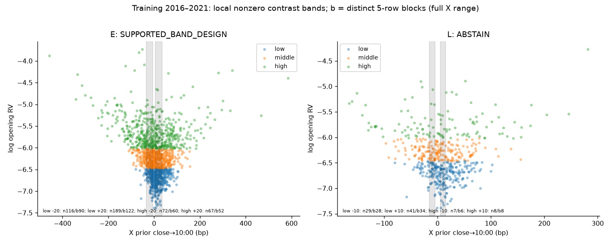
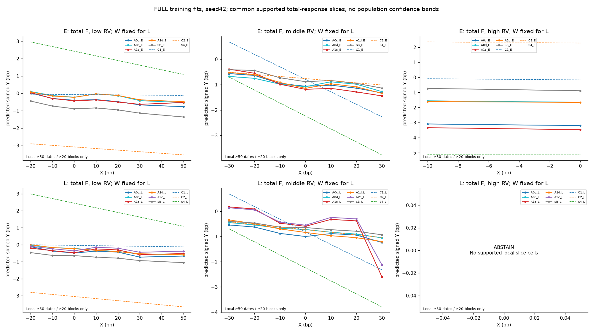
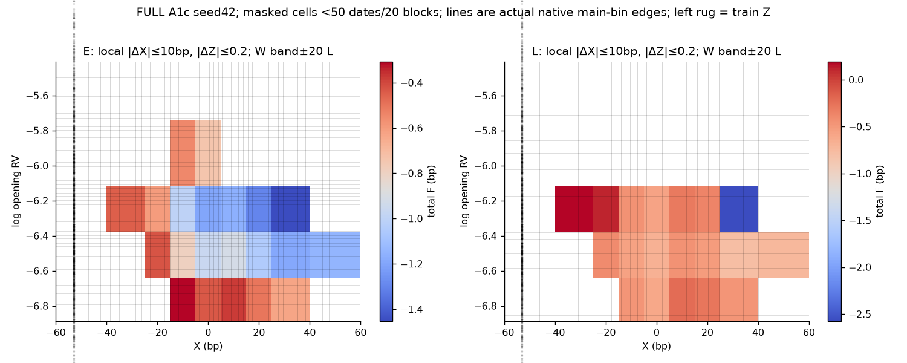
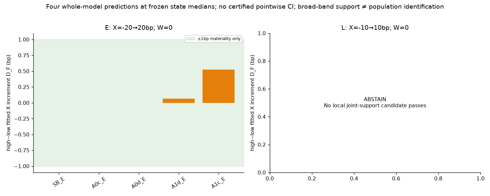
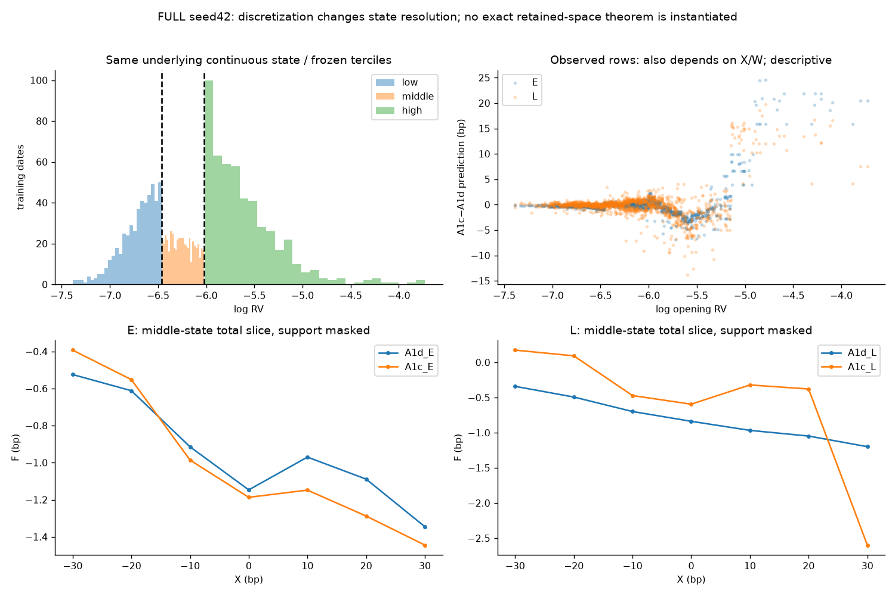
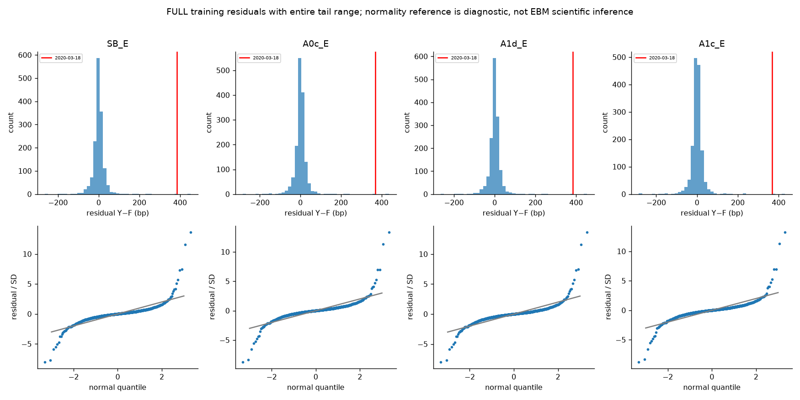
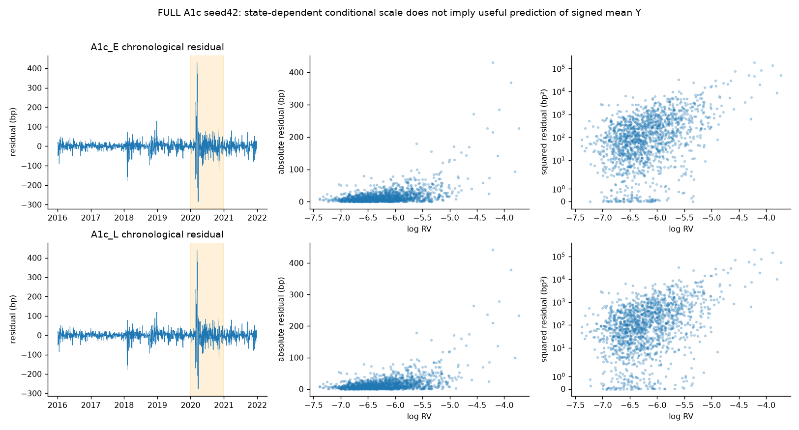
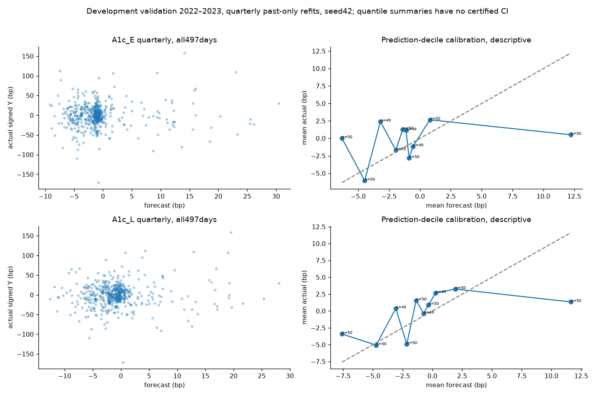
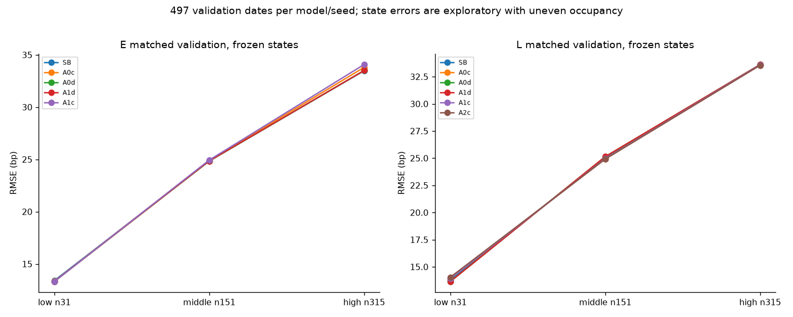
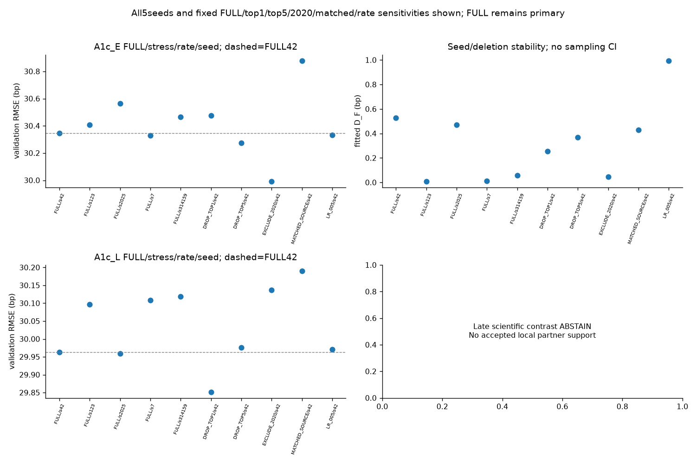
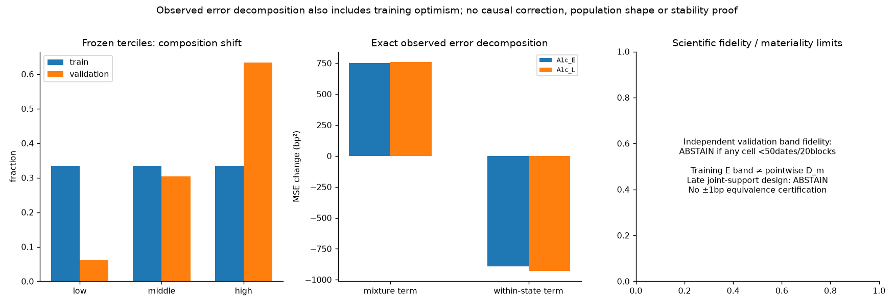
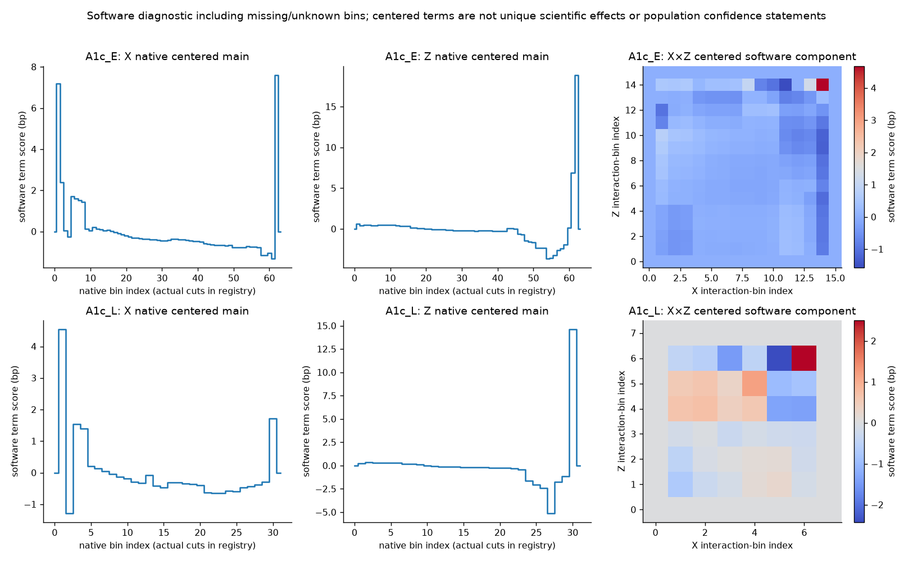

## Handoff and remaining stages

All11 model families, matched saved predictions, exact terms/bins, supported/non-supported total-surface queries, complete negative/sensitivity evidence and [theory applicability audit](stage2B_theory_applicability_and_implementation.md) are reviewable. No scientific novelty or positive alpha follows from implementation alone. Review exact losses/CIs and support before any selection. Later Stage4 requires separately frozen shortlisted full-pipeline null/permutation and sealed walk-forward protocol; Stage5 requires execution/cost economics. Stage2B completes neither and leaves2024–2026 sealed. Optional100nullreplicates deferred with a concrete future plan in theory report, no counterfeitp-value.
