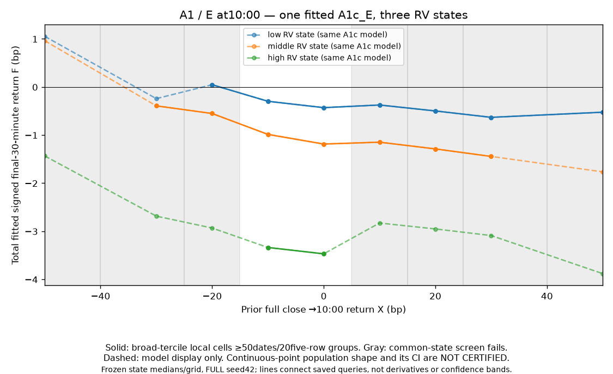
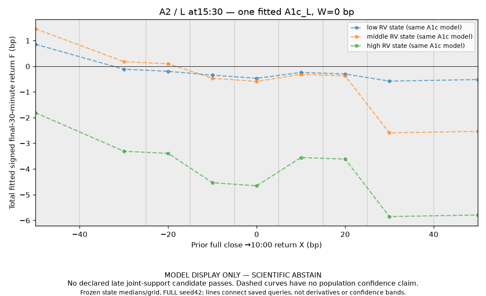

# Experiment B — literature-anchored A1/A2 developmental closeout

**A1: CLOSED_INCONCLUSIVE_DEVELOPMENT. A2: CLOSED_INCONCLUSIVE_DEVELOPMENT.** The specified literature-anchored development pipeline is complete. The qualified negative finding is **no credible incremental state-interaction forecasting benefit established**. This is not a proof of no population effect or equivalence. Scientific raw shapes remain uncertified; late joint-support comparisons abstain. No progression to a permutation, sealed test or trading stage is needed to close this developmental work.

## Actual dataset, timing and source fidelity

One canonical SPY daily table derives from immutable Alpaca SIP split-adjusted D2 plus exactly39 native-price D2.1c Hugging Face missing-key repairs. Daily ID B_SPY_daily_split_source1_stage1_v1; SHA256 `2aa3e2df1cab897abd679ed9cbeff8f6fcb004ecc01a7b32c5938aa6c23b5c2f`. Stored full-session metadata2016-01-04–2026-09-30; first eligible2016-01-05. Training1,495days2016–2021; developmental validation497days2022–2023. Sealed683days2024–September2026 were not used for science here. Short sessions and missing critical anchors/opening minutes remain excluded; no new price repair or dataset copy.

Time zone America/New_York, minute bar timestamps denote UTC starts. Pprev is the preceding permitted full-session15:59close; P10/P15/P1530/P16 are09:59/14:59/15:29/15:59bar closes. X=10,000(P10/Pprev−1), including overnight; W=10,000(P1530/P15−1); Y=10,000(P16/P1530−1), the signed scientific final30minute return. OpeningRV=√[log(C09:30/O09:30)²+Σ29consecutiveclose-log-return²], Z=log(RV+1e−8). A1/E10:00 uses X and this opening state; A2/L15:30 adds W. L is not an early forecast and its inherited X-shape question does not isolate pure W effects. A2c_L separately explores W×Z beyond its X×Z interaction.

Gao1993–2013/ Limkriangkrai1996–2013 source-era data are unavailable: this is the approved modern2016start branch, not exact historical replication. The RV operational proxy/source normalization, TAQ versus SIP trade-count filtering, native community patch adjustment/rights and one-sided terminal repair qualifications remain in the [source crosswalk](../../docs/experiment_B_source_method_crosswalk.md). User-directed private use does not establish public redistribution rights. Modern training slopes do not corroborate the historical positive pattern:

| model | term | n | coefficient | ci_low | ci_high | p_value |
| --- | --- | --- | --- | --- | --- | --- |
| OLS1_E | x_open_bp | 1495 | -0.01300663 | -0.07303846 | 0.0470252 | 0.6710916 |
| OLS3_L | x_open_bp | 1495 | -0.0128096 | -0.07285782 | 0.04723861 | 0.6758716 |
| OLS3_L | w_preclose_bp | 1495 | -0.03771602 | -0.2975781 | 0.2221461 | 0.776053 |

These linear-projection HAC intervals are conditional on their own moment/dependence/selection assumptions. Within-state significance is not a between-state difference. Stage2A's six primary moderation/curvature tests did not survive Holm; C1/C2/S4 did not show convincing incremental benefit, with splines overfitting. Negative results were not rescued by changing targets, samples or state definitions.

## Executed model/evaluation ladder

Eleven native InterpretML0.7.3 families: SB_E/L; additive A0c_E/L and A0d_E/L; X×S A1d_E/L; X×Z A1c_E/L; secondary late A2c_L adds W×Z. No automatic interaction mining; S nominal and Z numerical. Same frozen RV cutoffs[0.001558374721607106,0.0024281183976187152] across validation. Two bounded settings selected on training-era2016–2020→2021; five final seeds; eight final bags; internal stochastic train-only early stopping is algorithmic. All562component fits/55FULLfamily-seed fits completed, including predeclared crisis/outlier/matched-source/temporal sensitivities. Native bins update within each past history. The old total662 field was an arithmetic error; all seven intended component counts sum562.

Both fixed2016–2021 and strictly past-only quarterly expanding predictions exist on identical497validationdates. Quarterly models can use earlier completed validation outcomes, never current/future Y; original category cutoffs/settings stay fixed. The validation period was reused across stages and comparisons, so it is development, not independent confirmation. E versus L mixes information availability and is not an equal-information model contest.

Quarterly FULL seed42 EBM scorecard (RMSEbp, MSEbp²):

| model_id | n | RMSE | MSE |
| --- | --- | --- | --- |
| A0c_E | 497 | 30.39814 | 924.047 |
| A0c_L | 497 | 30.26317 | 915.8594 |
| A0d_E | 497 | 30.17197 | 910.348 |
| A0d_L | 497 | 30.3377 | 920.376 |
| A1c_E | 497 | 30.60017 | 936.3703 |
| A1c_L | 497 | 30.27881 | 916.8062 |
| A1d_E | 497 | 30.17484 | 910.521 |
| A1d_L | 497 | 30.33408 | 920.1565 |
| A2c_L | 497 | 30.24208 | 914.5833 |
| SB_E | 497 | 30.15912 | 909.5724 |
| SB_L | 497 | 30.30848 | 918.6037 |

Simple/naive quarterly comparators on identical dates:

| model_id | n | RMSE | MSE |
| --- | --- | --- | --- |
| C1_E | 497 | 30.32906 | 919.8519 |
| C1_L | 497 | 30.3626 | 921.8876 |
| C2_E | 497 | 30.43277 | 926.1532 |
| C2_L | 497 | 30.46899 | 928.3596 |
| N0 | 497 | 30.30683 | 918.5041 |
| N1 | 497 | 30.31386 | 918.9304 |
| OLS1_E | 497 | 30.31283 | 918.8674 |
| OLS2_L | 497 | 30.33212 | 920.0374 |
| OLS3_L | 497 | 30.33215 | 920.0391 |
| S4_E | 497 | 31.42707 | 987.6608 |
| S4_L | 497 | 31.48669 | 991.4118 |

Principal and strong-comparator paired gains (positive favors A1c; conditional asymptotic BartlettHAC5/10/20 numerical verification):

| info | candidate | comparator | n | lag | gain | ci_low | ci_high | p_holm |
| --- | --- | --- | --- | --- | --- | --- | --- | --- |
| E | A1c_E | A0c_E | 497 | 5 | -12.32325 | -27.14755 | 2.501046 | 0.2065019 |
| E | A1c_E | A0c_E | 497 | 10 | -12.32325 | -29.96549 | 5.318993 | — |
| E | A1c_E | A0c_E | 497 | 20 | -12.32325 | -33.12852 | 8.482021 | — |
| E | A1c_E | SB_E | 497 | 5 | -26.79789 | -59.34075 | 5.744981 | — |
| E | A1c_E | C1_E | 497 | 5 | -16.51834 | -49.58019 | 16.54351 | — |
| E | A1c_E | C2_E | 497 | 5 | -10.21709 | -43.87813 | 23.44395 | — |
| E | A1c_E | S4_E | 497 | 5 | 51.29052 | 10.62526 | 91.95579 | — |
| E | A1c_E | N0 | 497 | 5 | -17.8662 | -52.264 | 16.53159 | — |
| E | A1c_E | N1 | 497 | 5 | -17.43989 | -51.86865 | 16.98886 | — |
| E | A1c_E | OLS1_E | 497 | 5 | -17.50288 | -49.7287 | 14.72294 | — |
| L | A1c_L | A0c_L | 497 | 5 | -0.9468342 | -11.3948 | 9.501133 | 0.8590219 |
| L | A1c_L | A0c_L | 497 | 10 | -0.9468342 | -10.5949 | 8.701228 | — |
| L | A1c_L | A0c_L | 497 | 20 | -0.9468342 | -9.951793 | 8.058125 | — |
| L | A1c_L | SB_L | 497 | 5 | 1.797491 | -32.84328 | 36.43826 | — |
| L | A1c_L | C1_L | 497 | 5 | 5.081365 | -34.30363 | 44.46636 | — |
| L | A1c_L | C2_L | 497 | 5 | 11.55341 | -25.50874 | 48.61557 | — |
| L | A1c_L | S4_L | 497 | 5 | 74.60562 | 30.00583 | 119.2054 | — |
| L | A1c_L | N0 | 497 | 5 | 1.697869 | -37.64196 | 41.0377 | — |
| L | A1c_L | N1 | 497 | 5 | 2.12418 | -37.50272 | 41.75108 | — |
| L | A1c_L | OLS3_L | 497 | 5 | 3.232858 | -34.90409 | 41.3698 | — |

A1c−A0c primary quarterly gains are negative in E and L, Holm p≈.2065/.8590. C1 is the strongest saved state-aware simple comparator within E/L, and N0 is stronger among the saved naive/source-OLS references. A1c_E is worse than C1/N0 by point MSE; A1c_L's small point gains over C1/N0 have wide intervals including no gain. The discrete interaction adds almost nothing over its categorical additive counterpart: quarterly A1d−A0d gains≈−.173bp²E/+ .220bp²L, both intervals includezero. Some EBMs beat overfit S4/S6 models, which does not establish increment over C1/N0. Early SB has lower observed RMSE than the state-aware EBMs; late A2c_L has the smallest late EBM point RMSE, but neither a minimum row nor its small A2c_L−A1c_L gain proves a reliable state/W interaction.

Interpretation: adding additive Z information, nonlinear state-blind flexibility, X×state moderation and W×state moderation are different questions. State-linked conditional scale/ARCH is evident but is not useful signed-mean moderation by itself. Standard paired loss/bootstrap uncertainty is **CONDITIONAL_STANDARD_INFERENCE**, not exact post-selection or raw shape inference. Holm does not repair dependence/moment violations or account for the entire discovery trajectory. A materiality claim would need the relevant valid lower bound, not only a favorable point gain.

## Scientific shape, support and stability

The frozen E comparison is X−20→+20bp with local Xhalfwidth15 and broad low/high RVterciles. Training cell counts116/189/72/67, with90/122/60/52distinct five-row groups, satisfy an exploratory heuristic. The four continuous model query values at fixed training medianZ give A1c_E D_F≈.52624bp. Additive controls cancel by construction. None of this is a raw pointwise D_m estimate or affirmative±1bp equivalence. Broad band means integrate different X/W/Z distributions; their raw-versus-predicted band comparison is a different estimand. Validation low/middle/high occupancy31/151/315 prevents the required independent local-band confirmation. Lhas no accepted joint X/RV/Wcandidate, so raw scientific contrast **ABSTAIN**, never zero.

Heavy tails, serial dependence, residual conditional scale, influential2020-03-18 and native sparse/extreme bins persist. Fixed single/top-five/2020/matched-source deletions, seeds and dated-window refits are perturbation diagnostics, not independent sampling confidence. No sensitivity replaces FULL because it looks favorable. The empirical state-error mixture decomposition is exact observed algebra and includes training optimism; it is not a transport or stable-conditional-shape theorem. Within-tercile Z/prediction spread documents finite-panel compression, not a known-moment inverse or isolated causal information loss.

Optional explanatory overlays show **one model, three states**, on the original grid and state medians. Gray/dashed regions are unsupported/model display only; no confidence bands or new science selection:

## Theory correspondence and accomplishment

Twenty-two supplied source statements were audited, with zero exact-scope instantiations. The [theorem audit](stage2C_theorem_method_audit.md) and [flat crosswalk](../../data/registry/B_stage2C_theorem_diagnostic_crosswalk.csv) preserve each source's filename/line/status and separate actual deterministic algebra, adapted diagnostics, conditional standard inference, blocked premises and different-model theorems. T12 exact Gaussian selection and literal tree-path guarantees do not apply by analogy. T22.G2/T24.I1/T25.F1 can cover an arbitrary current native output **if** valid matched raw confidence/bias information exists; it does not exist here. Unverified population bounds, smoothness, moments and mixing are marked unverified, not inferred false just from sample diagnostics. Omitted settings/proofs were not independently certified.

CV-ready executed record:

- Implemented and audited an11family native EBM ladder with fixed information times/interactions, five-seed matched chronological development evaluation and stronger simple/naive controls, retaining negative and abstaining findings.
- Adapted support-aware whole-response and raw-versus-fitted scientific diagnostics from the internal theory program; produced an assumption-by-assumption crosswalk against22supplied statements and independent no-refit numerical verification.
- Distinguished original internal source labels from classical tools and software application; did not claim a new proof, publication priority, theorem validity for dependent SPY, certified shape or alpha.

## Explicit closure and remaining boundaries

**Close A1/A2 development now as CLOSED_INCONCLUSIVE_DEVELOPMENT.** Implementation and bounded developmental science are complete, with qualified negative incremental-prediction evidence and uncertified/unsupported raw shapes. H0exacthistoricalreplication is unavailable; H1modernpredictive benefit is not confirmed; H2/H3moderation/nonlinear increment are not established; H4representation differences are descriptive; H5rawenvironmental equivalence is uncertified; H6economics is untested.

**No-test/no-permutation decision:** zero new learner fits, zero null replicates, zero sealed evaluation and no trading/cost analysis. The previously deferred100full-discovery null (~8400native fits for the recorded two-family five-seed path) stays deferred; this session does not launch or require it. Sealed2024–September2026 stays sealed. A future sealed/permutation/economic study would need a separate reviewed task, assumptions and frozen protocol. Do not describe development closure as completion of the original full confirmatory/economic agenda.

A3–A6, rolling-RV, macro/options or new targets are separate research projects, never retroactive rescues of this A1/A2 result. No mandatory next model experiment remains for this closeout. All earlier reports/data/models/forecasts were preserved verbatim. See [closeout manifest](../../data/registry/B_stage2C_closeout_manifest.json) and the linked detailed session report for exact access, checks, hashes, commands and resources.
