# C2R scientific visual gallery

**PASS_WITH_QUALIFICATIONS — explored development, not independent confirmation.**

The reproducible prior-RV closing-hour contrast is 2.0050 pp, but materiality >2 pp and global near-invariance are not certified. Prior RV is plausibly associated with a redistribution of realized variance within a day; no causal mechanism follows. OLS moderation, support, robustness and the past-only spline score comparisons below describe how much of that exploratory pattern these small models capture.

## Scientific assessment

The best-supported direct signature is the historical closing-hour high-minus-low allocation of **2.005 pp**. It is reproducible on these complete sessions and the added block20 descriptive interval remains positive, but its lower endpoint is below the 2 pp materiality threshold. The whole-curve TV point estimate near 0.05 and its qualified interval do not establish near-stability. All curves retain a broadly similar U shape.

The scalar linear prior-RV slope has conditional HAC10 six-family Holm p=0.0007315. Piecewise slope moderation (Holm p=0.2086) and quadratic curvature (Holm p=0.4564) are not established at the conventional 0.05 reference. This supports studying a modest linear association, with the stated selection/dependence caveats; it does not establish a new nonlinear mechanism.

On previously exposed 2020/2021 backchecks, OLS-L1 lowers closing-share MSE by 2.43%, while **M0 has the lowest full-profile MSE** and the primary spline raises it by 1.66%. Year/state mixtures shift, some 2020 cells fail support, residual means change across years, and four March 2020 crisis days are absent. These results constrain stability and generalization. C3 design review could compare a bounded EBM with these strong simple baselines, but no EBM increment or independent confirmation is demonstrated here.

## 01_direct_three_state_profiles.png

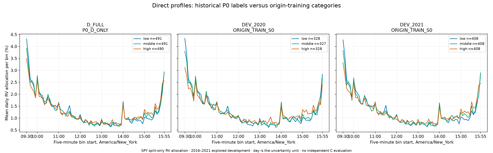

The historical P0 curves use retrospective rank groups, while the two other panels use each training origin’s quantile cuts. These are different grouping rules; similar U shapes are compatible with a small localized compositional effect, not a new global geometry.

## 02_closing_share_scatter_and_state_OLS.png

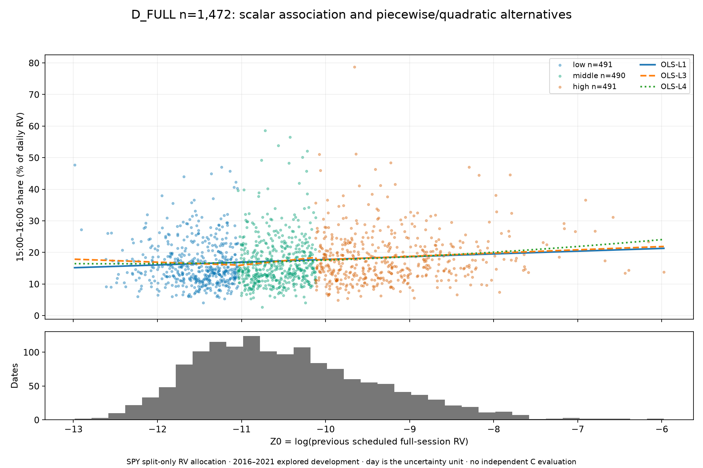

Every point is a complete-day closing-hour share and prior-session log RV. Piecewise slopes and quadratic curvature are interpretive scalar descriptions. Density and tails matter; these curves do not replace the full profile.

## 03_OLS_estimates_and_interaction_tests.png

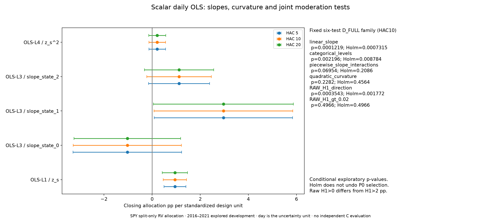

Slope intervals are conditional daily HAC diagnostics. The joint piecewise-slope Holm p is 0.2086, so the displayed different slopes are not established as population moderation. Joint interaction and curvature tests are separate from within-state slopes. The fixed six-family Holm results do not supply post-P0 confirmation or a certified material effect.

## 04_scalar_OLS_residual_and_QQ.png

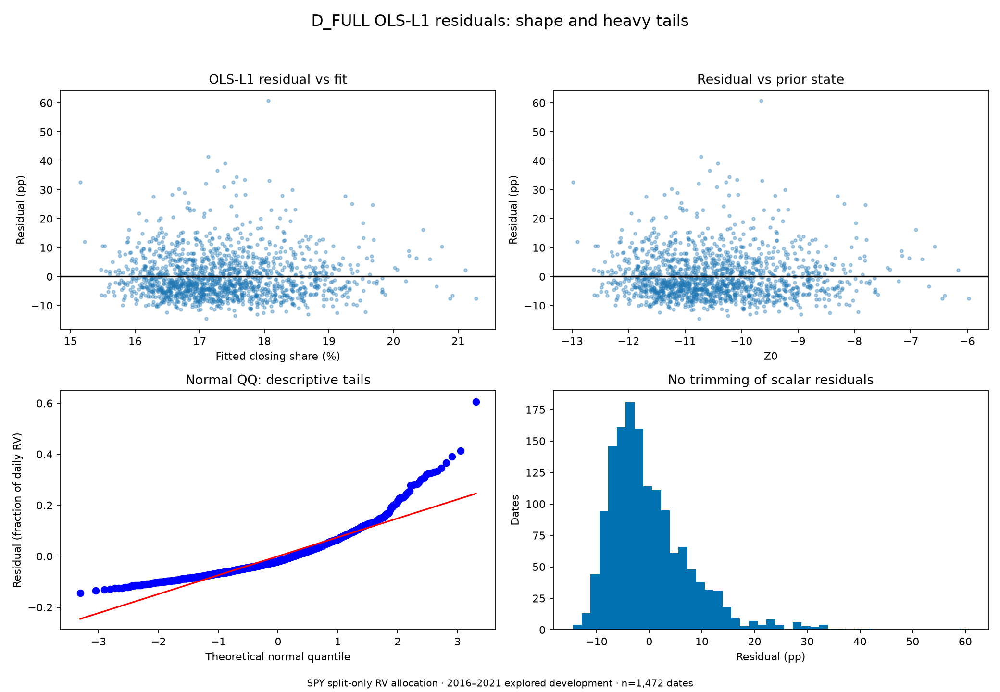

Residual plots retain extreme observations. The QQ panel uses residual fractions; the other residual panels use percentage points. Tail/normality and shape deviations limit classical Gaussian interpretations; they do not justify deleting days or changing the scientific target.

## 05_scalar_OLS_residual_time_ACF_and_variance.png

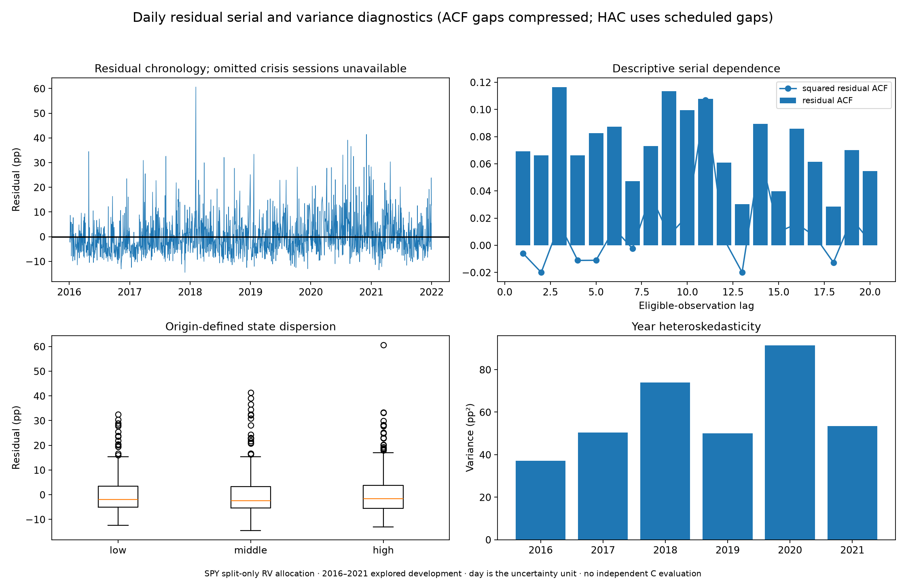

Chronology, serial correlation and changing variance show why ordinary IID inference is insufficient. Eligible-order ACF is descriptive; scheduled-date HAC and block resampling retain calendar gaps separately.

## 06_influence_and_robustness.png

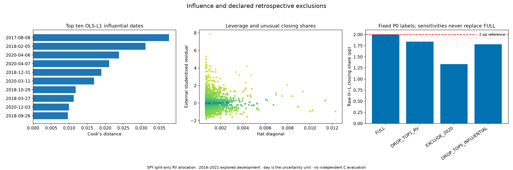

Cook and leverage identify influential observations under one declared scalar fit. The same fixed five exclusions apply across models; all sensitivities remain secondary to FULL and can change the estimand.

## 07_M0_M1_M2_profile_fit.png

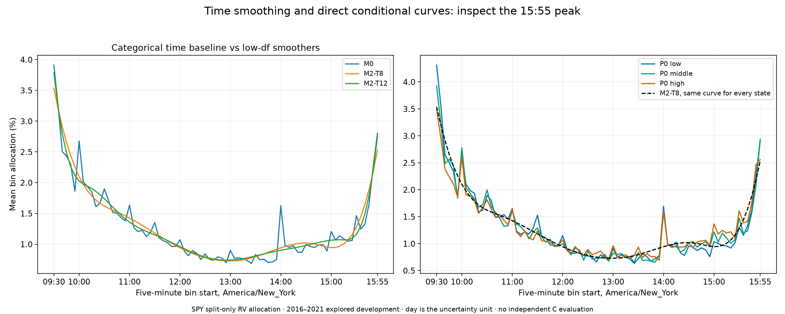

M0 preserves the empirical categorical time curve while low-df M2 trades detail for smoothness. A sharp final-bin feature can be hard for eight/twelve basis columns; no basis expansion was selected from that appearance.

## 08_state_dependent_profile_OLS.png

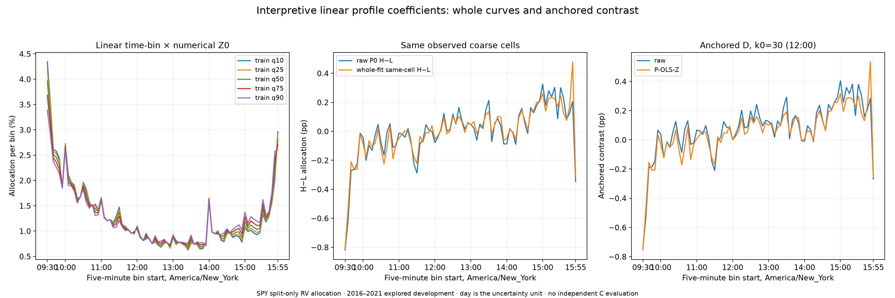

P-OLS-Z maps one continuous state to all 78 bin slopes and satisfies coefficient-sum identities. Raw and modeled contrasts average identical observed coarse cells. Anchored D is a whole-curve difference, not an individual regression term.

## 09_M4_continuous_state_heatmap.png

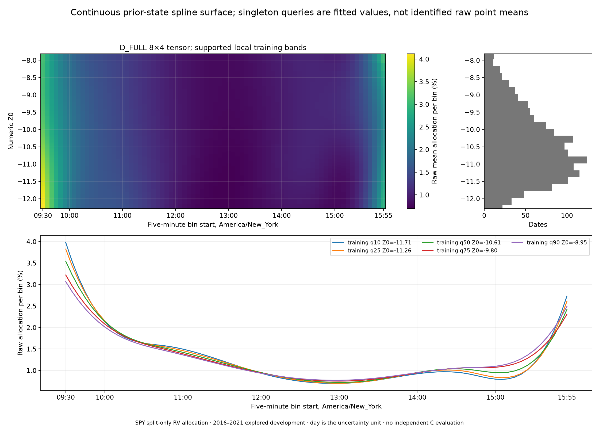

The 8×4 tensor gives a continuous fitted state/time surface and five training-derived slices. These are model evaluations on supported training bands, not pointwise conditional-mean identification or confidence bands.

## 10_raw_vs_spline_scientific_fidelity.png

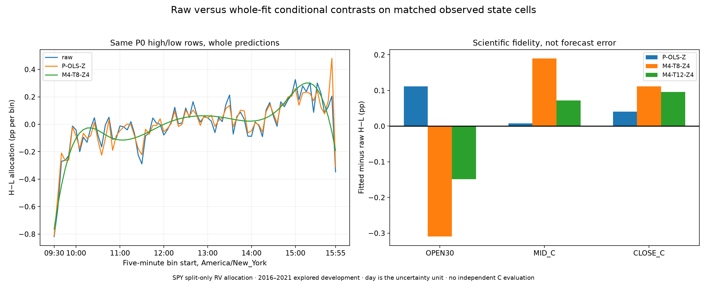

Scientific fidelity compares raw group means with average predictions over precisely the same rows. A small global predictive error can coexist with a closing-window discrepancy; direct means remain noisy empirical references.

## 11_development_chronological_model_scorecard.png

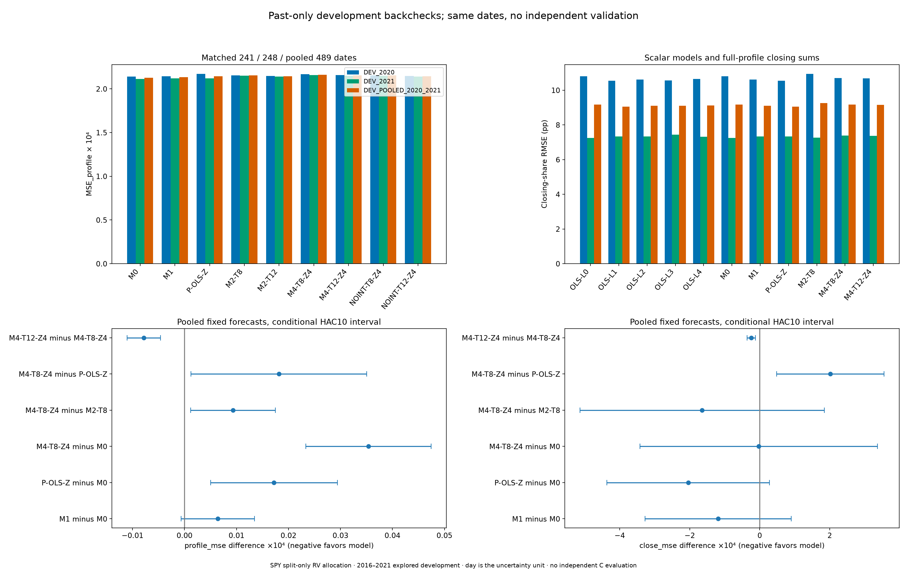

All candidates face identical 2020/2021 dates. M4-T8-Z4 changes pooled profile MSE by -1.66% relative to M0; M0 has the lowest pooled profile MSE. Conditional fixed-forecast intervals are developmental sensitivity, not independent validation.

## 12_environment_support_and_composition.png

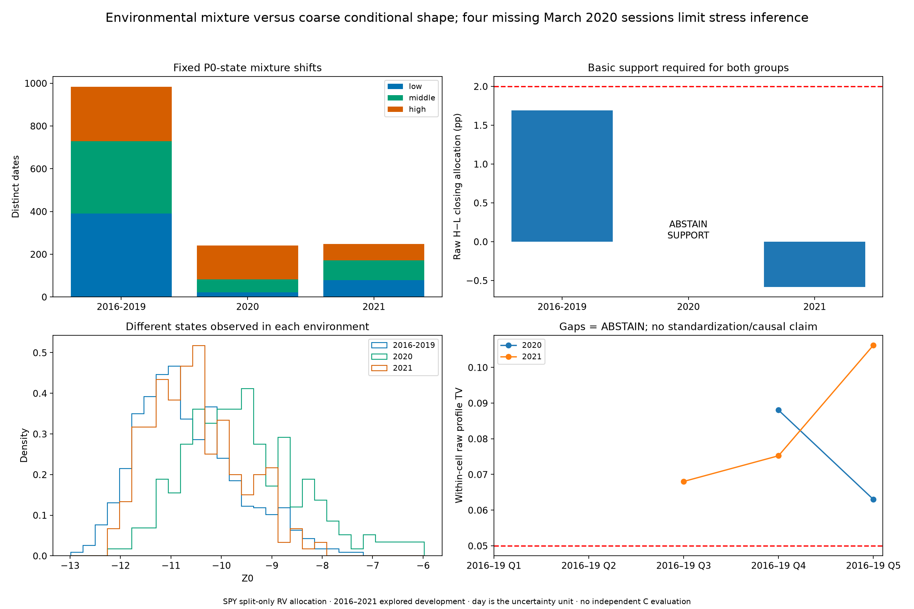

Mixture counts and numeric state distributions differ across environments. Missing cells are ABSTAIN, not smooth evidence of invariance. The four omitted March 2020 crisis sessions remain a central generalization limitation.

## 13_normalization_residuals_and_last_bin.png

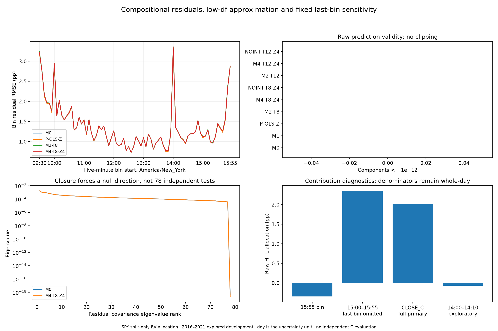

Raw normalization/negative shares and residual covariance are visible. The last 15:55 bin contributes -0.3471 pp to H1; omitting its numerator is a separately labeled diagnostic. The 14:00 region is exploratory without event data.

## Handoff

Review the main diagnostics report and machine tables before C3 design. Keep 2016–2021 labeled previously viewed, retain 2020 support/missingness warnings, and retain raw model defects. Full-C horizon/split, Zret/Zvol and reserved-data permissions remain pending. No C3 implementation is authorized by this gallery.

## 14_scalar_calibration_period_means_and_PACF.png

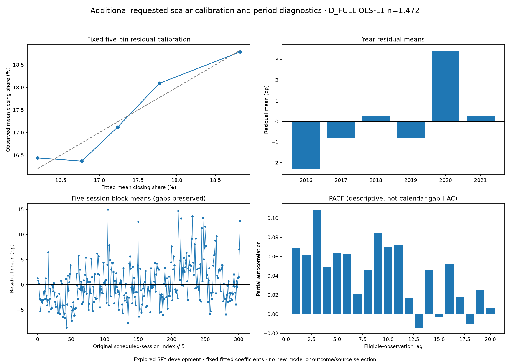

Fitted-value quintile calibration and residual year/five-session means expose departures obscured by an average zero residual. The PACF is a daily-series descriptive check. These diagnostics preserve every fitted coefficient and do not add a candidate model or choose a new transformation from outcomes. Conditional group-mean intervals and chronological extrapolation/normalization are tabulated in the main report.
