# C3 scientific gallery for human review

All figures use SPY 2016–2021 previously explored development profiles. LOW is blue, MIDDLE teal, HIGH orange. Curves are complete prediction averages over the same observed state rows, except explicitly named singleton model slices. All means and contrasts use 78-bin whole-day Q. D_FULL n=1,472 is in-sample; DEV2020/2021 n=241/248 are prior-explored backchecks. No plot establishes population truth or certified materiality.

| model | H1 | H1_error | H3_TV | half_L1 |
| --- | --- | --- | --- | --- |
| RAW | 2.00498 | 0 | 0.0485101 | 0.0485101 |
| T0_EBM_TIME_ONLY | 6.93889e-16 | -2.00498 | 1.30104e-17 | 1.30104e-17 |
| M3c_EBM_ADDITIVE | 5.0307e-15 | -2.00498 | 7.80626e-17 | 7.80626e-17 |
| M3d_EBM_ADDITIVE | 6.93889e-16 | -2.00498 | 3.51282e-17 | 3.51282e-17 |
| M5_EBM_CONT_INTERACT | 1.56544 | -0.439544 | — | 0.0338914 |
| M6_EBM_DISC_INTERACT | 1.39458 | -0.610403 | — | 0.0298352 |
| M8 | 1.90375 | -0.101233 | 0.0431457 | 0.0431457 |

H1/H1 error columns above are pp. H3/half-L1 are fractions; H3 blank means raw closure invalid. The three state colors identify the same states across models; line style and panel title identify model and source.

## 01. direct and simple reference profiles

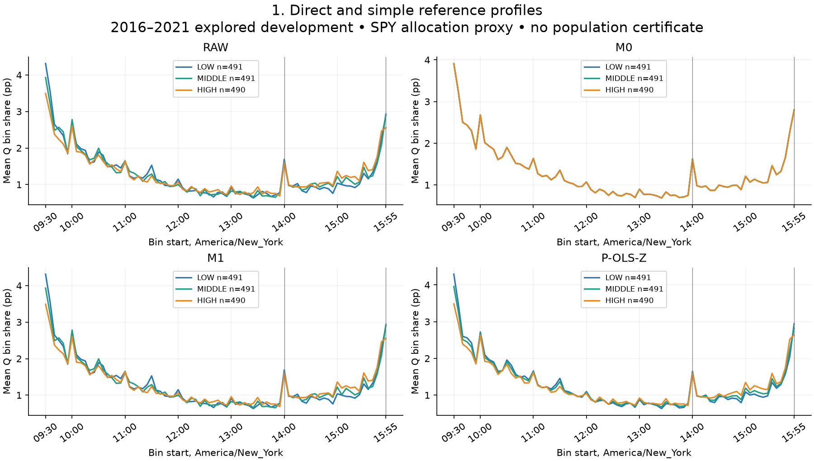

Raw H1 +2.005pp; sharp 14:00 and 15:55 bins persist. P-OLS-Z is a strong simple shape comparator.

Numerical source: `group_mean_profiles.csv: D_FULL/HISTORICAL_P0; mean,bin,state`. All paths refer to `artifacts/C/C3_one_state_ebm_v1_1/`.

## 02. time only ebm vs unsmoothed and splines

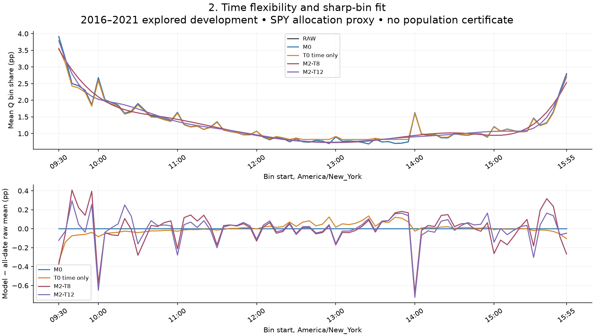

T0 retains all 78 time categories. Its conservative finite-round fit still shrinks sharp time structure; M0 is the exact unsmoothed mean.

Numerical source: `global_mean_profiles.csv: means/bias`. All paths refer to `artifacts/C/C3_one_state_ebm_v1_1/`.

## 03. additive ebm continuous three state curves

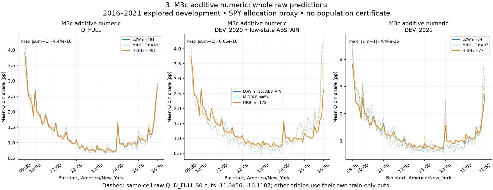

Additive state effects collapse to numerical zero on balanced normalized targets; native interactions redistribute allocation but do not enforce closure. Forecast curves are fixed at the origin. 2020 low n=15 under past-origin S0 (n=21 under full-S0): ABSTAIN for raw high-low inference.

Numerical source: `group_mean_profiles.csv: TRAIN_S0; profile_predictive_metrics.csv: sum_defect_max`. All paths refer to `artifacts/C/C3_one_state_ebm_v1_1/`.

## 04. additive ebm discrete three state curves

Additive state effects collapse to numerical zero on balanced normalized targets; native interactions redistribute allocation but do not enforce closure. Forecast curves are fixed at the origin. 2020 low n=15 under past-origin S0 (n=21 under full-S0): ABSTAIN for raw high-low inference.

Numerical source: `group_mean_profiles.csv: TRAIN_S0; profile_predictive_metrics.csv: sum_defect_max`. All paths refer to `artifacts/C/C3_one_state_ebm_v1_1/`.

## 05. continuous interaction ebm three state curves

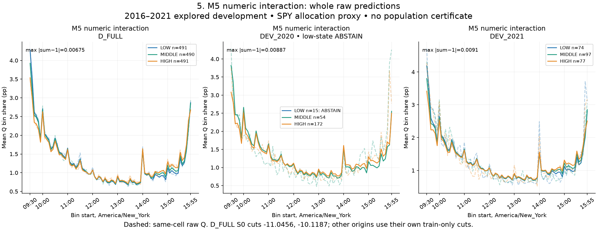

Additive state effects collapse to numerical zero on balanced normalized targets; native interactions redistribute allocation but do not enforce closure. Forecast curves are fixed at the origin. 2020 low n=15 under past-origin S0 (n=21 under full-S0): ABSTAIN for raw high-low inference.

Numerical source: `group_mean_profiles.csv: TRAIN_S0; profile_predictive_metrics.csv: sum_defect_max`. All paths refer to `artifacts/C/C3_one_state_ebm_v1_1/`.

## 06. discrete interaction ebm three state curves

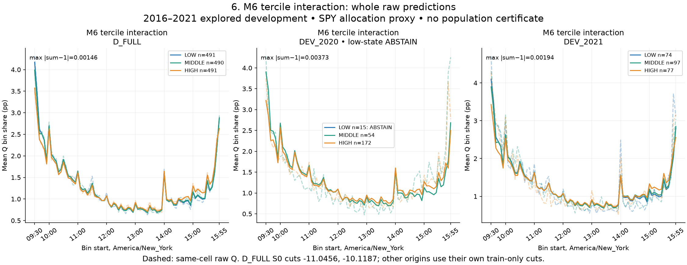

Additive state effects collapse to numerical zero on balanced normalized targets; native interactions redistribute allocation but do not enforce closure. Forecast curves are fixed at the origin. 2020 low n=15 under past-origin S0 (n=21 under full-S0): ABSTAIN for raw high-low inference.

Numerical source: `group_mean_profiles.csv: TRAIN_S0; profile_predictive_metrics.csv: sum_defect_max`. All paths refer to `artifacts/C/C3_one_state_ebm_v1_1/`.

## 07. all ebms matched shapes overview

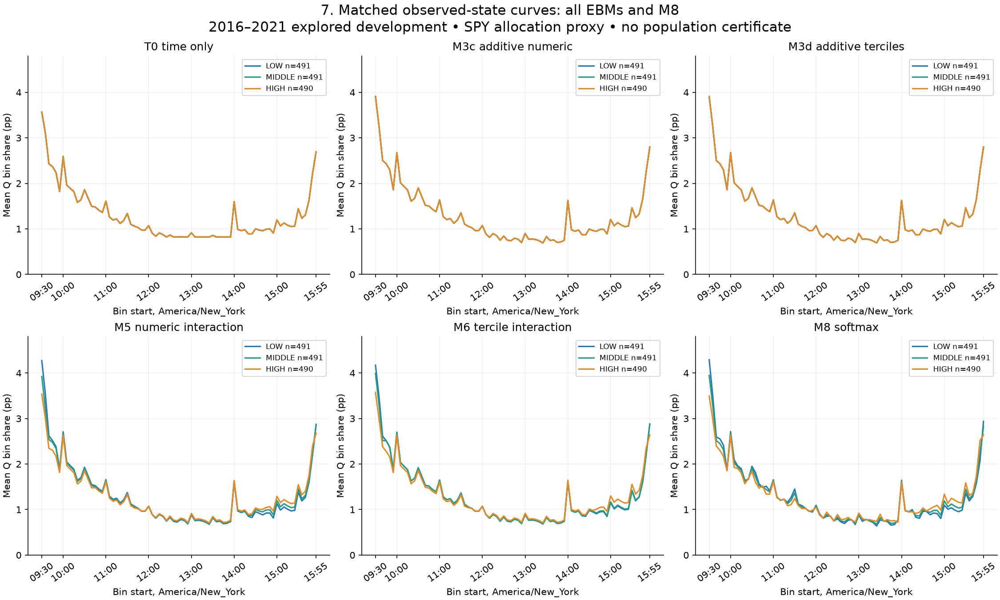

Same state colors and y scale. The additive fits share one shape; M5/M6 retain modest state/time structure; M8 is intrinsically normalized.

Numerical source: `group_mean_profiles.csv: D_FULL/HISTORICAL_P0; identical rows`. All paths refer to `artifacts/C/C3_one_state_ebm_v1_1/`.

## 08. continuous ebm total surface and support

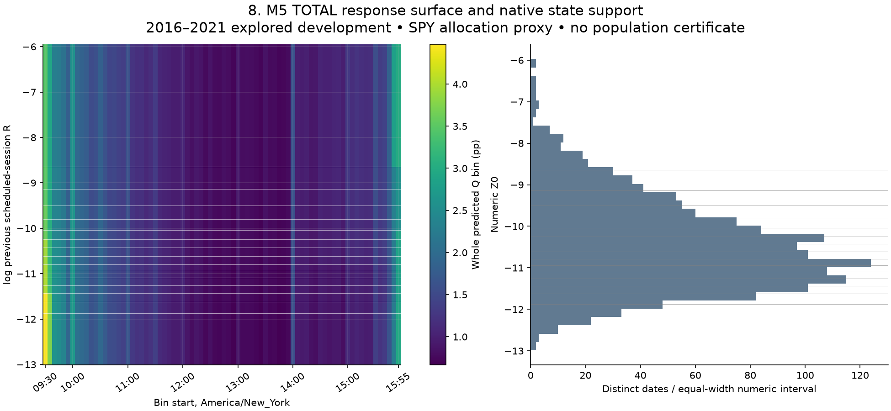

Stepwise numeric EBM total prediction, never an isolated interaction term. Bands failing basic date/group support are masked; all D_FULL 16 quantile bins currently pass.

Numerical source: `continuous_total_surface.csv; checkpoint D_FULL M5 transform.cuts`. All paths refer to `artifacts/C/C3_one_state_ebm_v1_1/`.

## 09. continuous ebm five numeric state slices

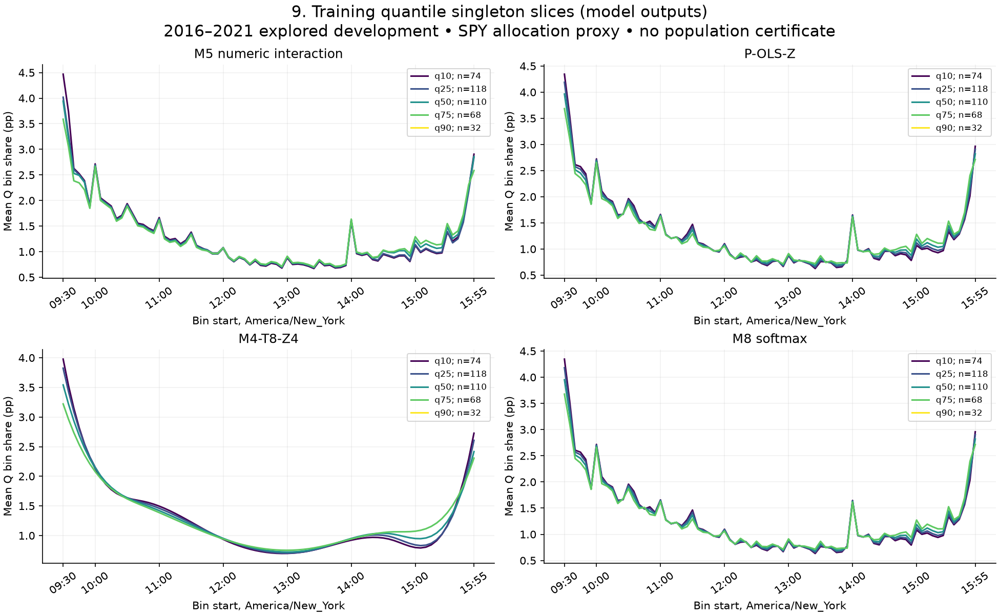

All models evaluated at identical train-only quantiles. A singleton fitted curve is not an identified population conditional mean; neighborhoods describe support.

Numerical source: `continuous_slices.csv: prediction; neighborhood width and date/group counts`. All paths refer to `artifacts/C/C3_one_state_ebm_v1_1/`.

## 10. native additive vs interaction contrast

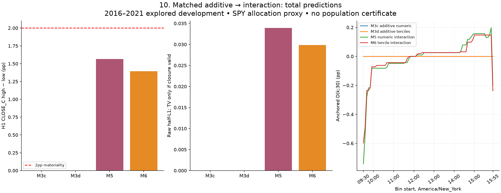

Raw M3 anchored D is zero to roundoff. M5/M6 whole-model contrasts are nonzero but attenuate raw H1. Invalid-closure half-L1 is explicitly not TV.

Numerical source: `model_shapes_and_scientific_contrasts.csv; group_mean_profiles.csv anchored_D`. All paths refer to `artifacts/C/C3_one_state_ebm_v1_1/`.

## 11. raw versus fitted scientific fidelity

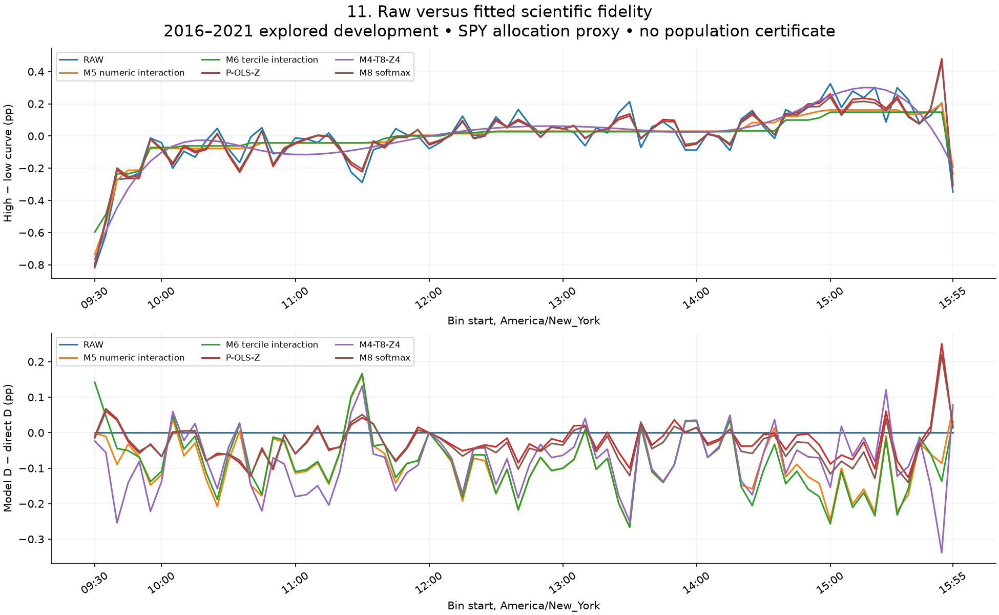

M5 H1≈1.565pp, M6≈1.395pp versus raw≈2.005pp. P-OLS-Z and M8 are stronger H1 fidelity references; no extra EBM fidelity certificate.

Numerical source: `group_mean_profiles.csv: matched historical P0 state_difference/anchored_D/raw_anchored_D`. All paths refer to `artifacts/C/C3_one_state_ebm_v1_1/`.

## 12. developmental error scorecard

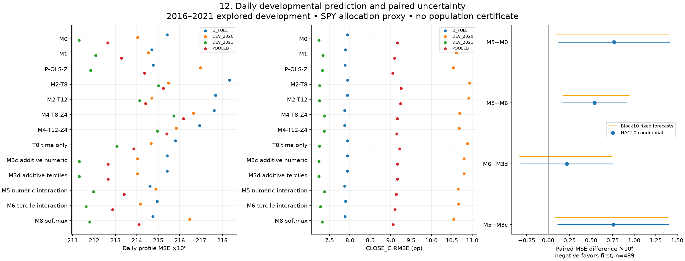

2020 n=241, 2021 n=248, pooled n=489. Native interaction adds no established profile increment over matched additive/M0. Confidence labels condition on saved selected forecasts.

Numerical source: `profile_predictive_metrics.csv; paired_loss_tests.csv HAC10 and block10`. All paths refer to `artifacts/C/C3_one_state_ebm_v1_1/`.

## 13. state support year composition and drift

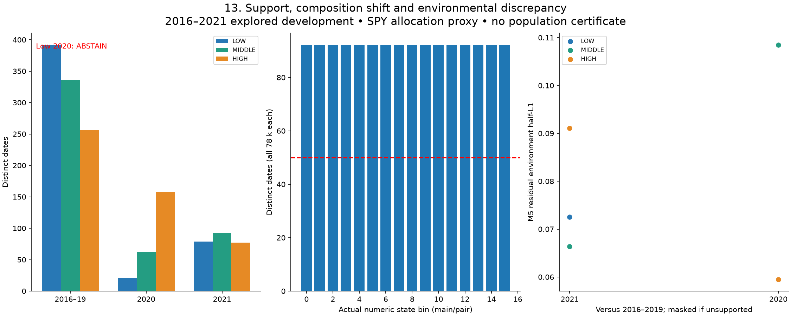

Quantile occupancy over full development does not ensure yearly overlap. Basic gates ≥50 dates/20 original groups are operational; absent overlap remains ABSTAIN.

Numerical source: `state_support_and_masks.csv; environment_residual_discrepancy.csv`. All paths refer to `artifacts/C/C3_one_state_ebm_v1_1/`.

## 14. residual qq acf arch and calibration

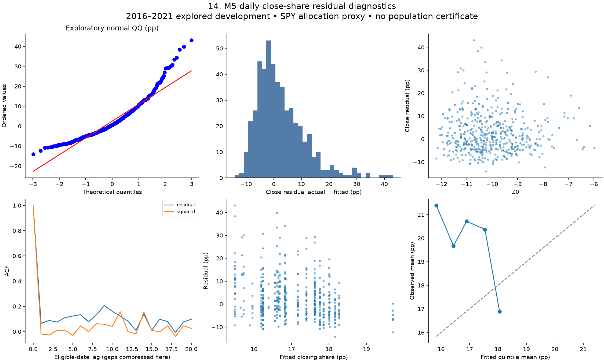

Heavy tails and residual dependence persist. ARCH/Ljung–Box references are heuristic; native EBM has no classical OLS Cook/hat inference.

Numerical source: `residual_daily_features.csv: POOLED/M5; calibration_quintiles.csv; serial_diagnostics.csv`. All paths refer to `artifacts/C/C3_one_state_ebm_v1_1/`.

## 15. outlier regime seed stability

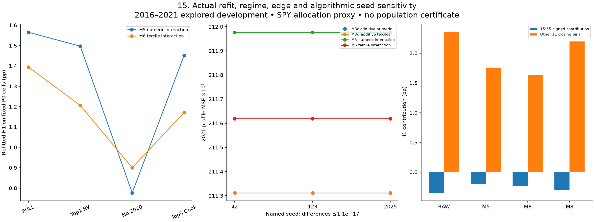

Ten actual stress refits completed; top5 additive controls and native LOYO deferred. All three seeds are deterministic to roundoff. Last-bin exclusion is exploratory, primary CLOSE_C unchanged.

Numerical source: `stress_refits_and_fixed_scores.csv; native_seed_and_complexity_stability.csv; model_shapes_and_scientific_contrasts.csv`. All paths refer to `artifacts/C/C3_one_state_ebm_v1_1/`.

## 16. native software terms and binning

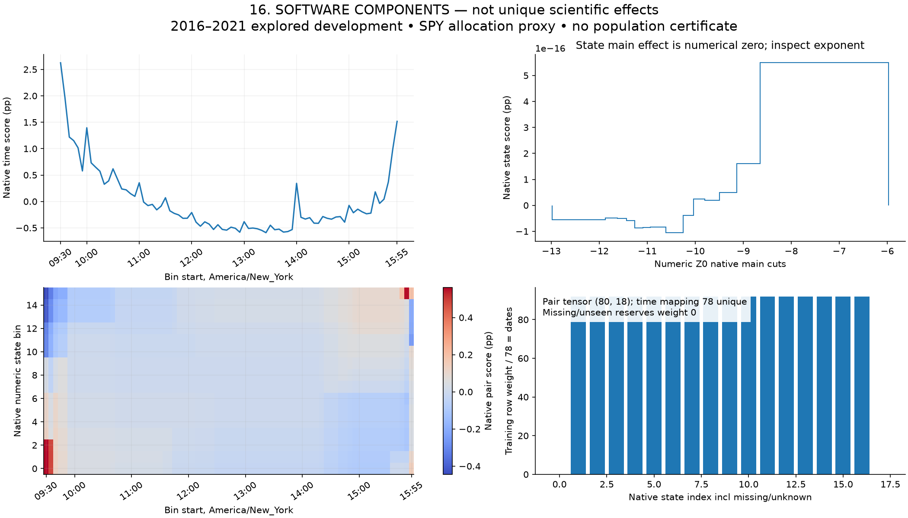

Main and pair components depend on centering and software conventions. Scientific contrasts elsewhere use total native predict. Shared category mappings may be stored once and reused at both resolutions.

Numerical source: `native_terms_and_bins.json + hash-verified D_FULL M5 checkpoint: term_scores_,bins_,bin_weights_`. All paths refer to `artifacts/C/C3_one_state_ebm_v1_1/`.

## 17. normalization coarsening model adequacy

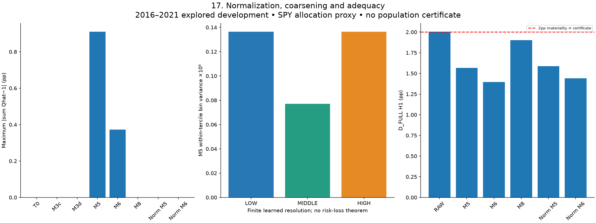

NORM variants apply the frozen positive-part closure map and have distinct model identities. They cannot inherit native additive interpretation. No model supplies a raw materiality/equivalence certificate.

Numerical source: `profile_predictive_metrics.csv; continuous_vs_discrete_coarsening.csv; model_shapes_and_scientific_contrasts.csv`. All paths refer to `artifacts/C/C3_one_state_ebm_v1_1/`.

## Figure/source provenance register

| figure | numerical_source | sha256 |
| --- | --- | --- |
| 01_direct_and_simple_reference_profiles.png | group_mean_profiles.csv: D_FULL/HISTORICAL_P0; mean,bin,state | d14081dabd67fcedeb8f440711658f3e3b4305b7b654ceaf5be179230c1ddb34 |
| 02_time_only_ebm_vs_unsmoothed_and_splines.png | global_mean_profiles.csv: means/bias | 11b9413129a5f5e803588a37fa25705b823401966463b38acc07de34648c8686 |
| 03_additive_ebm_continuous_three_state_curves.png | group_mean_profiles.csv: TRAIN_S0; profile_predictive_metrics.csv: sum_defect_max | 8d07ee11069bea8990b60e712777e3f628101969a360609527cd008b711ab085 |
| 04_additive_ebm_discrete_three_state_curves.png | group_mean_profiles.csv: TRAIN_S0; profile_predictive_metrics.csv: sum_defect_max | 7b3506f017d579e6cc3025930aea05cb29c29a032e089ba056e39263b6aa76f2 |
| 05_continuous_interaction_ebm_three_state_curves.png | group_mean_profiles.csv: TRAIN_S0; profile_predictive_metrics.csv: sum_defect_max | 8da58d67f3f1d76a2880827d231dcec27b21996af46bb87bdb6fa16d7e3dd5c7 |
| 06_discrete_interaction_ebm_three_state_curves.png | group_mean_profiles.csv: TRAIN_S0; profile_predictive_metrics.csv: sum_defect_max | 304d64871698afbbbc7a2a707857d229f26b0488e11638b1107d98e437a3bc82 |
| 07_all_ebms_matched_shapes_overview.png | group_mean_profiles.csv: D_FULL/HISTORICAL_P0; identical rows | ebd1c4dbec91ad1d3a4f004ee958e4063823fa8af9287f1ccca3608f68b27814 |
| 08_continuous_ebm_total_surface_and_support.png | continuous_total_surface.csv; checkpoint D_FULL M5 transform.cuts | 2e60279a8a2684c03a2745f1a6753d04e871905e6a1323e2df09b826a29ae8c1 |
| 09_continuous_ebm_five_numeric_state_slices.png | continuous_slices.csv: prediction; neighborhood width and date/group counts | 241d73fe91bd5b3993fa9d6be1cbb2a9f717c1b017854210e56b7e8aeb8bdf1f |
| 10_native_additive_vs_interaction_contrast.png | model_shapes_and_scientific_contrasts.csv; group_mean_profiles.csv anchored_D | 5dd25d4c2a0c7adbeaf8fdd163ebba6d4ba4ce74ef0a2398c9ed2b1a93fd01eb |
| 11_raw_versus_fitted_scientific_fidelity.png | group_mean_profiles.csv: matched historical P0 state_difference/anchored_D/raw_anchored_D | 6902960319d699135b1d6d9fde56da440d9db360a4a992a4bf45f3439102a48c |
| 12_developmental_error_scorecard.png | profile_predictive_metrics.csv; paired_loss_tests.csv HAC10 and block10 | da873307fc2b27cc2a11d38a4b1a18b385d14d5f5a90c154d49c391cb92df5aa |
| 13_state_support_year_composition_and_drift.png | state_support_and_masks.csv; environment_residual_discrepancy.csv | 1e118847c14cf0983c739218e89ad07b37d8937a620b3d5936d3bc886f0682dd |
| 14_residual_qq_acf_arch_and_calibration.png | residual_daily_features.csv: POOLED/M5; calibration_quintiles.csv; serial_diagnostics.csv | 2b0205e9b08879de82ce21c555749902ed5fb9e88c35697c960bbf68e4909c2c |
| 15_outlier_regime_seed_stability.png | stress_refits_and_fixed_scores.csv; native_seed_and_complexity_stability.csv; model_shapes_and_scientific_contrasts.csv | 704ad0316b8659067bf2038c95d1353cbcf8041bb3bb2fc43e8d2ad57ed4c13a |
| 16_native_software_terms_and_binning.png | native_terms_and_bins.json + hash-verified D_FULL M5 checkpoint: term_scores_,bins_,bin_weights_ | 7591221b65d4156e43ca467e2155785a770fcade16eb590a1261db2a055c2327 |
| 17_normalization_coarsening_model_adequacy.png | profile_predictive_metrics.csv; continuous_vs_discrete_coarsening.csv; model_shapes_and_scientific_contrasts.csv | 0b0b90c3b7747aa7f80699032caa798d5eb0150e25dc697aa9a6d871cddf4d0a |

[Full results](C3_one_state_EBM_scientific_results.md) · [Theory applicability](C3_one_state_EBM_theory_applicability.md) · [Contact sheet](../../artifacts/C/C3_one_state_ebm_v1_1/figures/contact_sheet.png)
