# Experiment C P0 — visual review gallery

**QA PASS · scientific recommendation WEAK.** Primary P0 evidence is mixed, so the overall recommendation is WEAK/INCONCLUSIVE. The OPEN-state whole-day closing-half-hour contrast is -1.196 percentage points (block5 interval -2.131 to -0.294); after post-10:00 renormalization it is -1.160pp, but the block10 interval crosses zero (-2.355 to +0.053pp). PREV primary closing-half-hour and midday contrasts are uncertain. A promising, separately labeled supplementary PREV closing-hour contrast is +2.005pp (block10 +0.839 to +3.206pp), with positive remaining-day, drop-top1 and median contrasts; it is not promoted to the primary window. Remaining-day profile TV is0.0361 OPEN and0.0444 PREV, below the C-spec reporting tolerance0.05 as point estimates only, with no equivalence inference. These signals warrant design-thread review, not a claim that the RV-state extension has been confirmed or ruled out.

Read the [scientific report](C_preliminary_RV_profile_results.md) for complete source, exclusions, arithmetic, fixed terciles and limitations. OPEN n=1491, PREV n=1472; matched n=1472; 2016-01-05–2021-12-31. Fractions below become percentage points after multiplying by100. Bands are pointwise exploratory date-block intervals, never simultaneous proof. P0 windows are primary; C-spec wider windows are supplementary per user decision.

## OPEN: retrospective descriptive same-day state

The first six response bins enter the state directly. The shaded interval marks this mechanical overlap; assess later/renormalized behavior separately. Counts are in legends, and shared scales match PREV.

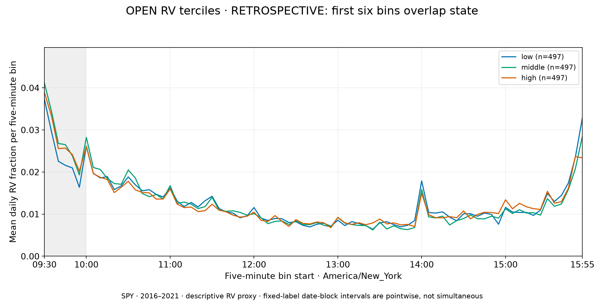

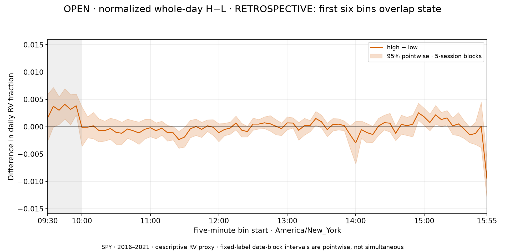

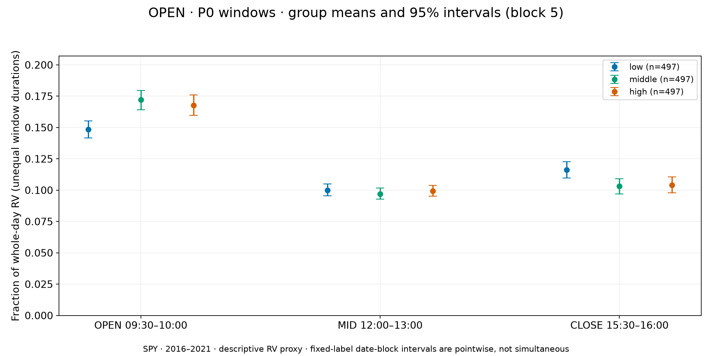

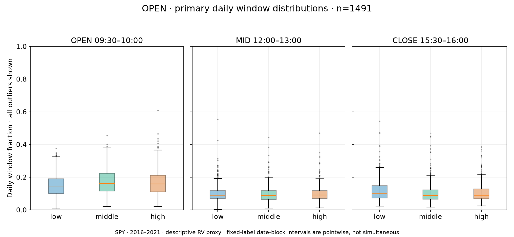

## PREV: immediate prior scheduled-session state

Missing and half-day predecessors are excluded, not skipped. The grouping is temporally prior, but descriptive tercile thresholds use the full observed branch cohort.

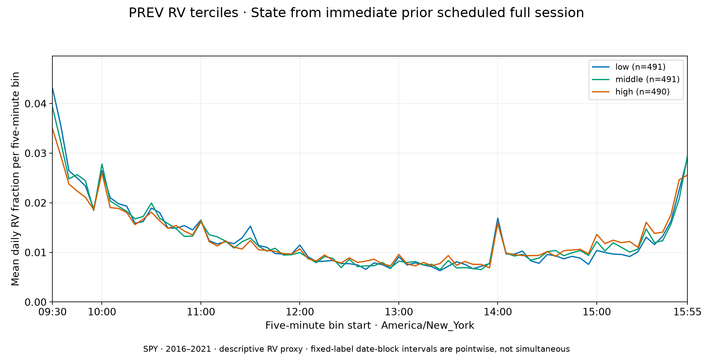

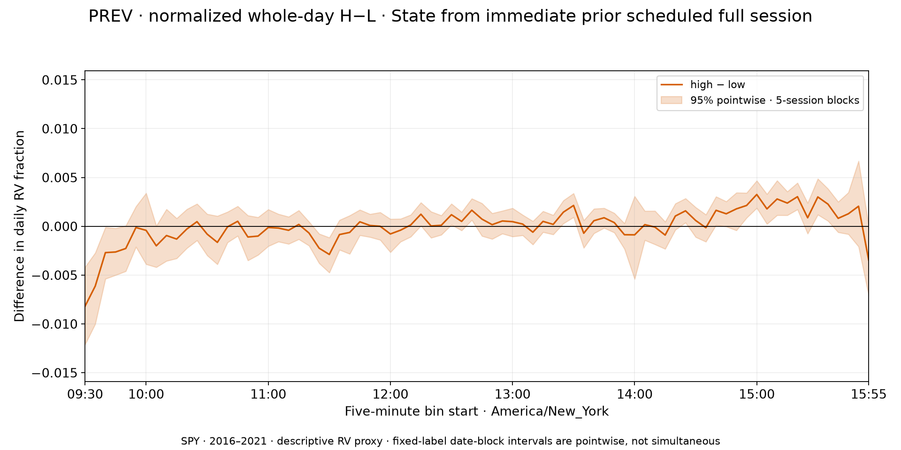

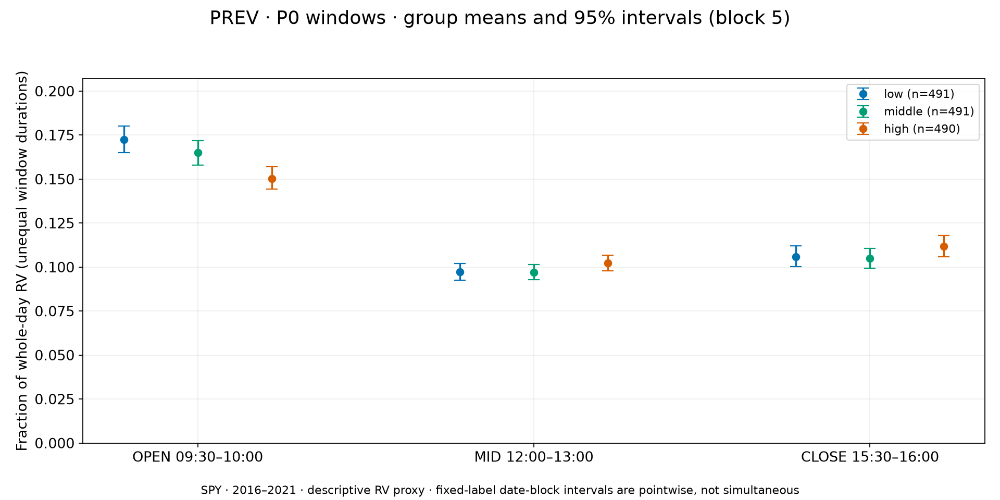

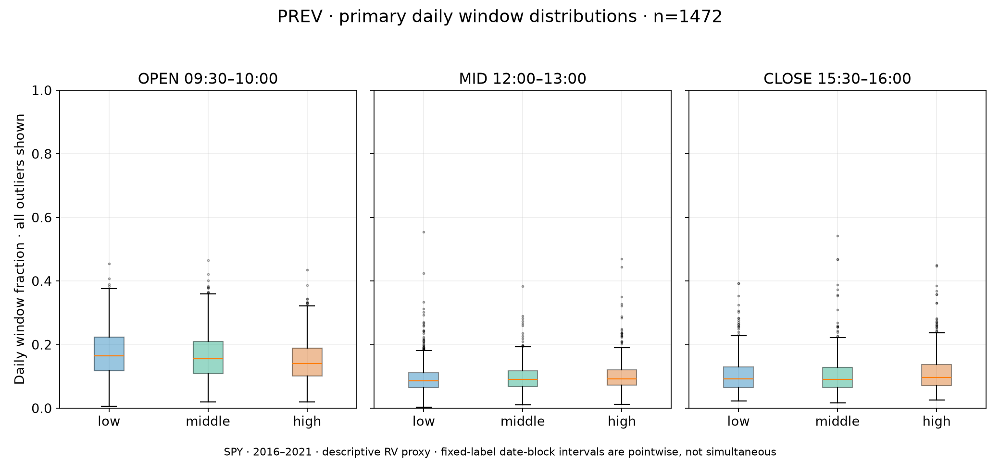

## Nonoverlap diagnostic

These 72-bin profiles renormalize only10:00–16:00 variance and keep the original state labels. This removes direct opening-numerator overlap, not all dependence. Primary full-day curves above remain the main result.

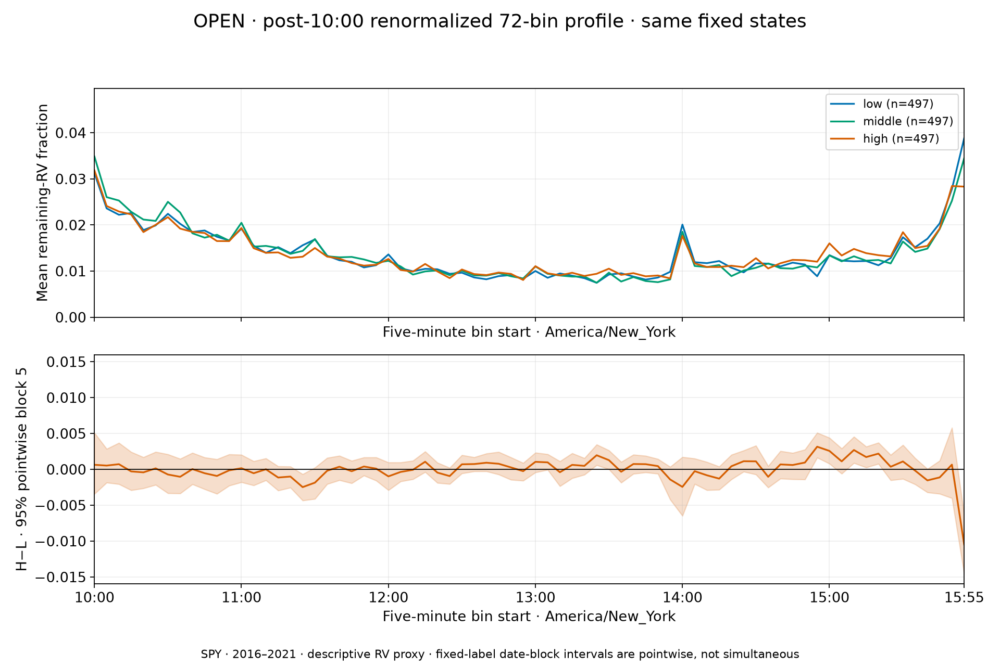

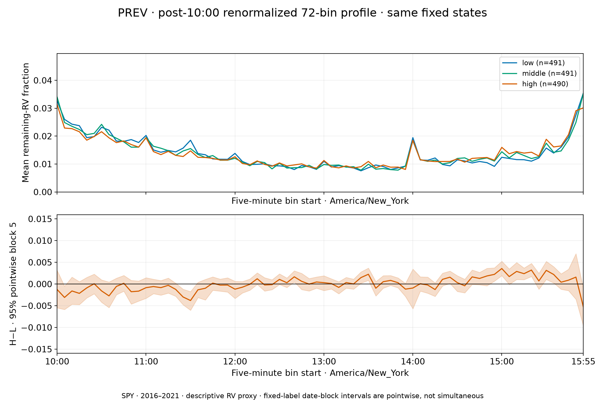

## Primary H−L numerical window shares

| branch | mode | window | summary | lo_5 | hi_5 | lo_10 | hi_10 | effect_daily_SD |
| --- | --- | --- | --- | --- | --- | --- | --- | --- |
| OPEN | whole | OPEN | 0.019457 | 0.00827941 | 0.0304506 | 0.00828496 | 0.032163 | 0.262523 |
| OPEN | whole | MID | -0.000714934 | -0.00684706 | 0.00563588 | -0.00653967 | 0.0048964 | -0.0141803 |
| OPEN | whole | CLOSE | -0.0119644 | -0.0213086 | -0.00293994 | -0.0222774 | -0.00102205 | -0.197442 |
| OPEN | remaining | MID | 0.0013628 | -0.0054371 | 0.00828171 | -0.00505116 | 0.00755933 | 0.0245312 |
| OPEN | remaining | CLOSE | -0.0115976 | -0.0218827 | -0.00112799 | -0.0235507 | 0.000531961 | -0.16841 |
| PREV | whole | OPEN | -0.0220523 | -0.0319275 | -0.0122425 | -0.0316927 | -0.0109376 | -0.305082 |
| PREV | whole | MID | 0.00508117 | -0.00174623 | 0.0112523 | -0.00172057 | 0.0120567 | 0.096562 |
| PREV | whole | CLOSE | 0.00594303 | -0.00246983 | 0.0142292 | -0.00343329 | 0.0152017 | 0.0994707 |
| PREV | remaining | MID | 0.00285086 | -0.00463638 | 0.00962078 | -0.00457877 | 0.010046 | 0.0493705 |
| PREV | remaining | CLOSE | 0.00294517 | -0.007297 | 0.0126351 | -0.00748606 | 0.0136215 | 0.0427754 |

## Supplementary wider C-spec windows

| branch | mode | window | summary | lo_5 | hi_5 | lo_10 | hi_10 | effect_daily_SD |
| --- | --- | --- | --- | --- | --- | --- | --- | --- |
| OPEN | whole | C_SPEC_MID | -0.000751627 | -0.0106294 | 0.00925359 | -0.0105016 | 0.00803208 | -0.00996694 |
| OPEN | whole | C_SPEC_CLOSE | -0.00414756 | -0.0160679 | 0.0079543 | -0.0173088 | 0.00962865 | -0.0514292 |
| OPEN | remaining | C_SPEC_MID | 0.00453732 | -0.00616591 | 0.0147682 | -0.00616221 | 0.0139295 | 0.0556808 |
| OPEN | remaining | C_SPEC_CLOSE | -0.000994033 | -0.0141952 | 0.0122097 | -0.0149214 | 0.014419 | -0.0112335 |
| PREV | whole | C_SPEC_MID | 0.00348534 | -0.00664217 | 0.0135667 | -0.00741519 | 0.0143454 | 0.0447422 |
| PREV | whole | C_SPEC_CLOSE | 0.0200498 | 0.0092714 | 0.030796 | 0.00839002 | 0.0320587 | 0.256817 |
| PREV | remaining | C_SPEC_MID | -0.0021698 | -0.0129521 | 0.00840621 | -0.0132403 | 0.00877682 | -0.025711 |
| PREV | remaining | C_SPEC_CLOSE | 0.017371 | 0.0056369 | 0.0293666 | 0.00458935 | 0.0306822 | 0.199999 |

## Matched dates, outliers and dependence

Matched outcome cohort n=1472; original ranks retained (no new quantile selection). OPEN×PREV cross-state counts: `[[348, 129, 14], [137, 247, 111], [6, 115, 365]]`.

| branch | mode | window | HL | n_low | n_high | matched_dates | labels |
| --- | --- | --- | --- | --- | --- | --- | --- |
| OPEN | remaining | MID | 0.000920014 | 491 | 486 | 1472 | original fixed branch ranks, not reranked |
| OPEN | remaining | CLOSE | -0.0107552 | 491 | 486 | 1472 | original fixed branch ranks, not reranked |
| PREV | remaining | MID | 0.00285086 | 491 | 490 | 1472 | original fixed branch ranks, not reranked |
| PREV | remaining | CLOSE | 0.00294517 | 491 | 490 | 1472 | original fixed branch ranks, not reranked |

| branch | variant | window | summary | sd | n |
| --- | --- | --- | --- | --- | --- |
| OPEN | FULL | MID | 0.0013628 | 0.0555539 | 994 |
| OPEN | FULL | CLOSE | -0.0115976 | 0.0688656 | 994 |
| OPEN | DROP_TOP1 | MID | 0.00146533 | 0.055784 | 979 |
| OPEN | DROP_TOP1 | CLOSE | -0.0135611 | 0.0680314 | 979 |
| OPEN | MEDIAN | MID | 0.000285332 | 0.0555539 | 994 |
| OPEN | MEDIAN | CLOSE | -0.0098426 | 0.0688656 | 994 |
| PREV | FULL | MID | 0.00285086 | 0.0577442 | 981 |
| PREV | FULL | CLOSE | 0.00294517 | 0.068852 | 981 |
| PREV | DROP_TOP1 | MID | 0.0034431 | 0.057986 | 966 |
| PREV | DROP_TOP1 | CLOSE | 0.000882795 | 0.0680475 | 966 |
| PREV | MEDIAN | MID | 0.003668 | 0.0577442 | 981 |
| PREV | MEDIAN | CLOSE | 0.00637871 | 0.068852 | 981 |

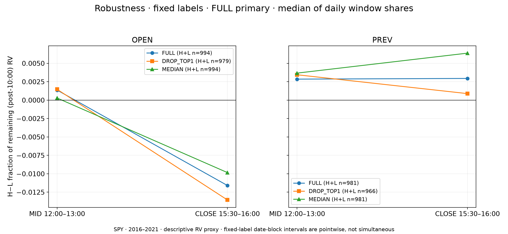

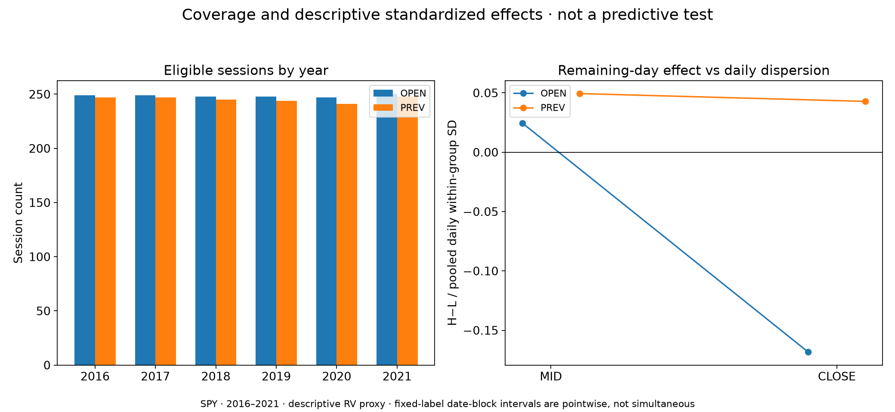

Top1% exclusion is a sensitivity with FULL primary; medians describe daily shares and are not normalized mean curves. Both 5/10 block interval sets appear in the numeric tables. Ordinary within-group daily scatter is substantial; standardized effects are not predictive performance. No strongest-bin aggregation, VIX replication, model fitting or trading inference follows from these figures.

## Whole-profile magnitudes and handback

| branch | mode | mean_abs_HL | max_abs_HL | sum_abs_HL | TV | sum_HL | top_contrast_ET |
| --- | --- | --- | --- | --- | --- | --- | --- |
| OPEN | whole | 0.00106723 | 0.00945412 | 0.0832441 | 0.0416221 | 1.80411e-16 | 15:55 |
| OPEN | remaining | 0.00100268 | 0.0104839 | 0.0721929 | 0.0360964 | 2.09902e-16 | 15:55 |
| PREV | whole | 0.00124385 | 0.00818767 | 0.0970202 | 0.0485101 | 7.45931e-17 | 09:30 |
| PREV | remaining | 0.00123197 | 0.00525059 | 0.0887015 | 0.0443508 | 1.45717e-16 | 15:55 |

**WEAK.** Primary P0 evidence is mixed, so the overall recommendation is WEAK/INCONCLUSIVE. The OPEN-state whole-day closing-half-hour contrast is -1.196 percentage points (block5 interval -2.131 to -0.294); after post-10:00 renormalization it is -1.160pp, but the block10 interval crosses zero (-2.355 to +0.053pp). PREV primary closing-half-hour and midday contrasts are uncertain. A promising, separately labeled supplementary PREV closing-hour contrast is +2.005pp (block10 +0.839 to +3.206pp), with positive remaining-day, drop-top1 and median contrasts; it is not promoted to the primary window. Remaining-day profile TV is0.0361 OPEN and0.0444 PREV, below the C-spec reporting tolerance0.05 as point estimates only, with no equivalence inference. These signals warrant design-thread review, not a claim that the RV-state extension has been confirmed or ruled out.

Report and [machine QA](../../artifacts/C/preliminary_RV_profile_v1_1/qa_results.json) distinguish passed numerical implementation from this provisional scientific judgment. [Contact sheet](../../artifacts/C/preliminary_RV_profile_v1_1/figures/contact_sheet.png) and individual figures are self-contained; all Markdown image paths resolve locally.
