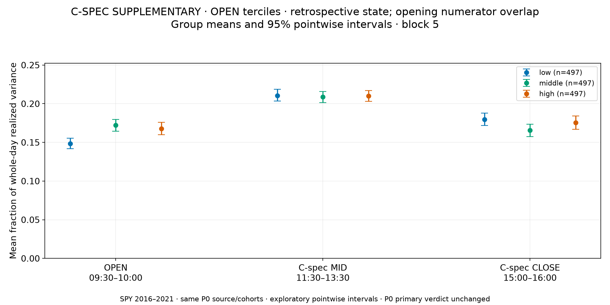
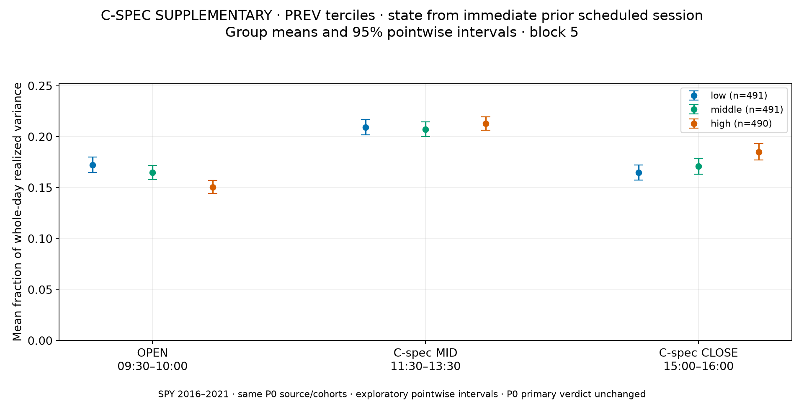
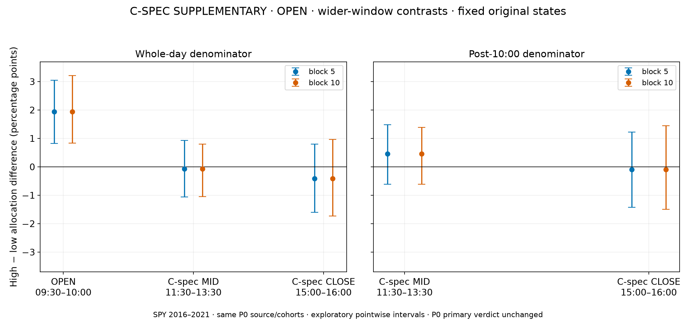
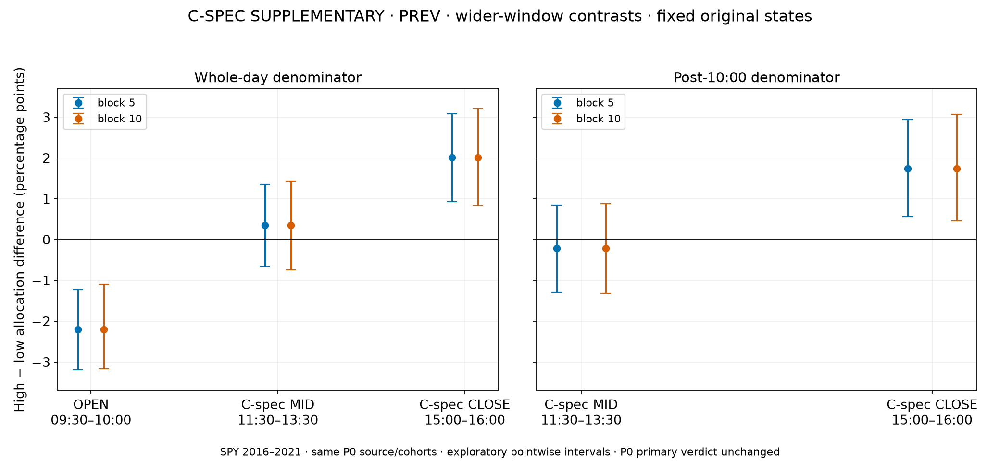
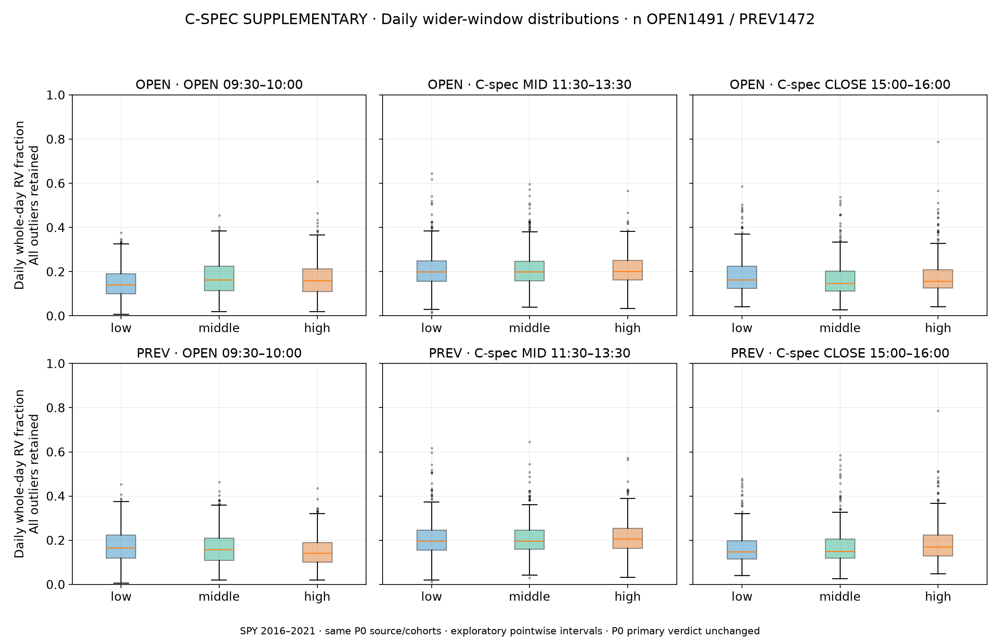
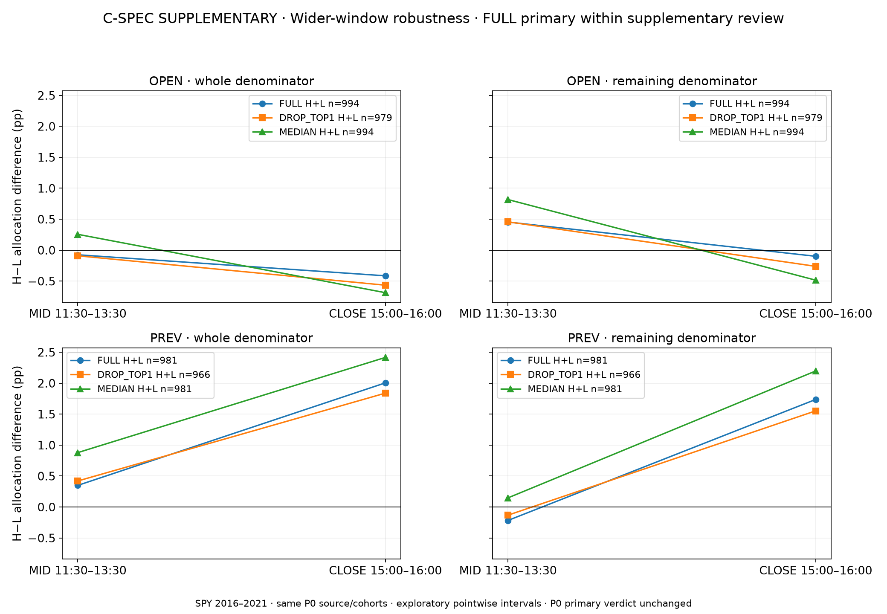
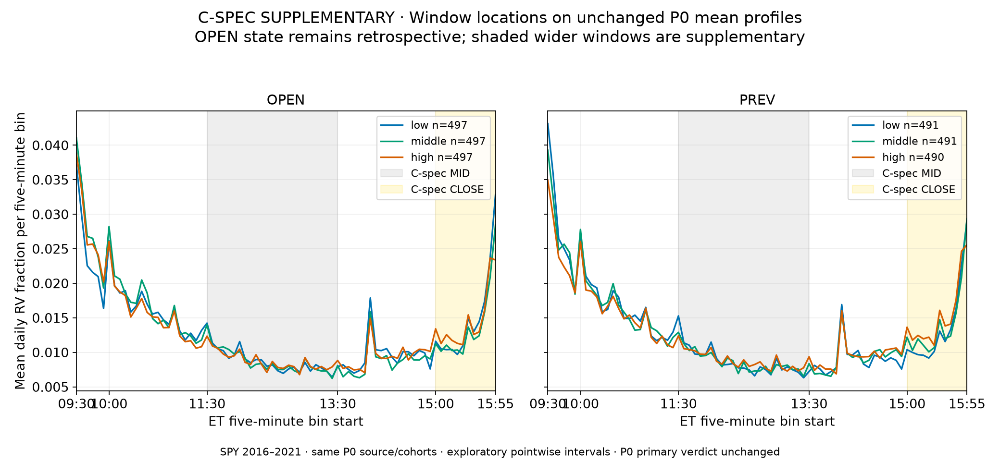

# Experiment C — C-spec windows: separate supplementary feasibility review

**Implementation/QA PASS. C-spec supplementary review: promising narrowly for PREV-state closing-hour allocation; OPEN-state wider windows and both midday comparisons remain weak/inconclusive. P0 primary remains WEAK/INCONCLUSIVE.**

This is the explicitly requested follow-on to the completed [P0 review](C_preliminary_RV_profile_visual_gallery.md). It does not replace that review's primary 12:00–13:00 midday / 15:30–16:00 closing windows, source, sample, states or verdict. The C-spec windows were specified before P0; supplementary numerical results were already visible there. This review adds the separately labeled visualization/feasibility assessment requested afterward; it is not a fresh blind test or new confirmatory evidence.

## Definitions and shared source

- C-spec OPEN 09:30–10:00, bins 0:6 (shared with P0).
- C-spec MID 11:30–13:30, bins 24:48 (24 five-minute bins).
- C-spec CLOSE 15:00–16:00, bins 66:78 (12 bins).
- Each mean is the mean of daily window shares, not the ratio of group variance totals. Window durations differ; displayed values are fractions of whole-day RV, not per-minute rates. They do not exhaust the day and are dependent.
- Same Alpaca SIP split-adjusted SPY bars, exact 390-minute full sessions, first log(close09:30/open09:30), then 389 close ratios, no overnight/fill. Main 2016-01-05–2021-12-31; OPEN 1491 days (497/497/497), PREV 1472 (491/491/490); matched 1472. Same independent fixed terciles, source hashes and strict preceding scheduled-session rule. No new source request, raw copy, model, state search, VIX or 2022–2026 scientific values.
- `whole` uses the full-day denominator. `remaining` retains original states and renormalizes only 10:00–16:00 RV, removing direct opening numerator overlap without removing all dependence. OPEN is retrospective/descriptive.

## Separate feasibility judgments

| branch | window | verdict |
| --- | --- | --- |
| OPEN | C_SPEC_MID | WEAK |
| OPEN | C_SPEC_CLOSE | WEAK |
| PREV | C_SPEC_MID | WEAK |
| PREV | C_SPEC_CLOSE | GO/PROMISING (descriptive feasibility only) |


PREV closing-hour H−L whole-day allocation is **+2.005pp**, with block 5 interval **+0.927 to +3.080pp** and block 10 **+0.839 to +3.206pp**. Remaining-day H−L is **+1.737pp**, with block 10 **+0.459 to +3.068pp**. Whole-day drop-top1 and median contrasts are **+1.839pp** and **+2.416pp**; remaining-day counterparts **+1.553pp** and **+2.197pp**. The original full-sample primary mean is retained. Standardized whole/remaining effects are about **0.257/0.200 pooled daily SD**, a modest but interpretable descriptive shift.

The C-spec 2pp closing-hour materiality reference lies inside the observed confidence interval: the estimate is near that reference, but the interval does **not** establish a shift larger than 2pp. Nor do other intervals containing zero prove invariance. Broader C RQ1/RQ2, source-paper replication, continuous-state models, temporal stability and forecasting are untested. The favorable PREV result supports considering a later reviewed stage, not automatic approval or full-C scientific success.

OPEN C-spec closing-hour H−L is **−0.415pp** (block 10 **−1.731 to +0.963pp**) and remaining **−0.099pp**; both uncertain. OPEN/PREV wider-midday contrasts are **−0.075/+0.349pp**, with both block intervals crossing zero. Thus this is a window- and branch-specific preliminary signal, not a uniform state effect.

## Numerical effects and both block lengths

Values in the table are fractions; multiply by100 for percentage points. All 95% intervals are exploratory **pointwise**, conditional on fixed original state labels and 1,000 joint date-block resamples per branch/length. P0 already independently replayed these intervals; this review verifies those saved input hashes and independently reconstructs all 120 C-spec summary/SD/count/contrast rows from the shared daily arrays to 1e-10. No new independent tests or simultaneous inference are claimed.

| branch | mode | window | summary | lo_5 | hi_5 | lo_10 | hi_10 | daily_SD_units |
| --- | --- | --- | --- | --- | --- | --- | --- | --- |
| OPEN | whole | OPEN | 0.019457 | 0.00827941 | 0.0304506 | 0.00828496 | 0.032163 | 0.262523 |
| OPEN | whole | C_SPEC_MID | -0.000751627 | -0.0106294 | 0.00925359 | -0.0105016 | 0.00803208 | -0.00996694 |
| OPEN | whole | C_SPEC_CLOSE | -0.00414756 | -0.0160679 | 0.0079543 | -0.0173088 | 0.00962865 | -0.0514292 |
| OPEN | remaining | C_SPEC_MID | 0.00453732 | -0.00616591 | 0.0147682 | -0.00616221 | 0.0139295 | 0.0556808 |
| OPEN | remaining | C_SPEC_CLOSE | -0.000994033 | -0.0141952 | 0.0122097 | -0.0149214 | 0.014419 | -0.0112335 |
| PREV | whole | OPEN | -0.0220523 | -0.0319275 | -0.0122425 | -0.0316927 | -0.0109376 | -0.305082 |
| PREV | whole | C_SPEC_MID | 0.00348534 | -0.00664217 | 0.0135667 | -0.00741519 | 0.0143454 | 0.0447422 |
| PREV | whole | C_SPEC_CLOSE | 0.0200498 | 0.0092714 | 0.030796 | 0.00839002 | 0.0320587 | 0.256817 |
| PREV | remaining | C_SPEC_MID | -0.0021698 | -0.0129521 | 0.00840621 | -0.0132403 | 0.00877682 | -0.025711 |
| PREV | remaining | C_SPEC_CLOSE | 0.017371 | 0.0056369 | 0.0293666 | 0.00458935 | 0.0306822 | 0.199999 |


## C-spec visual gallery

Every chart is explicitly labeled C-SPEC SUPPLEMENTARY. Comparable branch panels share scales; window distributions retain all outliers. FULL, drop-top1 and median summaries are shown separately. The full normalized curves and underlying state groups are unchanged from P0; the last figure only locates the wider windows on those curves.















## Robustness and matched dates

| branch | mode | window | variant | summary | sd | n |
| --- | --- | --- | --- | --- | --- | --- |
| OPEN | whole | OPEN | FULL | 0.019457 | 0.0741152 | 994 |
| OPEN | whole | C_SPEC_MID | FULL | -0.000751627 | 0.075412 | 994 |
| OPEN | whole | C_SPEC_CLOSE | FULL | -0.00414756 | 0.0806461 | 994 |
| OPEN | remaining | C_SPEC_MID | FULL | 0.00453732 | 0.0814879 | 994 |
| OPEN | remaining | C_SPEC_CLOSE | FULL | -0.000994033 | 0.0884881 | 994 |
| OPEN | whole | OPEN | DROP_TOP1 | 0.020238 | 0.0743593 | 979 |
| OPEN | whole | C_SPEC_MID | DROP_TOP1 | -0.000913854 | 0.0754748 | 979 |
| OPEN | whole | C_SPEC_CLOSE | DROP_TOP1 | -0.0056636 | 0.0804563 | 979 |
| OPEN | remaining | C_SPEC_MID | DROP_TOP1 | 0.0045723 | 0.0815823 | 979 |
| OPEN | remaining | C_SPEC_CLOSE | DROP_TOP1 | -0.00261759 | 0.0882506 | 979 |
| OPEN | whole | OPEN | MEDIAN | 0.0178053 | 0.0741152 | 994 |
| OPEN | whole | C_SPEC_MID | MEDIAN | 0.00255729 | 0.075412 | 994 |
| OPEN | whole | C_SPEC_CLOSE | MEDIAN | -0.00687476 | 0.0806461 | 994 |
| OPEN | remaining | C_SPEC_MID | MEDIAN | 0.00816948 | 0.0814879 | 994 |
| OPEN | remaining | C_SPEC_CLOSE | MEDIAN | -0.00485344 | 0.0884881 | 994 |
| PREV | whole | OPEN | FULL | -0.0220523 | 0.0722829 | 981 |
| PREV | whole | C_SPEC_MID | FULL | 0.00348534 | 0.0778983 | 981 |
| PREV | whole | C_SPEC_CLOSE | FULL | 0.0200498 | 0.0780704 | 981 |
| PREV | remaining | C_SPEC_MID | FULL | -0.0021698 | 0.0843918 | 981 |
| PREV | remaining | C_SPEC_CLOSE | FULL | 0.017371 | 0.0868557 | 981 |
| PREV | whole | OPEN | DROP_TOP1 | -0.02178 | 0.0724391 | 966 |
| PREV | whole | C_SPEC_MID | DROP_TOP1 | 0.00419635 | 0.0781557 | 966 |
| PREV | whole | C_SPEC_CLOSE | DROP_TOP1 | 0.0183902 | 0.0775773 | 966 |
| PREV | remaining | C_SPEC_MID | DROP_TOP1 | -0.00131885 | 0.0846057 | 966 |
| PREV | remaining | C_SPEC_CLOSE | DROP_TOP1 | 0.0155303 | 0.0863809 | 966 |
| PREV | whole | OPEN | MEDIAN | -0.0244008 | 0.0722829 | 981 |
| PREV | whole | C_SPEC_MID | MEDIAN | 0.00877744 | 0.0778983 | 981 |
| PREV | whole | C_SPEC_CLOSE | MEDIAN | 0.0241575 | 0.0780704 | 981 |
| PREV | remaining | C_SPEC_MID | MEDIAN | 0.00147465 | 0.0843918 | 981 |
| PREV | remaining | C_SPEC_CLOSE | MEDIAN | 0.0219708 | 0.0868557 | 981 |


Top1% removes 15 largest RV_day dates per branch without refitting state labels. Those dates account for 22.49% of OPEN-cohort raw RV and 18.11% of PREV-cohort raw RV. Median contrasts are differences of medians of daily window shares, not sums of per-bin medians. This robustness does not recover excluded incomplete sessions.

| branch | mode | window | HL | n_low | n_high | matched_dates | labels |
| --- | --- | --- | --- | --- | --- | --- | --- |
| OPEN | whole | OPEN | 0.0193247 | 491 | 486 | 1472 | original fixed branch ranks, not reranked |
| OPEN | whole | C_SPEC_MID | -0.00140773 | 491 | 486 | 1472 | original fixed branch ranks, not reranked |
| OPEN | whole | C_SPEC_CLOSE | -0.00332537 | 491 | 486 | 1472 | original fixed branch ranks, not reranked |
| OPEN | remaining | C_SPEC_MID | 0.0035952 | 491 | 486 | 1472 | original fixed branch ranks, not reranked |
| OPEN | remaining | C_SPEC_CLOSE | 2.50073e-05 | 491 | 486 | 1472 | original fixed branch ranks, not reranked |
| PREV | whole | OPEN | -0.0220523 | 491 | 490 | 1472 | original fixed branch ranks, not reranked |
| PREV | whole | C_SPEC_MID | 0.00348534 | 491 | 490 | 1472 | original fixed branch ranks, not reranked |
| PREV | whole | C_SPEC_CLOSE | 0.0200498 | 491 | 490 | 1472 | original fixed branch ranks, not reranked |
| PREV | remaining | C_SPEC_MID | -0.0021698 | 491 | 490 | 1472 | original fixed branch ranks, not reranked |
| PREV | remaining | C_SPEC_CLOSE | 0.017371 | 491 | 490 | 1472 | original fixed branch ranks, not reranked |


The matched cohort uses the same 1472 outcome dates with original branch labels. Its OPEN closing-hour whole/remaining contrasts are −0.333/+0.003pp, still a weak wider-hour result; PREV contrasts equal the full PREV cohort. OPEN/PREV state-group membership differs even on common dates; no causal paired interpretation follows.

## QA, selection and limitations

120prior P0 files and334earlier B/shared snapshot files remain hash-unchanged. Numerical reconciliation 120 rows passed to 1e-10; interval provenance is the preserved P0 QA and matching window table, not a newly estimated uncertainty distribution. All 7 main PNGs decode, are nonblank and≥1600px wide; the contact sheet permits manual review. No download bytes were added; original cumulative response-body total remains 119,675,359/1,000,000,000.

The source's complete-session selection omits 12 early closes and 7 ordinary days with 100 missing minutes, including four 2020 March crisis dates. Those omissions are not random; causes of missing bars were not established and no bars were fabricated. Same SPY asset/2016–2021 era, full-sample terciles, fixed-label conditional intervals, two block lengths and no global multiplicity correction limit generalization. This is an RV proxy, not the original VIX/futures periodicity estimator or evidence of trading value.

## Reproduce and next step

```sh
.venv/bin/python -B scripts/c_spec_window_review.py
```

The command reads existing compact P0 products and verifies their hashes, then replaces only this supplement's own outputs. It never calls a source API or alters P0 data/config/reports. Output folder: `artifacts/C/C_spec_window_preliminary_v1/`; independent review CSV, decision/QA JSON, seven figures and contact sheet; no duplicated daily array or raw-minute table. Read [P0's full source/method report](C_preliminary_RV_profile_results.md) for original math/eligibility/bootstrap checks. Next safe action: design-thread review of the promising PREV closing-hour finding, keeping this C-spec supplement distinct from P0 and from any future full C analysis.
